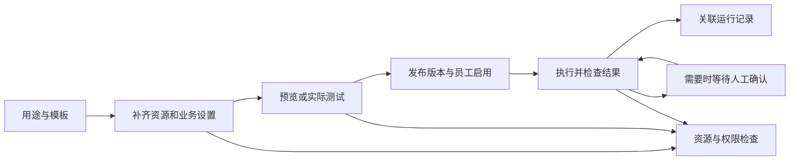

# 域见 AI 员工、工作流与设备控制开发计划

**2026-10-14 续开发（3.81）：**运营监控已提供超时 `unknown/sending` 会话通知的人工核对：二次确认原因、原状态、固定消息编号查询和运营审计，后端不重发通知；API 4 项、目标静态、Web 类型检查和构建通过。正式运营账号与运行中服务未验收，页外主动告警、频道异常处置和完整原目标仍未完成。见[剩余计划 4.2.38](business-scenarios-remaining-development-plan.md#4238-381-进展会话通知人工安全核对2026-10-14)。

**2026-10-14 3.80 复验：**会话操作待核对监控的前端完整类型检查和生产构建已在内存恢复后通过；本机 API/Web/Docker 当前未运行，正式运营页面和运行中接口仍待验收，页外通知与人工安全处置仍待开发。见[剩余计划 4.2.37](business-scenarios-remaining-development-plan.md#4237-380-进展会话操作待核对监控2026-10-14)。

**2026-10-14 续开发（3.80）：**会话命令失败可发现性已接到平台运营监控：超过 5 分钟的未完成通知/频道效果按运营身份脱敏查询，Web「系统监控→服务状态」展示并分页，每分钟刷新。API 相关 3 项与目标 Python/Web 静态检查通过；完整 Web 类型检查因本机 Node 内存不足失败，实际运营页、主动通知和人工核对处置尚未验收/实现。详见[剩余计划 4.2.37](business-scenarios-remaining-development-plan.md#4237-380-进展会话操作待核对监控2026-10-14)。

**2026-10-14 续开发（3.79）：**四条员工会话路由已用模拟员工经真实 ASGI 路由和本机 WuKongIM 验证通知、频道成员效果与操作回执，四项通过。隔离 PostgreSQL 中的同编号跨进程争用及远程删除成功后进程退出/恢复演练通过，测试库和随机频道已清理。正式登录员工经运行中 HTTP API/聊天页、目标部署 IM、逐调用点故障和完整业务/运维门槛仍待验收；真实订单/物流继续暂缓。详见[剩余计划 4.2.36](business-scenarios-remaining-development-plan.md#4236-379-进展四路由真实-im-与跨进程故障演练2026-10-14)。

**2026-10-14 续开发（3.78）：**会话关闭/转接的频道效果已通过本机真实 WuKongIM 正反验证；随机测试频道中，重复删除会话成功且其他客服不受影响。独立 PostgreSQL 测试库先提交操作，再由另一个 Python 进程恢复转接、未知重放和关闭，真实 IM 状态与回执一致；测试库和频道已清理。正式登录员工四入口、逐调用点故障、多实例竞争、生产 IM 版本及完整原计划仍待验收。详见[剩余计划 4.2.35](business-scenarios-remaining-development-plan.md#4235-378-进展会话频道真实-im-与跨进程恢复验证2026-10-14)。

**2026-10-14 续开发（3.77）：**关闭/转接的频道成员变更与 IM 操作意图已随业务事务保存，后台按原编号恢复并核对最新负责人。API `0053_session_channel_effects` 在开发库备份后升级，API 42 项、隔离 PostgreSQL 2 项、Web 回执恢复 10 项通过，本机 API 已单独重启并健康。详见[剩余计划 4.2.34](business-scenarios-remaining-development-plan.md#4234-377-进展会话频道操作持久恢复2026-10-14)。

**2026-10-14 续开发（3.76）：**会话通知后台恢复已做到单条失败回滚、30 秒退避并继续处理其他操作，避免持续失败记录阻塞队列。API 相关 33 项测试通过；本机运行服务尚未重载本次代码，真实 IM 与频道成员副作用仍待开发和验收。详见[剩余计划 4.2.33](business-scenarios-remaining-development-plan.md#4233-376-进展会话通知恢复批次失败隔离2026-10-14)。

**2026-10-14 续开发（3.75）：**员工 CLI 关闭/转接已在发请求前按服务、企业、员工和访客保存原操作编号，本地原子替换与跨进程锁避免两个 CLI 各生成一个编号；中断后先查原回执，没有回执时只允许显式使用原编号重试。`receipt` 同步本地状态。CLI 129 项测试与构建通过，独立类型检查仍有旧 `output.test.ts` 两处问题；统一脚本仍被 CRLF 阻断。MCP 调用方仍须自行保留编号；真实 IM、正式页面与完整目标继续待验收。详见[剩余计划 4.2.32](business-scenarios-remaining-development-plan.md#4232-375-进展cli-本地会话操作日志与恢复2026-10-14)。

**2026-10-14 续开发（3.74）：**员工 CLI 关闭/转接已接原操作 UUIDv4，提交前打印编号，提供同编号重试和 `receipt` 查询；MCP 两个写操作要求调用方提供编号，并可用新回执工具查询。CLI 114 项测试与构建通过，独立类型检查还有旧 `output.test.ts` 两处问题。尚缺本地原子日志/跨进程锁、实际业务与 IM 验收，不视为完整 R2 恢复。详见[剩余计划 4.2.31](business-scenarios-remaining-development-plan.md#4231-374-进展员工-cli-与-mcp-会话操作编号2026-10-14)。

**2026-10-14 续开发（3.73）：**关闭/转接请求由 Web 预先保存 UUIDv4 操作编号，API 以该编号串行化并拒绝重复提交；响应丢失时按原编号查询精简回执，不能确定结果时只允许显式重试原编号。Web 刷新后可找回待确认操作，退出清理标识，登录过期重登保留同账号标识。API 30 项、Web 恢复 10 项、类型检查、目标 ESLint 及限制并发后的生产构建通过；本机 HTTP 健康与未登录拒绝、CORS 预检通过。真实 IM、正式页面、跨端、频道副作用和重启恢复仍需验证；未提交、推送或部署。详见[剩余计划 4.2.30](business-scenarios-remaining-development-plan.md#4230-373-进展原操作编号由-web-发起和找回2026-10-14)。

**2026-10-14 续开发（3.72）：**员工会话关闭/转接已加入与业务事务同提交的 WuKongIM 通知意图、原消息编号、待确认/未知回执、原操作查询和后台恢复；超时先查询原编号，不自动重发。开发库备份后升级 API `0052_session_command_deliveries`；会话命令 27 项、相邻回归合计 98 项、隔离 PostgreSQL 2 项及目标静态检查通过。本机 API 单独重启后新路由对未登录请求返回 `403`，未完成授权业务调用。真实 IM、正式页面、频道订阅/清理持久补偿、实际恢复演练与原完整计划仍待验收；未提交、推送或发布线上。详见[剩余计划 4.2.29](business-scenarios-remaining-development-plan.md#4229-372-后续关闭转接通知的持久回执2026-10-14)。

**2026-10-14 续开发（3.71）：**员工会话关闭/转接补独立 PostgreSQL 双事务验证：并发关闭只有一次提交和通知，目标客服在转接选择后停用则拒绝提交；专项 2 项与相邻回归 65 项通过。持久通知回执、重启恢复、正式页面/IM 和主计划其他模块仍待完成。详见[剩余计划 4.2.28](business-scenarios-remaining-development-plan.md#4228-371-后续员工会话命令的独立-postgresql-竞争验证2026-10-14)。未提交/推送/上线。

**2026-10-14 续开发（3.70，历史）：**员工会话关闭/转接四入口补原员工权限、原会话、提交前与输出前复查；本机相关 65 项回归通过。详见[剩余计划 4.2.27](business-scenarios-remaining-development-plan.md#4227-370-后续原员工会话关闭与转接四入口2026-10-14)。未提交/推送或线上发布。

**2026-10-14 当前重点（3.63）：**完成三页基础路径的键盘、关闭、失败重试和窄屏衔接收尾。员工与资源选择弹窗共用焦点管理；Esc只关闭最上层，关闭确认默认继续填写；知识库/工作流/设备勾选避免重复切换，管理入口另开标签保留配置。窄屏AI导航改为横向滚动，三页保留桌面风格。85项专项、14文件ESLint、最终类型/build通过，五组隔离正式组件流程及三尺寸浅深色检查通过；全工程旧Python/yarn与一项已有文案测试问题保留。已恢复本机API/内网API/AI/RAG/Workflow/Device，六个health及Web代理200，CLI尚无登录配置，真实模型/知识/设备效果未验收。下一项是实际效果验收，真实订单/物流继续暂缓；历史七类扩展另行安排。未提交推送、未云端发布。当前入口为[基础版清单](business-scenarios-foundation-plan.md)。

**2026-10-13 前序实施（3.61）：**继续最初三个模块的“场景启发 → 模板 → 配置 → 测试”，保持原风格。工作流模板已补唯一已启用且关联知识库员工的预填，多候选由用户选择；刷新失败/重试保留名称与选择。基础表单显示中文业务输入、员工接收内容与返回来源，保存后打开测试面板，主动填入示例；运行前再次保存修改，保存失败不执行。窄屏内容和测试面板已修正。34项相关回归、目标ESLint及最终前端类型/build通过，三组正式组件浏览器流程使用隔离API数据通过；不代表真实模型/订单效果。当前收尾为AI员工基础向导、三页操作衔接与实际效果验收；历史七类全系统扩展不计入本次基础版剩余量。真实订单/物流继续暂缓，全工程统一门槛仍有历史失败，未提交推送或云端发布。以[基础版清单](business-scenarios-foundation-plan.md)为当前入口。

**2026-10-13 前序实施（3.60）：**按最初目标继续“场景启发 → 选择模板 → 补齐配置 → 测试”，保持原有界面风格。三个模块的场景卡现在直接显示处理过程；设备页补用途选择、已有/新设备接入、真实工具列表检查及带入员工配置。原设备与用途保留，已有草稿内容不覆盖，更换原绑定设备需要确认；继续前重读在线状态与所需能力，不自动创建或启用员工。连接码失败有明确提示/重试；消息服务从单独authStore导入，修复本机白屏循环依赖。相关Node回归67、目标lint及前端类型/构建通过，四组正式组件浏览器流程采用隔离API测试数据；不是实际设备操作或生产验收。当前交付以[基础版清单](business-scenarios-foundation-plan.md)为入口，全量系统扩展保留历史并分开安排。真实订单/物流继续暂缓，无SQL迁移、Git提交推送或云端发布。

**2026-10-13 历史实施（3.59）：**客户标签关联与两种移除、旧等待队列接入和取消五个入口已补原员工权限、目标/版本、提交和回应检查；提交前捕获精确结果，旧请求不能修改重建关联或新会话。API 320、八文件目标类型与新文件 Ruff、本机独立 SaaS HTTP/CLI/PG 五组和现有服务十七组通过。常驻本机 SaaS 配置未改，完整工程仍失败，正式 UI/原生协议与云端未验收。下一批处理会话转接和关闭，再推进剩余七大类；无可靠总工作量分母，不按批次数计算百分比。真实订单/物流继续暂缓，无新 SQL 迁移、提交推送或生产部署。详见当前交接 7.21、实施进度 3.59 和剩余计划 4.2.26。

**2026-10-13 前序实施（3.58）：**员工客户 create/attributes/patch、AI enable-disable、service-mode、delete 和手动 self-accept 已接原员工授权、当前操作权限、原企业/客户/平台和客户版本。提交时锁定真实客户，原员工/权限记录使用共享锁保护；服务模式异步检查先处理独立对象，复查后再修改 ORM。属性更新不再自动新建、恢复已删除客户或切换未知平台；创建要求真实、有效的本企业平台。手动接入将原授权带入实际分配与频道 dispatch，拒绝重复接入与回退分配给其他员工，等待中撤权阻止新的提交/通知/输出。已提交变更与未确认通知分开，未声称远端副作用已停止。API 291 项、六文件目标类型和目标 Ruff通过；本机真实 HTTP/CLI/ PostgreSQL 共十七组通过，临时记录/权限/分配与对象已清理。完整工程门槛仍未通过；标签/其他队列转接/关闭、其他私密入口和全部消费者、R2 恢复并发、正式 UI/原生协议、B5/B6/D3～D7 和原 G0～G5 全范围仍继续。真实订单/物流继续暂缓，无新 SQL 迁移、提交推送或云端发布。详见进度 3.58、剩余计划 4.2.25。

**2026-10-13 前序实施（3.57）：**注册响应改为独立字段清单，只返回网站聊天身份、原凭据、显示字段和必要时间；不返回员工备注、联系方式、自定义属性、标签、AI 分析/配置、系统资料。注册保留原网站/企业/Key，并在异步接入后及响应字节前复查。员工客户列表、basic、详情、按渠道查询、拟人设置和客户渠道内部资料复查原员工、当前读取权限与客户归属；列表批量核验，不为无效/缺失/跨企业客户生成默认记录，返回 404。Widget 类型已同步，现有界面风格保持。API 242、Widget 84 项通过；八文件目标类型、目标 Ruff、Widget 构建及本机实际 HTTP/CLI 十三组通过，临时记录/图片已清理。完整工程门槛仍未通过；写入/派单/AI 模式、其他入口与消费者、R2 恢复并发、正式 UI/真机/原生协议、B5/B6/D3～D7 和原 G0～G5 仍未完成。真实订单/物流继续暂缓，无新 SQL 迁移、Git 提交推送或云端发布。详见进度 3.57、剩余计划 4.2.24。

**2026-10-13 前序实施（3.56）：**本地上传的客户头像 GET 已要求原员工或原网站访客授权；匿名、Key-only、其他客户、end-only 与失效访问拒绝。新上传绑定具体文件版本，旧版本不再读取；旧无版本记录只在唯一文件时兼容，不再按 mtime 猜测。上传在每次异步读取及提交前重查，取消/失败仅清理本次新对象；换图提交后只删除原绑定对象。员工端共用头像组件使用 header 授权取得 Blob，配置 API 之外不发送凭据，换号/退出/过期和迟到结果不显示，复查失败清理旧图；样式不变。API 168、Web 29 项通过，六文件目标类型、目标 Ruff/ESLint、Web 类型与构建通过；本机实际 HTTP/CLI 十组通过，测试记录/图片已清理。全工程门槛仍未通过；本批不关闭 R3 全入口、所有消费者、恢复/并发或正式 UI/真机验收。仍有 7 类工作，真实订单/物流继续暂缓，无新 SQL 迁移、Git 提交推送或生产发布。详见进度 3.56、剩余计划 4.2.23。

**2026-10-13 前序实施（3.55）：**继续补 R3-c：访客 basic、渠道显示和活动不再允许匿名/平台 Key 单独访问；网站访客只看自己及已关联发送者的公开昵称/头像，活动不能覆盖其他客户或平台来源配置。员工插件面板、工具、工具栏与通用 render/event 使用原员工和数据库客户资料，校验当前企业/归属/会话，异步返回和响应字节前复查；UI action 仅允许已核验的员工 AI 会话，后台保留原员工授权。Web/CLI 同步渠道和活动 header、当前身份/迟到响应检查，无视觉样式修改。API 373、Web 84、CLI 25 项通过；十文件目标类型、目标 Ruff、Web/CLI 构建和本机实际 HTTP/CLI 十组通过，临时记录/对象已清理。全工程门槛仍失败；R3 头像/其他媒体与元数据入口、iOS/Flutter、正式页面/真机、R2 恢复/并发、R4 原生协议、B5/B6/D3～D7 和原微信/G0～G5 全范围继续。真实订单/物流验收暂缓，未新增 SQL 迁移、提交推送或线上发布。详见进度 3.55、剩余计划 4.2.22。

**2026-10-13 前序实施（3.54）：**普通/OpenAI 聊天、取消入口及后台/SSE/IM 回复已接原访客当前授权；网站平台 Key 与自报 UID 不能创建/冒充访客或取消其他客户任务。非网站渠道复用内部服务身份；Web/Mini/CLI 的文字/媒体/取消请求同步 Authorization 和迟到结果检查，CLI 只输出核验后的最终答复或明确受理状态。API 294、Web 73、Mini 55、CLI 23、渠道 7 项通过；五文件 scoped strict mypy、目标 Ruff、三个客户端构建及本机实际 HTTP/CLI 六组通过，临时记录/对象已清理。全工程门槛仍失败；正式页面、微信真机、原生直连控制、iOS/Flutter、其他私密入口与持久恢复未验收/未完成。仍有 7 类工作：全部入口/消费者、恢复并发、正式 UI/协议、固定流程与记录、售后/设备、屏幕/扩展、原微信/G0～G5 全范围。真实订单/物流继续暂缓。详见进度 3.54、剩余计划 4.2.21；未新增迁移、Git 提交/推送或生产发布。

**2026-10-13 前序实施（3.53）：**访客历史/回复补拉、附件下载/续期和上传已接原访客当前授权；服务端复查企业/平台、访问修订及原客户引用，并在异步返回和文件字节发送前复查。文件专用链接不携带 IM/读取凭据，最长五分钟且不超过原授权有效期；网站平台 Key 单独不能读文件/历史或上传。Web/Mini/CLI 同步请求头授权、迟到响应丢弃与文件链接更新，未修改视觉样式。API 196、Web 56、Mini 44、CLI 9、后台文件契约 3 项通过；六文件目标类型/静态、客户端构建和本机真实 HTTP/实际 CLI 三组通过，临时数据及对象已清理。全工程门槛仍失败；没有正式浏览器、微信真机、商户或生产验收。R3 的 chat/cancel/SSE、媒体/UI actions/其他私密入口及 iOS/Flutter 兼容仍待开发，R2/R4、B5/B6、D4～D7、原微信/G0～G5 全范围继续。真实订单/物流继续暂缓。详见进度 3.53、剩余计划 4.2.20；无新迁移、Git 提交/推送或云端发布。

**2026-10-13 前序实施（3.52）：**网页 App/store/可信宿主变更和小程序组件/store/provider 已接退出、重建与旧异步结果隔离；小程序补页面隐藏/显示、组件所有者、输入草稿/选图清理、上传中止及平台配置迟到保护。只有明确 `409 / visitor_owner_changed` 才按客户变化重建，一般错误或声明重放仍拒绝。Web 47、Mini 35、API 214 项相关回归通过，隔离 PostgreSQL 恢复后 3 项通过，本机 HTTP/双连接/实际 CLI 10 组通过；客户端构建通过。原生直连认证控制仍 `PENDING`，全工程 Python 类型/lint 和 Web 工具链门槛仍失败；没有真实浏览器、微信真机、商户或生产验收。历史/文件/媒体/chat/cancel/SSE 的全部入口保护、持久清理恢复、CLI 并发、固定流程版本与统一记录仍待开发。真实订单/物流继续暂缓，B5/B6、D4～D7 和原微信客服/G0～G5 全范围继续。详见进度 3.51～3.52、剩余计划 4.2.19。无新迁移、Git 提交/推送或云端发布。

**2026-10-13 前序实施（3.50）：**注册已发原访问专用的 `visitor_end_token`，结束可用此凭据，不必保留读取/IM 凭据重试；用途、原企业/平台/访客、访问修订与原摘要均核验。网页/小程序已有独立退出与重试服务，完整组件换号/代次联动仍未接；访客 CLI 已接 `session end`、`session retry-end`、`reset` 和有效新初始化时结束原访问。API 207、隔离 PostgreSQL 3、Web 37/Mini 15/CLI 7 项通过；目标类型/静态、客户端构建和本机实际退出/访客 CLI 有证据。原生直连控制仍未返回明确回执，完整工程门槛仍失败；历史/媒体/SSE 与完整账号隔离继续。仅本机 API 重载，无新迁移、提交推送或生产发布，真实订单/物流继续暂缓。B5/B6、D4～D7 和原 G0～G5 全范围不变。详见进度 3.50、剩余计划 4.2.17。

**2026-10-12 前序实施（3.49）：**公开结束访问、旧 AI/等待记录终止、迟到结果与重试拦截，以及实时网关的访问修订/原客户引用核验已接。非 SaaS 网站访客也使用签名凭据、受控网关与私有上游凭据，退出重试区分访问已关闭和任务停止待确认。API 196、隔离 PostgreSQL 3 项通过；目标 8 文件类型/静态与客户端构建通过，本机 HTTP/双连接关闭/员工 CLI 有实际证据。原生直连认证探针没有收到明确回执，未计通过；SDK 完整换号/退出、历史/媒体/SSE 与持久取消恢复仍未完成，整体工程质量门槛仍失败。仅本机主/内网 API 重载，无新迁移、提交/推送或云端发布。真实订单/物流继续暂缓；B5/B6、D4～D7 和原官方微信/多模态/知识/会员 CRM/工作台/运维/G0～G5 全范围继续。详见实施进度 3.49 与剩余计划 4.2.16。

**2026-10-12 前序实施（3.48）：**公开注册/重连已校验原访客持有者，绑定客户后要求本次客户证明；首次客户兑换增加访客持有因素。网页/小程序支持签名声明在客户端交换并建立受保护注册，CLI 私下保留普通访问凭据；服务端渠道改用带现有内部凭据的专用入口，不返回浏览器令牌。API 113、隔离 PostgreSQL 3、渠道 19、Web 34、Mini 13、CLI 6 项及本机 9 组 HTTP/员工 CLI 有通过证据；三个客户端构建通过，完整工程/默认 CLI 门槛仍失败。本机主/内网 API 已重载，无新迁移或生产发布。公开历史/附件/SSE、实际退出/队列、IM 网关和完整账号切换仍未接完，整体未完成；真实订单/物流继续暂缓，B5/B6、D4～D7 与原 G0～G5 全范围继续。详见实施进度 3.48 和剩余计划 4.2.15。

**2026-10-12 前序实施（3.47）：**固定访客客户归属已接签名兑换/解析，访问秘密摘要、当前客户引用检查及可重复退出的服务逻辑已有；API `0051_visitor_business_scope` 经本地一致快照备份、实际临时库恢复后升级。相关回归 86 项、退出逻辑 15 项重查、隔离 PostgreSQL 3 项、目标静态/6 文件类型及本机 HTTP/员工 CLI 有通过证据。访问检查尚未接公开注册、历史、附件、SSE、实时 IM 与 SDK 换号流程，完整隔离仍未完成；全工程/通用 CLI 门槛仍失败，无正式页面/模型/真机/生产验收。下一批优先关闭剩余隔离和队列，再继续 B5/B6、D4～D7 与原 G0～G5 全范围。真实订单/物流按用户要求暂缓，未启用真实员工、提交/推送或发布生产。详见剩余计划 4.2.14 和实施进度 3.47。

**2026-10-12 前序实施（3.46）：**网页 Widget、小程序与访客 CLI 已接本次文字请求的签名客户会话；私密数据只进完成请求，回调/身份改变阻止旧凭据继续发送，CLI 私密流等待明确成功完成事件。Web 28、Mini 7、CLI 5 共 40 项及三个客户端构建通过，CLI 受控真实 HTTP 测试通过；没有真实商户、模型/页面/真机或生产验收。检查同时确认账号变更后的访客/历史/IM 完整隔离仍缺，因此下一项 P0 先关闭该边界，再补其他入口与 B5/B6，D4～D7、原计划和 G0～G5 保留。未启用真实员工、修改 SQL 表/迁移、提交/推送或发布生产；真实订单/物流继续暂缓。接入见[SDK 说明](business-customer-sdk-integration.md)，详细任务见集中清单 4.2.13，完整目标仍未完成。


**2026-10-12 最新实施（3.45）：**AI 正式订单/物流工具、API 私有凭据与客户解析、Plugin 归属校验/审计及查询前后原授权重查已接线；岗位启用检查仅在正式协议可用且两项当前业务评审通过时允许继续。真实商户仍暂缓，本批没有启用实际员工或执行商户查询。已验证工具/流式作用域、当前角色与会话变更、私有 HTTP 和三服务拒绝链路；共享契约及目标类型/静态通过，完整工程/默认 CLI 仍未通过。无新数据库迁移、前端修改、提交/推送或生产部署。下一批补其他入口/SDK 与正式模型/页面证据，再完成 B5/B6 固定流程、员工发布版本和统一运行记录；D4～D7、官方微信、多模态、RAG 评测、会员/CRM、工作台、隐私/运维、真实恢复、影子/灰度/G0～G5 继续。详见[集中清单 4.2.12](business-scenarios-remaining-development-plan.md)和实施进度 3.45，完整目标仍未完成。


**最新实施（2026-10-12，3.44）：**访客文字请求的客户凭证→真实会话/原请求/尝试→私有头→AI 准备核验→发布前新事务重查已接通；旧订单查询不再以可编辑属性或普通平台编号自授权。同步/SSE/后台、默认服务模式继承及秘密不进入模型/公开序列化有专项证据，实际本机 PostgreSQL/私有 HTTP/AI 客户端 5 组通过，六服务健康。正式业务工具、条件启用、其他客户入口/SDK/队列、真实商户和正式 UI 继续待完成，订单岗位未开放。无新表/迁移、前端修改、提交/推送或生产部署；完整工程/通用迁移/默认 CLI 门槛未通过。下一批直接 B4-R3/R4→B5/B6，再完整 D4～D7/原 G0～G5。交接见[集中清单 4.2.11](business-scenarios-remaining-development-plan.md)和进度 3.44，下面为历史。

**最新实施（2026-10-12，3.43）：**B4-R1 已将当前订单/物流独立业务评审纳入岗位检查，将具体业务依据版本接入启用原命令、执行身份、工具及发布比较；旧知识启用命令保持兼容。正式客户消息上下文与只读工具还未贯通，订单岗位仍未开放接待。专项/隔离 PostgreSQL/本机 18 组接口及员工 CLI、目标类型/lint 和约 183 秒构建有通过证据，SDK 平台探测导致的单项超时已隔离并重跑；完整工程仍未通过，六服务最终 HTTP 200，无新迁移。下一批直接开发可信上下文→正式工具→条件启用与发布→B5/B6 样板；D4～D7、原 G0～G5、正式 UI 和真实商户暂缓项保留。未提交/推送/上线。详见[集中清单 4.2.10](business-scenarios-remaining-development-plan.md)和进度 3.43；以下为历史。

**最新实施（2026-10-12，3.42）：**B3-R3c 当前员工状态接口、提交前重查、前台刷新和页面状态提示已接通；新测试/连接编辑要求停用，查询/取消/评审恢复保持可用。自建隔离进程的实际 HTTP 超时、强退/重启验证原请求不自动重放；使用合成业务/身份，不能当真实商户验收。119 项相关自动验证、17 组本机接口/员工 CLI、目标类型/静态及约 36 秒构建通过，六服务恢复，无新迁移。继续 B4 正式目的/连接操作/客户消息上下文授权和发布重查，再 B5/B6 样板、D4～D7 与原 G0～G5；真实商户联调按用户要求暂缓，正式 UI 和完整工程/生产门槛仍未关闭。交接见[集中清单 4.2.9](business-scenarios-remaining-development-plan.md)，证据见进度 3.42，下面轮次为历史。

**最新实施（2026-10-12，3.41）：**B3-R3b 原评审意图/命令/回执、一次领取、30 秒截止、按原键读取/继续/取消及 Web 重开恢复已接通；仍处理不启动第二执行者，取消与结果保存使用事务屏障，恢复不改变原决定或预期版本。安全浏览器存储只增加闭合评审选择，订单/客户凭证仍不存。107 项相关自动验证、本机 16 组接口/员工 CLI、目标静态/类型和构建通过；备份后开发库升级 `c1d2e3f4a5b6`。继续 B3-R3c 当前员工/正式页面、实际故障演练、B4 正式授权与 B5/B6 样板；真实商户联调按用户要求暂缓，原 D1～D7/G0～G5 及生产门槛保留。交接见[集中清单 4.2.8](business-scenarios-remaining-development-plan.md)，证据见进度 3.41。下面轮次为历史。

**最新实施（2026-10-12，3.40）：**B3-R3a 已补准备元数据记录、15 秒截止、5 秒锁等待、按原键提前取消和终止恢复；Web 报告未找到时读取准备状态，未知请求可取消，存储无法保存编号时不提交。AI 27、API 49、Web 19、隔离 PostgreSQL 2 项及本机 13 组接口/员工 CLI、目标类型/静态/构建通过；开发库备份后升级 `b0c1d2e3f4a5`。继续 B3-R3b 未知评审续办、B3-R3c 当前员工状态/正式页面，再推进 B4 正式授权与 B5/B6 模板样板；真实商户联调按用户要求暂缓。完整工程、正式 UI、生产及原 G0～G5 门槛仍未关闭，交接见[集中清单 4.2.7](business-scenarios-remaining-development-plan.md)，证据见进度 3.40。下面轮次保留历史。

**最新实施（2026-10-12，3.39）：**B3 新增独立业务评审、不可变原请求回执、当前客户/配置依据及逐连接/操作能力状态；Web 已接业务测试、签名客户验证、报告/取消/评审与编号恢复，员工卡片分列订单/物流业务状态，保持原组件风格。隔离 PostgreSQL 迁移/并发、AI 42、API 49、Web 26 项相关验证及本机接口/员工 CLI、类型/目标静态/前端构建有证据；开发库备份后升级 `a9b0c1d2e3f4`。评审和状态仍不授予正式执行，继续 B3 失联准备/取消恢复及页面收尾、B4 正式授权、B5/B6 模板样板。真实商户联调按用户要求暂缓；正式浏览器/全工程/生产门槛未关闭。交接见[集中清单 4.2.6](business-scenarios-remaining-development-plan.md)，验证见进度 3.39。

**最新实施（2026-10-12，3.38）：**B3 独立业务测试的持久报告、一次派发/查询领取、原请求读取、取消、当前员工/连接/管理员及签名客户身份核验，API→AI→API→Plugin 专门只读目的已接通。AI 新迁移 `z8a9b0c1d2e3` 完成隔离升级/回退/并发验证，备份后应用于本机开发库；145 项专项/相关回归与本机 HTTP/员工 CLI 有通过证据。报告固定待评审、不授予启用；B3 业务评审、能力状态和 Web 测试入口仍需开发，随后继续 B4～B6。真实订单/物流接口验收按用户要求暂缓，不计通过；完整工程、正式 UI 及生产保持待完成。当前交接见[集中清单 4.2.5](business-scenarios-remaining-development-plan.md)，本批证据见进度 3.38。

**最新实施（2026-10-12，3.37）：**员工连接分页/已关联资源读取、卡片订单/物流配置摘要、逐操作最新配置报告/有效期已实现，API/AI 私有契约同步；前端状态、API/AI 专项、目标静态及本机 HTTP/员工 CLI 有通过证据。卡片显示关联或缺连接，不显示岗位业务测试通过；完整工程、正式页面/真实接口及生产仍未验收。无新增数据库迁移，继续 B3 独立业务能力测试→B4 正式授权→B5 查询模板→B6 固定版本/记录。当前入口见[集中清单 4.2.4](business-scenarios-remaining-development-plan.md)，完整目标及原 G0～G5 保留。

**最新实施（2026-10-12，3.36）：**AI 员工连接/允许操作及原请求回执已持久化，API 私有当前元数据/公开代理、Web 向导/编辑保存与恢复已接通；开发库备份后升级 `y7z8a9b0c1d2`。专项、隔离 PostgreSQL、本机 HTTP/员工 CLI 和当前前端类型/构建通过；仍仅为配置基础，知识门禁不会授权订单执行。B1/B2 继续分页、卡片及逐操作有效期/正式页面收尾，再开发 B3 独立业务测试和 B4 正式查询；详细计划见[集中清单 4.2.2～4.2.3](business-scenarios-remaining-development-plan.md)，证据见进度 3.36。完整质量、真实业务/UI和生产尚未通过。

> **当前剩余任务入口（2026-10-12，源码复核 3.35）：**[三模块剩余开发计划与验收清单](business-scenarios-remaining-development-plan.md)。集中列出实际差距、D1～D7 子任务、服务责任、依赖、预算和关闭条件；首批拆成员工连接绑定、所有者核验、业务能力测试、正式授权、查询模板和固定版本样板六个工作包。本文件保留完整需求及各轮历史。下面“当前/最新”按原轮次理解。

**本次审计（3.35）：**签名客户身份基础已有，剩余是实际商户接入和消息可信上下文；员工到业务连接/操作的明确持久绑定尚缺，现有执行身份和连接配置测试不能代替岗位权限或业务能力证明。工作流固定发布绑定、统一实际输入/记录、审批恢复、设备用途/策略及本地屏幕和扩展继续实施。更新的是开发文档，本次没有新增测试、迁移或上线证据。

**最新实现（2026-10-12，3.34）：**商户签名客户身份/加密绑定、独立业务会话、轮换/撤销/原请求恢复及配置页面已接通；本机API备份后升级0050，相关自动/PostgreSQL/实际接口证据见进度3.34。真实商户登录、消息可信上下文和正式查询授权继续D2-A/B，身份不替代业务能力/员工启用。接入说明见[商户身份协议](business-customer-identity-integration.md)，全部后续阶段与原G0～G5保持。

**最新实现（2026-10-12，3.33）：**API/Plugin和管理页面已接商户标识、请求/操作映射、业务状态字典、安全结果分类与时区；映射不降低客户/商户/订单归属检查。可信客户绑定与正式授权、查询模板、实际商户/TLS及正式页面仍待完成；集中清单D2-C已校准，不重复从零开发。详情见实施进度3.33，完整目标继续。

## 1. 文档信息与结论

**最新实施入口（2026-10-12，进度 3.31）：**“工具 → 业务连接”已接实际管理/表单/测试/历史报告、原请求恢复及启用/停用。API 114、Web 16 项专项和目标静态、原生产构建、本机示例网络 7 组通过；报告新增当前适用性/有效期，原创建可不重发凭证查询。浏览器不可用，正式页面没有验收；真实客户授权/映射、引用模板/样板、实际 Provider/TLS、完整质量及生产仍未完成。第 2.4/7.13 节继续提供完整任务，下方旧轮次保留历史。

**当前权威入口（2026-10-12，实施进度 3.30）：**企业连接专用测试入口、API 持久报告/查询/取消、逐操作当前证明及 Web SDK 已接通；相关 API 106 / Plugin 68 项、隔离 PostgreSQL 2 项及本机示例网络 6 组通过。开发库已备份并升级到 `0049_business_connection_tests`。管理页面、正式客户身份/授权、真实业务映射及第一条样板仍未完成；完整质量失败、真实 Provider/页面/生产验收保留。第 **2.4 / 7.13** 节继续提供剩余开发路径，进度第 **3.30** 节记录本批证据；下面各轮“最新”按原日期理解。

**最新实施（进度 3.28，2026-10-12）：**企业连接所有者基础已有 API 模型/迁移、加密凭证、企业隔离、原创建请求去重、配置/授权修订、轮换/停用及私有精确版本读取；共用目录已读取实际连接，Web 类型和客户端同步。本机开发库备份后升级到 `0048_business_connections`，API 专用私密配置保留在被忽略的服务环境文件中。76 项相关回归、隔离 PostgreSQL 1 项及本机 HTTP/员工 CLI 5 组通过。真实连接测试/Provider 接线、DNS/请求目标保护、配置页面、订单映射和正式调用仍未完成，不能把保存连接记为业务测试通过；没有部署生产。

- 编制日期：2026-10-11；本次复核日期：2026-10-12。
- 依据：用户确认的“三模块统一业务路径”方案、当前工作区源码、既有验证记录。
- 当前检查基线（3.35）：分支 `main`，HEAD `218fb3f64a5202db97d92f4172014ab50ccf230f`，以及尚未提交的工作区改动。HEAD 本身不包含这些新改动；前序 `codex/business-scenarios-completion` 属于当时记录，本次没有切换分支。
- 文档性质：现状审计及后续开发计划。第 3、4 节按当前工作区复核；T00～T28 状态、各轮专项测试及实际接口证据见[实施进度与后续开发清单](business-scenarios-development-progress.md)。以下明确区分已有接口与拟开发接口。
- 范围：AI 员工、工作流、设备控制及它们共用的配置、执行、权限和记录基础设施。
- 关联文档：[企业 SaaS 计划](enterprise-saas-development-plan.md)、[Windows 开发环境](native-development.md)、[原开发计划](../DEVELOPMENT_PLAN.md)。此前文档中的阶段状态保留为历史记录，不用于证明本次功能已经完成。

**结论：场景卡基础缺项、员工向导、知识试聊/评审、启用门禁、流程快照/发布回退及业务连接管理/配置测试已有实现；原执行身份、工具前后及最终回复发布前检查已有接线。主要缺口是非知识能力证明、可信客户与正式连接授权、真实商户映射和查询模板、持久流程版本/客户上下文/统一记录、审批恢复、设备业务配置及真实模型/页面/生产验收；整条业务路径尚未完成。**

**当前阅读入口（2026-10-12）：**先看第 2.4 节的未完成清单，再按第 7.13 节开工；第 7.11～7.12 节保留前序详细任务和预算。进度文档第 3.29 节记录本次源码复核。此次只更新开发文档，不重新运行测试、启动服务、应用迁移或发布生产；已有测试文件、新检查代码和前序通过记录分别记录，不据此关闭 D1。原微信客服及 G0～G5 范围继续保留，已取消的安卓聊天客户端不纳入计划。

**后续实施更新（进度 3.27）：**三页场景卡已接后端基础资源检查、缺项/补齐入口、完成项折叠、失败重试及账号/角色/渠道隔离；唯一可用资源可建议采用，员工模板使用已核验选择预填，系统默认模型仍保留跟随模式。51 项相关专项及目标 ESLint、前端构建通过；正式页面/真实业务和完整质量仍待验收。K05 的基础场景检查已有实现，其他能力证明及工作流/设备配置续办继续按 D2/D5 开发。本机后端临时暂停以释放构建内存并恢复，未部署生产。

**前序源码复核（2026-10-11）：**当时以第 2.3、7.11 节为入口。启用原请求的持久回执、查询、原编号重试及前端刷新恢复已经有源码、迁移和测试文件，更新为“已有实现、待完整验收”，不再安排从零开发。该审计轮只核查源码并更新文档，没有重新运行测试、启动服务、应用迁移或访问生产；旧测试和运行记录保留各自证据范围。当前工作区实现不代表线上已经包含这些功能。

**最新实际实施（进度 3.25）：**已验证原启用回执，接入 Supervisor 准备阶段的服务端渠道及当前有效证明检查，修复工作流旧 `agent_ids` 和失败回执继续下游；API/Workflow 同步私有调用并保留表达的知识渠道。实际本机 HTTP/CLI 10 组、隔离 PostgreSQL 1 项、目标专项/静态及原生产构建通过，三个本机后端已恢复。完整质量仍未通过；执行期间授权重查、真实模型/页面、K05/K06、D2～D7 与原 G0～G5 未完成，未部署生产。第 7.11 节继续作为开发入口，不能把准备检查记为全部执行授权已完成。

**最新实施（进度 3.23）：**旧策略移除已改为独立核验当前管理员，旧模板或模型不可用不再阻止已停用员工的配置撤销；第二位管理员保存相同配置取得自己的修订回执，原请求重试不覆盖他人修改。AI 65/API 53/隔离 PostgreSQL 1/Web 状态 23 项及本机真实 HTTP/员工 CLI 6 组通过；本机仅重载 API、内部 API、AI。私有鉴权回执仍 `can_enable=false`，不授予业务执行。未知启用结果完整恢复、正式执行、K05/K06、D2～D7 和原 G0～G5 继续待完成，未部署生产。

**最新实施（进度 3.22）：**卡片、管理页、高级编辑和向导最后一步已接共用岗位/渠道配置及当前核验；显示缺项/过期/待评审、启用确认和停用入口。编辑只发实际变化，身份/角色切换后的旧响应不更新当前页面，知识型岗位初始设置及未确认评审保护已有实现。67 项前端专项、TypeScript 和目标 ESLint 通过；正式浏览器、真实模型成功启用及接待验收仍缺。旧策略移除、未知启用请求完整恢复、正式执行重查和 K05/K06 继续完成。详细质量/构建结果见进度 3.22，未部署生产。

**当前进展（2026-10-11）：**前序岗位策略、知识评审/汇总、模型修订和只读检查见实施进度 3.13～3.19。最新 3.20 已将核验接入 AI 实际创建/修改/默认切换和内部业务服务，API 注入当前管理员身份，独立资源开关保护接待员工；新建默认停用，拒绝不先停用原员工，昵称修改不重写业务配置。本机备份后迁移到 `w5x6y7z8a9b0`，已有专项、隔离 PostgreSQL 及 8 组真实本机 HTTP/员工 CLI 证据。高级页面、卡片/向导接线、正式执行渠道限制、订单等能力及真实模型/页面/生产验收仍缺。岗位要求/知识汇总仍不授予启用，真正切换必须取得当前完整 `employee_activation` 核验。继续按第 2.2、7.9 节及 D1～D7/T00～T28、原 G0～G5 推进。

优先完成一条“澜月女包订单与物流查询”样板，再扩展售后登记、人工确认及设备业务动作。设备作为可选资源，在业务确实需要文件、脚本或已有软件操作时接入。

**前序复核（实施进度 3.21）：**当轮已有启用共用状态及 19 项专项，页面尚未引用；确认编辑页全部字段提交、旧模板移除和未知结果恢复缺口。随后页面及编辑实施见 3.22；其余缺口继续按第 7.10 节完成，第 7.9 节保留完整批次安排。

首次编制后已实施部分 M0/M1/M2/M4 源码。前序实施又补充了 API 管理员试聊公共路由、专用用量预约/结算/恢复和 PostgreSQL 并发测试。需求审计轮复跑 API 试聊专项 28 项，并只读核查本机 AI 迁移为 `r0s1t2u3v4w5`；该审计轮没有追加运行代码。

最新继续开发已补员工卡片及创建向导的独立试聊、AI 所有的草稿到员工稳定关联和同员工配置更新。本轮 AI 16 项（含隔离 PostgreSQL）、API 31 项、Web 30 项及实际本机保存/权限/CLI 7 组通过；本机 AI 升级为 `s1t2u3v4w5x6`。详细证据和质量检查限制见实施进度第 3.9 节。实际模型/RAG、业务评审、正式 UI 和生产验收仍缺；本轮没有操作生产。

最新知识修订轮已补 RAG 所有的内容/治理/渠道/有效期/当前发布修订，API、AI 和 Web 契约同步；RAG 30/API 27/AI 20 项及实际本机资源 HTTP/员工 CLI 5 组通过，见实施进度第 3.10 节。该轮没有调用真实模型，也没有实施测试报告失效或启用门禁；T04/T09 和 D1 仍为部分实现/未实现。

最新报告适用性轮进一步保存服务端知识修订快照，比较生成前后修订，并在读取报告时核对当前员工配置和知识；历史回答保留，资料/配置变化提示重测，不可确认为未知。API/Web 契约、终态报告刷新及旧报告兼容同步；AI 专项合计 40 项、API 30 项、Web 23 项及合成报告实际 HTTP/CLI 6 组通过，前端完整构建通过。AI 开发库备份后升级到 `t2u3v4w5x6y7`，详见进度第 3.11 节。核对范围只包括员工配置和知识，业务评审、其他资源修订、能力卡片与启用门禁仍未完成。

## 2. 状态口径与证据边界

| 标记 | 含义 |
|---|---|
| 已有代码 | 已找到实现；仍需要页面和业务验收，不能等同于已上线 |
| 部分实现 | 有基础实现，但缺少方案要求的关键行为或跨模块连接 |
| 未实现 | 本次检查的相关代码路径中未找到完整实现 |
| 待验证 | 实现或历史测试记录存在，真实页面、业务链路或上线结果尚未确认 |

2026-10-10 的本地验收记录报告：前端构建、TypeScript、目标 ESLint 通过；前端 20 项、后端 15 项测试通过。该记录同时注明：统一校验脚本存在工具缺失，真实业务联调、浏览器交互及视觉验收未完成。初次文档检查没有重新运行这些测试；2026-10-11 后续实现的重新验证与实际接口结果见实施进度文档。

最近预览使用 `http://127.0.0.1:5318/.tmp/business-scenarios-qa/index.html`，只挂载设备页面并使用空项目测试状态，不是完整管理端，也不能证明设备命令已执行。自动浏览器刷新曾被权限策略拒绝，后续验收应在浏览器访问获准后进行，不绕过限制。

本次未查询生产服务器、镜像或远端分支状态。三模块新改动仍在工作区，未完成本次交付的提交、推送和生产验收。

### 2.1 本轮核查结果与交付阻点

| 检查项 | 本轮确认 | 还缺的证据或开发 |
|---|---|---|
| 试聊公共入口 | 六类管理员路由已注册；登录身份决定企业/创建人；专项覆盖普通员工拒绝、身份覆盖及敏感字段校验 | 实际登录 API → AI → 模型/RAG 的网络联调，跨企业完整链路，断开/重启恢复 |
| 试聊用量 | 已有独立回执、同请求预约复用、终态结算/释放及过期核验；本轮相关专项通过 | 实际取消/故障恢复、SaaS 配置下的网络联调；单条恢复异常不阻断其他回执的回归 |
| 试聊页面 | 员工卡片和创建向导共用试聊面板；稳定保存唯一待启用员工；已有取消/恢复/来源/历史及知识用例四项核验、评审历史/重试入口 | 全岗位逐能力状态、其他资源失效、真实 Provider 和正式页面验收 |
| 本机运行环境 | API `18000`、AI `8081`、Web `5173`、RAG `18082` 有前序健康证据；本批重新核对五个进程身份、AI 健康和 API/AI 实际接口；AI 开发库备份后升级为 `v4w5x6y7z8a9` | RAG Worker、Workflow、Plugin、Device 等按实际联调需要核查；HTTP 健康不能代替文档处理或模型检索验收 |
| 对外交付 | 当前新实现仍在工作区；本轮未部署生产 | 正式页面、真实业务、质量门槛、提交/推送、迁移和生产发布/回退分别验收 |

专项测试使用模拟上游与隔离测试数据；不能据此认定实际 Provider、真实订单或完整用户操作已经成功。卡片试聊、保存、知识修订及报告适用性分别见实施进度第 3.8～3.11 节；知识单用例评审和知识模板汇总、实际数据库/HTTP 验证见第 3.13～3.14 节。下一批补其他业务能力、资源修订、逐场景缺项及统一启用检查，复用已有页面、代理与用量实现。

### 2.2 当前方案复核：缺项与实施入口（2026-10-11）

本节依据当前源码及实施进度更新：第 3.20 节已有创建/修改/切换门禁，3.22～3.23 记录页面和旧策略实施；第 3.24 节为本次只读源码复核，具体证据见第 2.3 节。前序“某轮通过”保留其对应范围，不扩展为本轮全仓回归。知识评审、模型/岗位要求、持久策略和后端门禁已有历史专项或本机 HTTP 证据；真实模型和正式页面仍待验收。本轮未查询远端或生产，未确认线上包含这些工作区改动。

| 业务环节 | 当前源码已经具备 | 尚未完成的实际行为 | 优先级 / 开发任务 |
|---|---|---|---|
| 发现用途 | 三页推荐区、示例、资源准备入口；已有配置后可收起 | 每张卡根据当前企业和渠道显示实际缺项；加载失败与资源未配置分别提示 | P0 / T05.1 |
| 使用模板 | 四个员工岗位、三个工作流场景、三种设备用途；员工草稿可续办 | 工作流和设备复用持久草稿；选择设备后仍保留用途；模板业务参数与连接引用接通 | P0/P1 / T06.1、T11.2、T21.1 |
| 配置员工 | 五步向导、默认模型、唯一停用员工；高级岗位/渠道、最小编辑、停用及旧策略安全移除；管理员回执；启用持久原请求与恢复代码 | 原请求恢复完整验收、推荐业务能力/流程绑定、完整续办/真实页面验收 | P0 / T07、T09、T12、K04.2 |
| 知识试聊 | 独立试聊、来源、取消/原请求恢复；配置与知识快照、读取时核对 | 真实模型/RAG生成和故障恢复验收；订单、工具、工作流、设备的独立试测 | P0 / T08；后续能力分别依赖 D2/D5 |
| 业务评审 | AI/API/Web 知识单用例评审、四项核验、历史/有效期、修订冲突与原请求重试；知识模板必测汇总和员工卡片已有代码与专项、合成报告 HTTP 证据 | 订单/物流/工具/流程/设备的完整岗位用例与依赖修订；真实模型答案及正式页面验收；知识汇总通过不能直接启用 | P0 / 第 7.3.4 节 K03～K04、K06 |
| 能力状态及启用 | 当前模型/知识及渠道检查；后端实际创建/修改/切换门禁；共用核验/确认；原请求与切换同事务、历史回执查询及按原编号恢复代码 | 正式执行按渠道/资源重查；回执传输、并发及页面完整验收；订单等独立证明；真实知识成功启用和正式接待 | P0 / T04.1、T09.1～T09.2、K04.2～5 |
| 企业订单与物流 | 只读适配器、示例 Provider、归属校验基础、查询审计 | 企业连接管理与凭证引用；轮换/停用；真实订单归属；业务错误及字段映射；目前目录仍为 `not_supported` | P0 / T10～T13 |
| 简单流程配置 | 表单和画布共用定义，基础字段/类型校验 | 查询连接选择、业务字段名称、结果整理、异常分支；物流模板仍直接返回 `query.body` | P0 / T11.2、T15 |
| 发布和绑定 | 不可变发布版本、排队快照、历史和回退 | 发布时真实资源核验；员工永久固定发布引用；直接/间接循环、深度限制和执行时权限重查 | P0 / T03、T12、T14 |
| 运行记录 | 试聊/工作流/设备各有记录 | 真实会话、消息、请求及父执行关联；实际节点输入脱敏；统一查询/动作回执；当前存在消息 ID 代替会话 ID | P0 / T15.1、T16 |
| 人工确认与售后登记 | 售后政策问答、现有取消和任务认领 | `waiting_approval`、检查点、确认/拒绝/到期、重启恢复；外部写入去重及未知回执核验；登记/分类转人工模板 | P1 / T18～T20 |
| 设备业务配置 | 绑定码、在线状态、工具列表；Go 文件/命令限制 | 目录/软件/固定动作、参数范围、网页策略及客户端生效确认；测试后关联员工/流程；引用和最近结果 | P1 / T21～T23 |
| 屏幕及扩展 | 屏幕场景限制提示；独立 Vision 云桌面适配器源码 | 本地 Windows 截图/窗口/点击/输入接入及真实验收；录制、定时/事件、真正并行 | P2 / T24～T28 |
| 最终交付 | 有专项验证和本机接口的历史记录 | 正式三页视觉交互、全服务检查、真实只读样板、目标环境迁移/回退、限定文件提交推送与生产核验 | P0，随批次 / T00、T17 |

**当前实施顺序：**复用已接通的配置/核验面板、旧策略撤销和原请求恢复代码，完成其验收；补正式执行渠道限制、逐卡缺项和真实知识验收，再开发企业订单/物流连接，打通澜月只读样板；之后完成审批售后、设备文件/脚本、受控屏幕和扩展。第 7.11 节是本次详细执行入口。首条只读样板 14～22 个有效开发日、全部三模块 49～77 日仍为规划预算，不是按源码审计确定的交付承诺；每批实际验收后复估，专项数量不直接换算为工期减少。

本次不将“有源码”“有测试文件”“本机健康”“实际业务测试”“生产已上线”混成一个完成状态。安卓聊天客户端已由用户取消，不纳入该方案；原微信客服计划的其他渠道/多模态/灰度工作保留在原计划中，不计入上述三模块工期。

### 2.3 本次源码复核：哪些已有代码，哪些仍需开发（2026-10-11）

本次以当前工作区实际实现为准，读取 Web 页面与状态、API 路由和资源目录、AI 服务和运行包装、Workflow 发布/执行及 Go 工具注册。以下是源码结论；已有测试文件的存在不表示本轮测试通过，之前的本机迁移/健康信息也没有在本轮重新核验。

| 环节 | 当前核对结果 | 本次确定的剩余工作 |
|---|---|---|
| 场景启发 | [ScenarioLibrary](../repos/tgo-web/src/components/business/ScenarioLibrary.tsx)有推荐、说明、示例和入口；准备区显示资源类别数量，卡片仍按静态 `requirements` 展示 | 每张卡接当前企业/渠道的实际缺项；完成项收起；直接定位待配置业务资源，避免重复填写系统模型 |
| AI 配置与试聊 | 共用岗位/渠道核验、停用、确认与知识试聊/评审已有实现 | 将订单、物流、流程、设备分别显示为具体能力；为各能力建立自己的依赖/测试证明，不能拿知识测试替代 |
| 启用原请求恢复 | [回执服务](../repos/tgo-ai/app/services/agent_activation_requests.py)、[公共路由](../repos/tgo-api/app/api/v1/endpoints/agent_activation_requests.py)、[前端恢复](../repos/tgo-web/src/utils/activationRequestRecovery.ts)及对应迁移/测试已存在；启用面板已经引用 | 核验实际传输、事务/并发、权限撤销、断网刷新和浏览器存储异常；确认所有启用入口走同一原请求路径。此项改为验收任务 |
| 正式业务执行 | 当前知识渠道治理保留；启用门禁已有实现。正式 Supervisor、工具/流程包装尚未形成覆盖全部岗位策略/能力的统一执行检查 | 从真实会话确定企业、访客和渠道；执行前检查对应能力与资源，停用/撤销立即生效；覆盖同步、流式、队列及直接工具入口 |
| 企业连接与查询 | [资源目录](../repos/tgo-api/app/services/scenario_resources.py)仍返回连接 `not_supported`；[物流模板](../repos/tgo-web/src/utils/businessScenarios.ts)仍生成通用 GET 并返回 `query.body` | 连接/凭证引用、业务输入/输出映射、归属核验、明确业务成功和异常处理；接实际只读订单/物流系统 |
| 流程版本及记录 | 发布快照、历史、回退已存在；[员工关联](../repos/tgo-ai/app/models/workflow.py)只保存流程 ID；[执行器](../repos/tgo-workflow/app/engine/executor.py)仍以 `node["data"]` 记录节点输入 | 持久固定发布版本、循环/深度检查、发布及执行时真实资源检查；记录实际解析输入并脱敏、贯通会话和父执行 |
| 售后人工确认 | 当前支持售后政策解释及已有转人工基础；检查范围内没有完整 `ApprovalRequest`/`WorkflowCheckpoint`/等待恢复实现 | 售后申请登记、分类转人工模板、确认节点、持久检查点、重启恢复、动作幂等及未知结果核验 |
| 设备业务与屏幕 | 设备场景入口仍只打开绑定码；能力弹窗按工具名称检测并跳转员工页；[Go 注册](../repos/tgo-device-agent/internal/tools/registry.go)只含文件读/写/编辑和命令 | 保留用途的配置向导、动作/目录/参数范围、策略生效确认、测试报告及引用；屏幕工具、软件限定和真实验收另行开发 |
| 扩展与交付 | 后端可用节点尚不包含定时、Webhook、事件和并行；当前新实现仍有大量未提交文件 | 分项实现触发、录制和真正并行；目标质量、正式页面、真实业务、发布及回退独立验收 |

**首个交付目标：**新企业能根据场景创建订单客服，复用系统模型，连接自己的订单/物流系统，测试通过后发布并启用；客户真实提问能获得有归属依据的结果，客服能查看对应全过程。设备只在该业务需要操作本地文件或软件时加入。

### 2.4 当前未完成项：以这份清单安排后续开发（2026-10-12）

本节覆盖用户方案的全部业务路径。3.36 已新增员工连接配置基础并取得专项/本机证据，正式查询授权和独立业务测试仍缺；正式页面和生产未验收。集中执行清单以[剩余开发计划](business-scenarios-remaining-development-plan.md)为入口，其中第 4.2.1～4.2.3 节提供 B1～B6 交接及当前状态；本节和第 7.13 节继续保留完整需求与前序任务。

| 环节 | 已有、直接复用 | 仍未完成 | 对应任务及优先级 |
|---|---|---|---|
| 发现用途、补齐配置 | 三页场景库、示例及共用目录；卡片基础缺项/补齐、完成项折叠、失败重试、渠道/身份隔离已有接线 | 正式页面及网络验收；完整业务能力证明、其他资源变更通知；工作流/设备的资源选择和配置续办 | D1-C / K05，P0；配置续办随 D2/D5 |
| AI 员工配置和知识能力 | 五步向导、稳定员工草稿、知识试聊/来源/评审、共用核验与启用确认；3.36 员工连接/操作绑定及保存/恢复已有 | 分页/卡片/逐操作状态和正式 UI；商品/订单/物流/售后登记/流程/设备分别建立能力状态和依赖证明；知识测试不能替代其他业务测试；岗位推荐流程实际绑定 | D1-C/D、D2-B、T09/T12，P0 |
| 启用及执行授权 | 启用原请求回执/恢复；当前配置门禁；原执行企业/员工/渠道/配置/策略身份；工具前后、流式事件和最终发布检查 | 原请求真实页面恢复、长运行/队列/嵌套入口完整验收；业务连接/固定流程/设备授权的独立证明；远程执行边界；模型/RAG及正式客户接待 | D1-A/B/D，P0；业务证明随 D2/D5 |
| 企业订单和物流 | 连接保管/目录/固定目标/持久报告/当前证明及管理页面；商户/请求/状态/金额/时区映射、业务错误分类、签名客户绑定/独立会话/撤销已有 | 实际商户登录及消息可信上下文；员工连接授权与独立业务测试、正式查询授权、实际接口/TLS及正式页面验收；配置测试不代表整个订单岗位可启用 | D2 / T10～T11，P0 |
| 场景工作流和业务变量 | 三类基础模板、简单表单与画布同定义 | 物流仍是通用 GET 后返回 `query.body`；需业务成功/无单/未发货/失败分支、中文业务字段及连接选择；工作流草稿续办；登记/分类转人工模板 | D2-D、D4 / T11/T20，P0/P1 |
| 固定发布与员工调用 | 不可变发布、排队快照、版本回退；单次工具构建固定读取到的发布版本 | `AgentWorkflow` 仅持有 `workflow_id`，没有持久发布版本；真实访客/渠道/会话/父执行、循环/深度及执行资源核验 | D3-A/B / T12/T14，P0 |
| 统一测试与记录 | 试聊、流程、设备分散记录和基础耗时/错误 | 实际节点输入仍记录配置；消息 ID 仍被作为会话 ID；缺从客户消息贯通员工/版本/流程/工具/设备、业务结果及三类测试记录 | D3-C / T15/T16，P0 |
| 售后登记与人工确认 | 售后政策解释、现有转人工、超时/取消/认领 | `waiting_approval`、持久检查点、审批权限、拒绝/到期、重启恢复、统一写入确认及外部幂等/未知结果核验 | D4 / T18～T20，P1 |
| 设备业务接入 | 绑定码、真实工具列表、本地文件/命令限制、独立会话 | 场景到配置用途续传、目录/软件/固定动作、参数范围、网页策略与客户端生效确认、试运行/关联及引用状态；当前网页更新只支持设备名称 | D5 / T21～T23，P1 |
| 屏幕与扩展 | 不支持屏幕场景提示；另有 Vision 云桌面适配器 | 当前 Go 注册 `fs_read/fs_write/fs_edit/shell_exec`；本地 Windows 截图/窗口/点击/输入未贯通；录制、真实事件/定时和并行引擎未形成完整路径 | D6/D7 / T24～T28，P2 |
| 实际交付 | 前序专项、隔离数据库、接口及构建记录 | 全服务质量门槛、真实模型/订单/设备及三页 UI、目标迁移/恢复/发布/回退；未确认远端或线上包含当前工作区改动 | T00/T13/T17，每批必验 |

**此次新增校准：**`agent_execution_scope.py`、`agent_execution_reference.py`、`agent_execution_publication.py` 以及 Supervisor/客户回复链路已有调用，不再把工具前后与最终发布检查安排为从零实现。现有测试文件覆盖撤销、生成完成后变更和改写后发布等情况，本轮未复跑。它们仍不能代替各业务能力的实际授权、长队列上下文及真实客户接待验收。检查与跨服务发布之间不宣称为一个数据库事务；写入动作的确认/恢复另按 D4 完成。

**连接执行的当前阻点（3.30 校准）：**Plugin 新运行器已注册专用私有入口，API 已有持久测试生产路径，并从各操作最新报告核验有效期和测试人当前权限；缓存字段不能单独成为证明。取消/过期/失败和迟到结果不能恢复旧通过。Web 管理页面已接线，正式浏览器和真实业务仍待验收；旧 `/business` 全局配置查询没有因此取得企业连接授权。当前只用于管理员配置测试，正式客户执行还需自己的身份与范围；示例不能启用真实连接或员工。实际 TLS/真实业务、完整页面和岗位能力验收继续保留。

## 3. 与方案逐项对照

### 3.1 统一场景启发

| 编号 | 方案要求 | 现状 | 剩余开发与验收 |
|---|---|---|---|
| R01 | 三个模块统一展示用途与配置入口 | 已有代码 | 验收三页内容、入口和资源切换后的状态 |
| R02 | 每页 3～4 个场景，已有资源后收起 | 已有代码 | 员工 4 个、流程 3 个、设备 3 个；验证收起行为及手机布局 |
| R03 | 卡片说明效果、过程、材料、示例 | 部分实现 | 效果/示例、卡片直接显示过程、缺项与已就绪资源折叠已接线；设备和工作流基础界面有隔离浏览器证据，实际业务与三页整体仍需验收 |
| R04 | 自动显示“当前缺什么” | 部分实现 | `ScenarioLibrary` 已调用后端 readiness 并提供补齐/重试；资源失败不显示成空资源；唯一可用选择和员工预填已有。完整业务证明、资源变更通知及正式页面仍待完成 |
| R05 | 使用模板生成草稿，带入系统资源，只展示缺项 | 部分实现 | 模板版本、员工草稿/默认模型及卡片核验后的资源预填已有；已就绪资源默认折叠。工作流唯一员工预填/保留手动选择、设备用途带入已接线并有隔离界面证据；完整持久草稿、业务连接引用和实际业务仍待验收 |

### 3.2 AI 员工

| 编号 | 方案要求 | 现状 | 剩余开发与验收 |
|---|---|---|---|
| R06 | 商品、订单物流、售后、助理四类岗位 | 已有代码 | 岗位预填及服务端测试问题已存在；推荐能力、流程和真实用例仍需接线 |
| R07 | 选择岗位 → 企业信息 → 资源 → 试聊 → 启用向导 | 部分实现 | 员工稳定保存、试聊/评审及最后一步当前核验/启用确认已有接线；启用成功结束向导，不重复保存接待员工。真实模型/完整业务能力、断网恢复及正式页面仍待验收 |
| R08 | 试聊问题、资料依据、工具调用结果 | 部分实现 | 知识试聊、卡片/向导、来源、单用例评审和知识模板汇总已接通；专项/开发库/合成报告 HTTP 已验证；实际模型/RAG、正式页面及工具/流程试测仍缺 |
| R09 | 员工卡片显示各项业务能力状态 | 部分实现 | 已增加商品咨询/售后政策的必测问题、待评审/待重测及已通过状态；业务回答与安全拒绝分别统计。订单、物流、售后登记、工具/流程/设备的完整能力仍缺，正式页面待验收 |
| R10 | 启用、配置完整、实际测试分别显示 | 部分实现 | 卡片/向导/高级编辑共用核验，接待与测试分列；当前原执行身份、工具前后及最终发布检查已有源码。知识汇总仍不授予启用；队列/嵌套、其他业务证明、真实客户接待及正式页面仍待完成 |

### 3.3 设备控制

| 编号 | 方案要求 | 现状 | 剩余开发与验收 |
|---|---|---|---|
| R11 | 从场景进入连接、配置、测试和绑定路径 | 基础引导已接线 | 场景/设备卡→选择或连接→所需工具检查→员工配置；用途与具体设备续传、失败重试、已有草稿保留。实际设备业务测试、完整设备策略/持久草稿另验 |
| R12 | 展示真实设备工具与能力 | 已有代码 | 已有工具读取、刷新和能力不足提示；待真实在线设备验收，并补授权策略是否生效 |
| R13 | 选择软件或目录，配置授权操作范围 | 部分实现 | Go 客户端有本地目录、Shell 和危险命令限制；网页更新设备当前仅支持名称，需策略协商、固定动作和参数范围 |
| R14 | 卡片显示服务系统、引用关系、最近测试和执行 | 部分实现 | 有设备状态和独立会话记录；缺业务系统、员工/流程引用和有效测试摘要 |
| R15 | 使用测试动作后关联员工或工作流 | 用途与设备带入已接线 | 能力弹窗按所需工具进入配置，带具体设备至员工草稿并在继续前重新检查。工具检测不等于实际动作测试通过；固定动作/工作流绑定与真实设备运行另验 |
| R16 | 截图、点击、输入后的屏幕操作模板 | 未实现完整接入 | 内置 Go 客户端只有文件和命令工具；另有云桌面视觉控制代码，但未贯通此模块的设备、策略和业务动作，不能作为本地屏幕模板已完成的证据 |
| R17 | 演示一次操作生成可编辑步骤 | 未实现 | 必须等真实屏幕工具、操作范围和执行恢复验证通过后开发 |

### 3.4 工作流

| 编号 | 方案要求 | 现状 | 剩余开发与验收 |
|---|---|---|---|
| R18 | 场景模板、我的工作流、运行记录 | 已有代码 | 页面入口已接入；需要真实记录和交互验收 |
| R19 | 咨询、订单物流、售后登记确认、分类转人工模板 | 部分实现 | 仍只有三类；售后为政策解释，物流为通用 GET 后直接返回 `query.body`；缺登记、确认和分类转人工 |
| R20 | 简单配置与高级画布共用定义 | 部分实现 | 线性表单与画布共用定义；本批已补中文输入/结果来源、保存到测试与错误保留/重试。复杂图保留画布；实际连接、业务结果判断和异常编排属于后续扩展 |
| R21 | 必填信息与字段校验 | 已有代码、待运行验收 | 已实现必填/严格类型/有限数字、文本长度和数字范围；API 网关保留约束字段，三种 HTTP 入口、直接执行与 Worker 共用校验，前端可配置和调试。附件与具体业务约束、真实页面及服务验收仍待完成 |
| R22 | 业务查询与设备动作配置 | 部分实现 | 通用执行器、设备绑定、实际连接目录及管理员配置测试已有；正式客户授权/真实商户映射/工作流模板尚未接通，设备缺已验证动作选择 |
| R23 | 人工确认、结果判断、异常处理 | 部分实现 | 工具失败会停止后继；缺 `waiting_approval`、持久化检查点、业务结果契约与有限重试 |
| R24 | 用业务名称选择变量 | 部分实现 | 已有变量选择器；本批基础表单按明确引用展示业务输入、员工回答和查询结果，自定义表达式保留画布。实际业务响应字段映射/缺字段处理仍待接入 |
| R25 | 每步输入、结果、耗时、错误及三类测试 | 部分实现 | 调试及 `draft_test`/`production` 已有；节点记录仍取 `node.data`，缺脱敏实际输入和示例/只读/写入测试分层 |
| R26 | 固定发布版本、新草稿、回退 | 已有代码、待真实验收 | 已有不可变发布表、版本摘要、发布/回退 API 与 UI；剩真实页面、依赖检查、员工持久版本绑定及生产验收 |

### 3.5 共享基础设施与交付

| 编号 | 方案要求 | 现状 | 剩余开发与验收 |
|---|---|---|---|
| R27 | 共用模型、知识库、连接、设备和工作流目录 | 部分实现 | API 聚合已含真实连接，前端共用状态及渠道/企业隔离已有；缺完整资源修订通知、固定流程/设备证明及引用关系 |
| R28 | 资源变化自动重新检查 | 部分实现 | 模型/知识/配置变化已进入报告和启用门禁；运行中重读原员工当前策略/配置并比较原身份已有源码。连接/固定流程/设备等独立修订与证明、完整队列/嵌套及资源变化通知仍缺 |
| R29 | 企业业务连接与服务端密钥管理 | 部分实现 | API 已保存企业连接、独立密钥加密凭证、轮换/停用和精确版本私有读取；普通 JWT 不授权读取密钥。管理员配置测试已按引用接通，管理页/报告/恢复已有实现；正式客户执行、实际 TLS/真实接口和页面/生产验收仍待完成 |
| R30 | 暂停、确认、超时、取消、防止重复提交 | 部分实现 | 已有超时、取消、认领和重复投递保护；缺审批状态、断点恢复与外部业务提交幂等 |
| R31 | 会话 → 员工 → 流程 → 设备的统一记录 | 部分实现 | 已有发布版本和执行关联；会话/消息 ID 尚有混用，缺父执行、设备动作和查询审计贯通 |
| R32 | 企业、员工、操作范围与发布权限 | 部分实现 | 草稿/发布/试聊及员工启用已有企业/身份限制；当前执行和客户发布检查已有源码。连接、审批、设备动作及队列/嵌套入口需一致核验，流程发布需检查实际依赖 |
| R33 | 节点可用性由后端真实能力决定 | 已有代码、待真实验收 | 后端能力接口及前端消费已实现；当前支持 8 类节点，定时/Webhook/事件/并行仍不可用，缺相应引擎 |
| R34 | 第一条澜月订单物流样板和完整交付 | 待验证 | 尚未通过统一配置路径、真实查询、版本发布、员工执行和线上验收 |

以上状态不折算“完成百分比”：场景卡与审批恢复的工作量、风险不同，不能以条目数量推算交付进度。

## 4. 本次复核的执行问题与剩余风险

| 编号 | 当前状态 | 本次源码证据 | 剩余处理要求 |
|---|---|---|---|
| B01 | 已有修复及历史专项证据 | 工具失败抛错、执行器终止；API、Worker 回归存在 | 保留三种入口的回归；补正式 UI、公开异步代理与生产验收，不重复按未修复安排 |
| B02 | 已有修复及历史专项证据 | 执行保存定义/输入快照、发布引用及摘要；Worker 读取保存内容 | 目标环境迁移及回退、正式 UI 与生产验收；历史无快照记录不得伪造 |
| B03 | 部分修复 | 已有正式/草稿模式及发布版过滤；`node_configuration_errors` 仍只查字段和节点能力 | 发布、启用及执行检查当前资源归属、依赖版本和操作权限；当前单次包装固定版本不等于永久绑定 |
| B04 | 未完成完整业务 | `buildScenarioWorkflow` 仍生成 `GET → answer(query.body)`；实际连接目录/凭证所有者已有 | Provider 消费连接引用、归属、映射、业务成功检查和回复整理后才作为可交付订单模板 |
| B05 | 未完成 | `AgentWorkflow` 只保存 `workflow_id`；员工与流程可互相调用 | 持久版本绑定、直接/间接循环检测、运行深度限制；租户和访客上下文由服务端传递 |
| B06 | 未完成 | `executor.py` 仍以 `input=node["data"]` 记录输入；意图编排仍将消息 ID 填入 `conversation_id` | 真实会话/消息/请求分字段、脱敏实际节点输入、跨服务追踪和历史兼容 |
| B07 | 卡片/向导试聊、知识评审、启用面板及后端切换检查已实现，完整业务闭环未验收 | 唯一草稿关联、配置/知识修订、岗位/渠道核验及启用原请求恢复已有代码；普通 runtime 仍拒绝停用员工 | 正式执行按能力重查、其他资源失效和业务评审；原请求恢复、实际模型/RAG、正式页面及生产验收 |
| B08 | 设备配置链路尚未开发 | 场景只开绑定码；`DeviceUpdateRequest` 只有名称；Go 注册四个文件/命令工具 | 用途续传、策略确认、固定动作与引用；真实屏幕能力开发验收后开放相应模板 |

本次结论来自当前源码复核及已有实施记录；此前审计轮记录的 28 项 API 试聊专项未在本次重跑。此次没有执行功能测试或真实业务链路。管理端员工卡片及向导试聊已有源码接线；审批/检查点与设备业务动作仍未形成完整路径，正式 UI 和业务验收尚缺。HTTP 非 2xx 已会报错，但 HTTP 200 的业务失败仍需对应适配器判定。

### 4.1 新增试聊核心的具体剩余问题

| 问题 | 当前源码状态 | 完成要求 |
|---|---|---|
| 页面和身份入口 | 内部/公共路由、Web service/store/员工卡片面板已有；企业/创建人取登录身份；本机管理员读取/普通员工拒绝及错误脱敏通过 | 保留向导保存/关联与身份测试，实测真实试聊报告跨企业和完整模型链路；保留身份切换与原请求回归。内部共享身份不能替代管理员授权 |
| 超时覆盖 | 统一等待预算已覆盖授权、员工加载、知识检索及生成；超时清理并存储失败状态 | 保留准备阶段超时及断开回归；实际模型/RAG 调用取消、进程中断后的报告和额度恢复仍需联调；区分执行预算和受限清理时间 |
| 终态竞争 | 完成/取消/到期使用 `status=running` 条件更新；完成另查租约，取消不会被晚到结果覆盖 | 保留 SQLite 和实际 PostgreSQL 并发用例；公共读取、取消和用量结算也按持久报告办理，不能根据单个 HTTP 请求结果自行改判 |
| 取消与未知结果 | 后端持久取消/请求匹配和页面原键查询/重试已有；Web 不重复提交新问题，旧响应不能复活终态 | 补真实模型取消/断开与重启恢复；草稿创建员工的独立去重/原子关联已有 PostgreSQL 与 HTTP 证据，正式 UI 关闭刷新续办仍待验收 |
| SaaS 用量 | AI 新认领请求沿用既有授权；API 已有专用回执、预约/结算/释放和过期报告核验；普通过期扫描排除试聊回执 | 补实际断开/取消/进程恢复与现有 IM/微信联调；核验单条异常、陈旧租约、明确拒绝和结果未知的处理；不因恢复失败中断其他回执，不伪造客户消息 |
| 业务判据 | `completed` 只表示执行完成；整体报告仍 `assessment=not_reviewed`、`can_enable=false`；知识单用例评审及知识模板汇总已有 AI/API/Web、数据库与合成报告 HTTP 证据 | 补真实模型及正式页面验收、其他业务能力的判据与汇总；无资料时安全拒绝与能依据资料回答分别评审，不能互相替代 |
| 配置失效 | 已保存配置摘要和知识修订，读取时重查；生成前后不一致永久保留重测标记，历史回答保留 | 补业务评审、连接/发布/设备等资源修订与逐能力授权；当前核对不覆盖完整业务依赖 |
| 数据库和真实运行 | 本机 AI 草稿关联迁移已备份后升级为 `s1t2u3v4w5x6`；前序 AI 报告及 API 用量隔离 PostgreSQL 各 1 项通过；本轮 API 专项 28 项通过；目标 API mypy 日志为 5 文件通过 | 生产迁移前备份并核验版本；实际模型/RAG、公共网络 API、故障恢复和正式页面分别留存结果。统一质量检查仍未通过，专项不能代替 |

这些事项归入 D1，复用已写核心。完成接口前不对外宣称“试聊可用”，也不临时启用待测试员工。

### 4.2 现有业务规则必须保留

当前员工服务和数据库约束限定每个企业同时启用一个 AI 员工；启用新员工会停用其他员工。岗位模板可以创建多个草稿，界面必须说明切换影响。本计划沿用该规则；多个岗位同时接待及其路由属于另行确认的产品变更。

已有只读订单/物流适配器具备示例模式、HTTP 模式、结果归属验证和查询审计。应复用它们并补企业连接管理，不另建一套无归属检查的查询链路。

已有执行取消、节点超时、任务认领、设备会话租约和设备目录限制应沿用；新增恢复、权限与动作配置围绕这些基础补齐。

## 5. 目标架构与服务责任



| 服务 | 职责与边界 |
|---|---|
| `tgo-web` | 统一场景、向导、资源选择、测试报告、业务状态和运行详情；保留现有蓝紫色、圆角、浅深色样式和画布 |
| `tgo-api` | 以登录身份确定企业；资源目录与状态聚合、连接配置入口、权限校验、测试和审批的对外接口 |
| `tgo-ai` | 员工岗位与资源绑定、真实试聊、工具调用、来源信息；执行时复核资源和调用链，避免递归 |
| `tgo-workflow` | 能力注册、配置及输入校验、版本、运行快照、结果判定、审批和恢复状态机 |
| `tgo-plugin-runtime` | 复用订单/物流只读适配器；按企业连接调用、验证归属和响应字段、查询审计 |
| `tgo-device-control` | 设备能力、动作授权、会话与执行结果；与设备侧协议保持兼容 |
| `tgo-device-agent` | 文件与命令限制、已授权业务动作；屏幕能力按阶段加入，真实能力由客户端上报 |
| `tgo-rag` | 提供知识处理、检索和治理状态，按需扩展状态契约；不重复存放知识内容 |

跨服务通过现有 HTTP 客户端或设备协议交互；禁止直接读取其他服务数据库。统一资源目录先用 `tgo-api` 聚合既有接口，不新增独立服务或复制所有资源。

## 6. 已有契约与待扩展接口

以下描述已有契约和目标扩展。资源目录、检查、场景草稿、流程发布、AI 内部试聊及公共权限/用量已有部分实现；Web 试聊、知识单用例评审和知识模板汇总已接线。完整业务评审、统一启用、企业连接、审批和设备业务动作仍待开发。扩展前需校准现有字段、权限和 OpenAPI，使用明确的 TypeScript 类型及 Pydantic 模型。

### 6.1 共用资源、配置和测试

本轮已实现的员工保存接口：API `POST/GET /v1/business-scenarios/drafts/{draft_id}/agent`；写入仅接收 `expected_revision`，配置由服务端从登录管理员自己的已保存草稿加载。AI `POST/GET /api/v1/agent-drafts/{draft_id}` 仅接受可信内部身份，AI 所有的 `ai_agent_draft_bindings` 保存企业、创建人、草稿、员工、版本及 HMAC 摘要。并发/重试不另建员工；较旧版本、同版本不同配置、外部页面修改及已删除员工重试拒绝。更高草稿版本更新同一个未启用员工；已经启用的员工不由此接口改配置。成功保存不表示业务测试通过，回执固定 `can_enable=false`。

本批已有岗位策略配置接口：管理员 `GET /v1/ai/agents/{agent_id}/activation-policies`；`PUT/DELETE /v1/ai/agents/{agent_id}/activation-policies/{channel}`。修改接收 `expected_revision` 与显式 `selection`，删除保留修订；AI 私有路由只接受可信内部身份。草稿保存同事务写入 `ai_agent_activation_policies`，回执增加 `activation_selection`；Web 类型/客户端已同步，高级配置界面尚未接入。列表固定 `can_enable=false`，策略 `enabled` 仅表示该条岗位策略未被删除，不能当作员工启用或完整能力通过。

- `ResourceSummary`：资源 ID、类型、业务名称、配置状态、支持能力、配置版本、可执行权限；查询不到时区分无权限与不可用，前台不给出其他企业资源详情。
- `ReadinessReport`：场景、目标员工/流程/设备、所需资源、缺项、检查时间、配置指纹、后续入口。
- `ScenarioDraft`：模板 ID/版本、企业业务信息、资源绑定、步骤进度、保存版本；关闭后可继续。
- `BusinessConnection`：企业、服务系统、端点规则、鉴权类型、响应映射、允许操作、凭证引用、状态和配置版本。
- `TestReport`：目标及配置指纹、测试模式、用例、真实执行标识、结果、来源和错误分类。示例预览不计作真实测试通过。

当前已有 `/v1/business-scenarios/resources`、`/readiness`、`/templates` 和 `/drafts` 系列接口，具体行为见实施记录。AI 已有 `AgentTrialRequest`、`AgentTrialReport` 和 `AgentTestReport` 初版，API/Web 也已增加试聊类型。已有内部接口为 `POST/GET /api/v1/agents/{agent_id}/trials`、`POST .../trials/lookup`、`GET .../trials/requests/{request_key}`、`GET .../trials/{report_id}`、`POST .../trials/{report_id}/cancel`；它们由可信服务身份访问，不是管理员页面公共接口。

已有管理员代理为 `/v1/ai/agents/{agent_id}/trials` 及对应查询/取消子路径，与现有员工 API 前缀一致：`POST/GET .../trials`、`POST .../trials/lookup`、`GET .../trials/requests/{request_key}`、`GET .../trials/{report_id}`、`POST .../trials/{report_id}/cancel`。API 限管理员，向 AI 传递登录身份；用量回执为私有数据，不暴露给页面。员工卡片和保存后向导通过 `AgentTrialsApi` 共用试聊；完整真实联调尚缺。配置/知识适用性已接入报告读取；其他业务依赖与企业连接公共接口仍需补齐。

知识单用例评审已有 `GET /v1/business-scenarios/knowledge-review-cases`、`GET/POST /v1/ai/agents/{agent_id}/trials/{report_id}/reviews` 及 Web 类型、service、store、页面消费；AI 内部接口使用既有可信身份。目录当前从商品知识、售后政策两个版本化模板生成 6 个用例，包含 2 个资料不足的安全回复用例。评审请求只提交用例标识、决定、四项人工核验、备注、请求键及预期最新评审标识；企业、评审人、用例内容由服务端确定。响应仅评价 `knowledge_case`，固定 `can_enable=false`。AI 评审迁移和合成报告实际网络已有第 3.13 节证据，真实模型与正式页面仍待验收。

知识能力汇总已有管理员 `GET /v1/ai/agents/{agent_id}/knowledge-capabilities?channel=web`、AI 私有汇总及员工卡片；由 API 提供当前完整用例，AI 重新核验报告/评审、当前配置/知识及有效期，范围为 `knowledge_templates`、`can_enable=false`。第 3.14 节记录专项及合成报告 HTTP；其他业务能力、完整依赖与统一启用契约依第 7.3.5 节及 D2/D5 扩展。

模型沿用系统设置，已选择资源自动带入。存在多个可选业务连接时由用户选择，不凭名称或邮箱猜测；知识库尚在处理、设备离线、连接失效均应显式指出。

配置完整、测试通过、启用状态分别维护。知识、连接、权限、模板或发布版本变化后，旧测试报告保留为历史记录，当前状态标为待重测；正式执行还要复核权限和依赖。

### 6.2 工作流版本与执行上下文

`WorkflowRelease`、执行快照、版本列表、发布与回退已有实现；下列资源修订、完整上下文及执行前授权复核属于待扩展部分。

- `WorkflowRelease`：企业、流程、版本号、不可变定义、配置指纹、发布者、发布时间。
- `WorkflowExecution` 扩展：发布版本或调试快照引用、执行模式、会话/消息/请求关联、父执行及调用深度。
- 草稿调试冻结当前草稿；正式执行读取指定有效发布版本；队列、同步、SSE 使用同一份冻结定义。
- 编辑产生新草稿；回退变更当前发布指针，已开始的任务继续使用原版本。权限撤销仍立即生效，快照不得绕过当前授权。
- 资源引用与凭证版本引用进入快照；明文密钥不进入流程 JSON、提示词、测试报告或事件记录。

复用已有版本列表、发布、回退、能力、执行、取消和记录接口；保留管理员校验、乐观锁及并发冲突处理，补实际资源依赖检查与调用链字段。

### 6.3 人工确认与业务动作

- `ApprovalRequest`：企业、执行/节点、固定版本、操作预览及摘要、确认人范围、过期时间、决定与操作凭据。
- `WorkflowCheckpoint`：等待节点、已执行集合、必要上下文引用、后继节点、当前版本和状态；只保存恢复所需内容并限定访问。
- `BusinessActionAttempt`：企业、动作、幂等键、确认摘要、提交状态、外部回执；重复确认不重复提交。
- 状态建议：沿用 `pending/running/completed/failed/cancelled`，扩展 `waiting_approval`；审批拒绝和过期作为明确的终止原因。
- Worker 在等待审批时释放，不用长时间阻塞线程；恢复由持久化状态和任务认领协调，不能从流程开头重新执行。
- 前台确认、工作流调用、员工直接调用工具和设备动作都进入同一服务端执行门禁。
- 外部提交结果未知时记为待核验，查询回执或转人工；只有外部系统保证幂等时才自动重试。

### 6.4 设备业务动作与能力

- `DeviceBusinessAction`：用途、设备、软件或工作目录、允许工具、参数类型、结果检查、执行风险、权限版本。
- 网页保存策略后，设备侧必须确认策略版本和摘要已生效；不能保存即显示授权成功。原有本地配置作为兼容路径保留。
- 文件权限与 Shell 工作目录不等同于限制命令的一切行为。业务动作优先引用审核过的脚本和参数白名单，保留危险命令拦截。
- 拟增加动作列表、试运行、策略生效状态、绑定引用关系接口；必要协议扩展需协商能力并兼容旧客户端。
- 屏幕场景需上报平台、截图/点击/输入工具、屏幕坐标与窗口约束；缺任一必要能力即不允许启用对应模板。

## 7. 分阶段开发任务

所有任务先明确回归用例，再实现；“完成”要求源码、自动检查、真实页面/接口及对应业务验收同时满足。下表周期是单名熟悉项目的全栈开发者的有效开发日估算，含阶段验证，不含等待用户接口授权、浏览器权限或环境修复；不是交付日期承诺。

### M0：校准现状与修复执行风险（2～3 日）

| 任务 | 内容、代码位置 | 验收与依赖 |
|---|---|---|
| T00 | 核对本次文件清单、恢复最小测试环境，建立三个模块页面验收清单；复用 `.skills` 与 `scripts/native-dev` | 保留此前注册、头像、试用等改动；明确源代码、测试、预览和生产状态 |
| T01 | 修复 B01；涉及 `engine/nodes/tool.py`、执行器及三种调用路径 | 工具失败或超时后记录失败，后继答案/写入节点不执行；先写失败契约测试 |
| T02 | 修复 B02；执行提交时保存不可变定义快照，队列使用快照 | 入队后修改流程不会改变该次运行；后续迁移到 M4 发布版本 |
| T03 | 校准节点能力来源、字段校验、错误分类与工作流正式/调试入口 | 前后端支持列表一致；未知节点拒绝；不把字段齐全显示为测试通过 |

**出口：**B01/B02 回归通过，支持节点和入口行为清楚。M0 不开放新业务写入。

### M1：共享资源与缺项检查（4～6 日，依赖 M0）

| 任务 | 内容、代码位置 | 验收 |
|---|---|---|
| T04 | `tgo-api` 聚合模型、知识、工具、流程、连接、设备；`tgo-web` types → services → stores → components | 三页同一资源状态；企业 A 看不到企业 B 资源；错误不显示为资源缺失 |
| T05 | 建立后端 ReadinessReport；扩展 `agentReadiness.ts` 和场景卡 | 自动指出实际缺项、知识处理未完及设备离线；正确提供补齐入口 |
| T06 | 模板增加版本、所需能力、资源绑定和默认值；持久化 ScenarioDraft | 已配置模型不重复要求填写；恢复向导不丢用户配置；不自动启用员工 |

**出口：**新企业和已有企业都能得到准确缺项清单，检查过程不执行命令或更改业务数据。

### M2：AI 员工配置向导与试聊（5～7 日，依赖 M1）

| 任务 | 内容、代码位置 | 验收 |
|---|---|---|
| T07 | 将 `CreateAgentModal` 的资源选择复用于岗位 → 企业信息 → 能力 → 试聊 → 启用向导 | 前进/返回、关闭续办、资源切换保持一致；浅深色和窄屏沿用原风格 |
| T08 | 四岗位各提供 3～5 条测试问题；试聊连接真实来源、工具事件和测试报告 | 分别显示预览与实际调用；来源不足、工具失败不会得到成功状态 |
| T09 | 员工卡片展示能力、缺项、测试与启用状态；启用接口重查依赖 | 配置变化标为待重测；切换员工说明并执行既有单启用规则 |

**出口：**用户能创建并续办岗位配置，看到真实测试的依据和失败原因；必要测试未通过时不能静默启用模板中的业务动作。

#### M2 下一批的具体开发拆分

以下是目标拆分，其中 T08.1～T08.4 已有 AI 内部知识试聊和管理员代理，T08.6 已有专用用量实现及专项证据；页面、有效评审和完整验收仍按第 4.1 节补齐。内部接口与公共入口的边界见第 6.1 节。先完成知识问答的管理端独立试聊；业务连接、流程和设备的测试逐项依赖 M3/M6 的可验证能力。

| 子任务 | 服务及实现位置 | 输入、输出和行为 | 必须通过的测试 |
|---|---|---|---|
| T08.1 独立试聊入口 | API 的员工测试代理；AI 的专用测试路由与 Supervisor 准备逻辑 | 管理员选择本企业已保存的待启用员工、测试问题和知识渠道；由服务端加载配置，禁止客户端覆盖企业、Provider 密钥、任意 MCP 地址和停用检查；创建、按请求键查找、详情/列表、取消采用明确契约 | 外企业/非管理员及伪造内部身份拒绝；停用员工可试聊，普通正式聊天仍拒绝；不修改当前启用员工；校验错误不回显敏感输入 |
| T08.2 测试隔离和依赖检查 | AI runtime/context、知识治理查询；API 共享资源检查 | 每次独立测试会话，关闭客户会话写入和长期记忆；知识预检在检索前执行；只允许已经核验的只读能力，尚未核验的工具、技能、设备动作不执行 | `disable_tools` 不能跳过知识渠道和治理过滤；无授权资源不能预检索；客户会话/记忆不污染；超时/取消清理 |
| T08.3 真实证据和失败分类 | AI 现有 KnowledgeEvidence、工具事件、工作流执行标识 | 保存真实来源标识、检索状态、工具回执和失败原因；明确没有命中、来源冲突、服务不可用和工具失败；答案文本不自行决定“通过” | HTTP 200 但业务失败不通过；资料不足安全回答与可回答能力分开；示例和真实接口结果分开 |
| T08.4 TestReport 持久化 | 扩展 AI 已有模型、Alembic 迁移和 API 查询契约 | 企业、创建人、员工、问题、测试模式、配置指纹、资源版本、执行标识、证据摘要、状态、时间；返回脱敏内容，旧报告保留；终态采用原子条件更新 | 企业隔离、输入脱敏、重复提交去重、升级/回退和旧记录保留；取消/完成/到期竞争不复活任务；不能由客户端写入成功状态 |
| T08.5 向导和报告页面 | Web types → services → stores → AgentSetupReview/员工卡片 | 点击预设问题或填写问题，展示进度、真实回答、来源/工具结果和失败；保存并关联测试报告；切换身份/员工后旧响应不更新新页面 | 前后退不丢填写；过期响应隔离；取消/重试不重复保存；浅深色、窄屏、键盘和焦点验收 |
| T08.6 试聊授权与用量 | API 现有 `ai_usage`/恢复逻辑；AI `quota_authorization` | 模型调用前校验订阅、额度、并发和允许模型；用试聊请求/报告关联预约及真实回执，客户端不传额度授权 | 同请求重试不重复调用/扣费；无额度不调用模型；取消/失败可恢复；结果未知按原报告核验；不伪造客户聊天投递记录 |
| T09.1 配置指纹与重测 | AI 配置版本；API 资源版本聚合；Web 能力状态 | 指纹包含职责、模型、知识治理版本、连接/流程发布/设备授权版本；这些依赖变化后保留历史报告，当前显示待重测 | 改名称展示与改业务配置的失效规则明确；撤销知识、停用连接、回退流程或改设备授权后重新检查 |
| T09.2 服务端启用门禁 | API 与 AI 现有创建/更新/切换入口 | 启用前重新核验管理员权限、当前依赖和适用测试；提示并执行既有单启用员工规则；不能通过另一创建/更新入口绕过 | 草稿、过期测试、依赖不可用、并发切换拒绝或明确冲突；停用与配置编辑仍可办理 |

T08.4 已有 AI 所有的初版存储，补齐评审/修订等字段时继续遵循迁移和契约同步；不得在 API 直接查询 AI 的业务表。测试执行会调用已配置的模型或实际只读接口，界面应显示测试模式及取消入口。T08.6 以原有计费政策为准，不能通过新增试聊入口绕过 SaaS 授权。

### M3：企业业务连接与澜月只读样板（6～9 日，依赖 M1；界面依赖 M2）

| 任务 | 内容、代码位置 | 验收 |
|---|---|---|
| T10 | 复用 `business_queries.py`、`http_provider.py`、MCP 工具配置，补企业连接及凭证引用 | 支持已有鉴权方式、轮换和停用；密钥不返回列表、流程导出或日志；按租户选择连接 |
| T11 | 订单物流模板改为连接引用、订单归属校验、字段映射、结果整理；扩展基础表单和 VariableSelector | 正常、无单、未发货、业务失败、超时、归属不明各有可理解结果；失败不伪装成发货 |
| T12 | 发布后绑定员工可调用的查询流程；检查循环与调用深度；贯通会话/访客上下文 | 从客户问题调用实际流程、实际只读工具并返回结果；草稿、跨企业或递归调用拒绝 |
| T13 | 澜月示例与用户真实接口分模式完成样板；复用现有示例知识和示例 Provider | 示例数据明确标识；真实接口验收另行记录，不把模拟订单称为真实订单 |

**出口：**“创建订单客服 → 选择企业订单连接 → 配置查询流程 → 实际查询测试 → 查看记录”在测试环境跑通；生产开放还需 M4。

连接目标应校验协议、主机、端口、解析结果和重定向范围，避免用户配置将服务端请求引向未授权网络。固定第三方适配器复用已有请求与归属校验。

### M4：发布版本、结果与记录，完成第一条上线样板（5～8 日，依赖 M0～M3）

| 任务 | 内容、代码位置 | 验收 |
|---|---|---|
| T14 | `tgo-workflow` 增发布快照、新草稿、历史和回退；同步 API 代理、AI 包装和 Web 类型 | v1 已发布后编辑 v2 不影响 v1；并发发布冲突明确；排队运行保持原版本 |
| T15 | 执行前必填/类型校验，共用节点结果契约、实际输入脱敏、响应字段/业务结果检查和失败策略 | 同步/SSE/异步及 Worker 一致校验；错误能定位字段或节点；只读重试次数有限；写入默认不自动重试 |
| T16 | 贯通真实 conversation/message/request ID、员工、版本、执行、设备会话和查询审计 | 从客户消息能定位该次流程及工具结果；敏感原始数据不进入通用日志 |
| T17 | 增三个模块正式页面验收、CLI 联调、迁移演练、发布与回退 | 完成第 9 节只读用例；生产核对实际发布镜像和行为后才记为上线 |

**出口：**第一条只读样板达到可交付标准，并保留配置、测试、发布和真实执行证据。前三模块的第一阶段页面改动在此一起完成验收。

### M5：售后登记、人工确认与恢复（8～12 日，依赖 M4）

| 任务 | 内容、代码位置 | 验收 |
|---|---|---|
| T18 | 新增人工确认节点、审批请求和检查点，扩展状态机/API/Worker/画布 | 暂停后重启仍可恢复；确认人权限、拒绝、过期、取消和并发确认正确 |
| T19 | 工具入口统一执行授权、操作预览摘要、幂等及回执核验 | 从员工直接调用也不能绕过确认；更改参数需重新确认；重复确认仅执行一次 |
| T20 | 售后申请登记模板、分类与转人工模板、业务输入与结果检查 | 先使用测试申请接口；完整覆盖登记、人工判断、失败转人工及会话记录 |

**出口：**售后申请可登记并等待人工决定，恢复不重复执行之前步骤。退款、取消订单、改价等动作仍须单独获得业务接入及执行授权。

### M6：设备业务配置与可验证动作（7～10 日，依赖 M1/M4；写入动作依赖 M5）

| 任务 | 内容、代码位置 | 验收 |
|---|---|---|
| T21 | 连接场景继续传递到设备、目录/脚本、动作配置、权限生效检查 | 用途和资源绑定可续办；设备离线或策略未生效不能显示测试可用 |
| T22 | 设备策略版本协商、固定动作和参数白名单，复用本地 sandbox | 路径越界、未经授权命令、过期授权拒绝；旧客户端显示能力限制 |
| T23 | 员工/工作流选择设备动作，统一测试与记录；补设备卡业务系统和引用关系 | 文件读取和报表脚本在真实受控设备通过；取消后不启动后续动作 |

**出口：**用户能配置并验证文件/脚本用途。读取测试不会修改文件；脚本是否有写入效果由动作定义及审核确定。

### M7：真实屏幕操作（10～15 日，依赖 M5/M6及设备运行环境）

先评估已存在的 `tgo-vision-agent` 云桌面/云手机适配器和设备侧可复用方案。该服务当前使用 AgentBay，源码包含截图、点击及输入封装；这不证明项目已在用户本地电脑提供对应工具，也不证明实际云服务调用已验收。固定“云桌面”与“用户已连接 Windows 电脑”的目标差异，选定执行后端后再补窗口约束、授权和恢复，避免重复建设。

| 任务 | 内容、代码位置 | 验收 |
|---|---|---|
| T24 | 首版聚焦用户已连接的受控 Windows 桌面：评估复用后补截图、窗口绑定、点击、输入、坐标校准、能力上报 | 明确使用的客户端和协议；验证系统接口或所选适配器；锁屏、会话变化、错误窗口均停止；云服务验收另行记录 |
| T25 | 业务软件选择、逐步演示和执行前后结果检查，增加用户停止入口 | 真实测试软件中完成有限动作；不能只凭工具存在就开放屏幕模板 |

**出口：**真实设备、真实界面和限定业务动作通过验收后开放屏幕场景。浏览器权限被拒绝时不借屏幕能力绕过限制。安卓端、员工聊天客户端不在本计划中。

### M8：录制、更多连接与触发扩展（10～18 日，依赖已验证的 M4～M7 能力）

| 任务 | 内容、代码位置 | 验收 |
|---|---|---|
| T26 | 录制生成可编辑动作、参数化、回放检查和版本管理 | 至少在两种受控界面状态验证；窗口变化或步骤失效明确停止 |
| T27 | 定时、Webhook、事件触发：签名、限流、去重、调度和取消 | 完整验证入口 → 队列 → 执行 → 记录；事件重放不重复业务操作 |
| T28 | 并行执行与结果汇合、分支失败策略，扩展更多业务连接 | 验证并发上限、部分失败、顺序和取消；不得按顺序循环假称并行 |

**出口：**各新增能力独立验收后进入后端能力表和前端模板库；尚未支持的节点保留明确限制。

### 7.1 依赖、资源与估算汇总

```text
M0 → M1 → M2
       └→ M3 → M4（第一条只读业务样板上线）
                 ├→ M5（审批与售后写入）
                 └→ M6（设备文件/脚本，写入依赖 M5）
                     M5 + M6 → M7（屏幕）→ M8（录制与触发扩展）
```

- M0～M4 顺序开发估算：22～33 个有效开发日。
- 全部 M0～M8 顺序开发估算：57～88 个有效开发日；屏幕工具的平台兼容、第三方授权与环境问题可能额外增加时间。
- 前后端多人协作可以在契约确定后并行，但接口、迁移和真实验收时间不能简单按人数除。
- 每阶段指定一名验收负责人；岗位分别为 Web、API/AI、Workflow、设备及业务验收，尚未分配具体人员。
- 首条样板需要企业订单测试接口、鉴权方式、响应样例、订单归属标识、测试订单、物流来源；真实账号和密钥只在安全配置入口提供。
- 设备阶段需要一台获授权的测试电脑、指定目录/测试脚本、可停止的业务软件测试环境；不影响其他正在运行的服务。

### 7.2 从当前代码继续开发的顺序

原 M0～M8 周期是整阶段估算。下表是本次复核后的剩余工作安排，含对应回归、契约同步和页面验收；按一名熟悉项目的全栈开发者估算有效开发日，不包含等待实际接口、设备或上线窗口。每批验收后调整估算，不以已建页面数量推算剩余时间。

| 批次 | 对应任务 | 优先级与依赖 | 应交付的业务结果 | 剩余估算 |
|---|---|---|---|---|
| D1 资源检查与员工真实试聊 | T04～T09 | P0；已有 M0 基础；流程/设备能力分别等待后续批次 | 场景卡显示缺项，员工独立试聊、有依据的报告、状态失效及启用检查 | 5～8 日 |
| D2 订单与物流连接 | T10～T13 | P0；资源/测试契约固定；实际验收需要订单接口授权 | 选择连接即可生成查询流程，检查订单归属，用实际回执回答 | 6～9 日 |
| D3 只读样板完整交付 | T03、T12、T14～T17 剩余项 | P0；D1/D2；保留既有快照和发布实现 | 配置、测试、发布、员工调用、会话记录贯通，三页和部署回退验收 | 3～5 日 |
| D4 售后申请与人工确认 | T18～T20 | P1；D3 | 登记申请、等待确认、恢复后继步骤；重复提交不重复办理 | 8～12 日 |
| D5 设备文件与脚本业务 | T21～T23 | P1；D1/D3；写入依赖 D4 | 用途、目录/动作、授权、实际测试、员工/流程引用完整配置 | 7～10 日 |
| D6 受控 Windows 屏幕操作 | T24/T25 | P2；D4/D5 和测试桌面 | 指定窗口内截图、点击、输入、结果核验和用户停止 | 10～15 日 |
| D7 录制、触发和并行 | T26～T28 | P2；各项所需能力已经实际验收 | 可编辑录制步骤、事件入口和真正并行，各自独立验收 | 10～18 日 |

- 第一条只读样板的剩余开发估算为 **14～22 个有效开发日**；全部批次顺序推进估算为 **49～77 个有效开发日**。屏幕兼容、真实系统联调失败及既有质量问题可能增加时间。
- 上述时间只覆盖三模块 D1～D7；不包含原微信客服计划尚未验收的真实渠道、多模态服务商、历史会话评测、影子/灰度和运维工作，不能当作整个项目剩余工期。
- P0/P1/P2 表示实施优先级。D1 可以先完成知识问答；订单、设备等能力在依赖尚未通过时显示“待配置/待测试”，不能因此宣称整个岗位已通过。
- D7 的事件触发和连接扩展可在 D3 后独立推进；录制依赖 D6，含业务写入的触发依赖 D4，设备触发依赖 D5。依赖按实际能力确定。
- 未接入真实接口时，D2 可先使用现有澜月示例 Provider 完成配置和契约；实际订单验收及 D3 的生产交付仍保留未完成状态。

### 7.3 D1：先完成可以验证的员工配置路径

T08/T09 的接口及测试细目见前述 M2 拆分。当前优先次序如下，每步完成对应证据后进入下一步；资源/草稿工作可在接口契约固定后同步推进：

1. **验收已有公共入口：**复用已注册的管理员代理、AI 内部路由、报告及类型；在实际登录网络链路验证企业归属、原请求匹配和敏感校验；不重复建设代理。
2. **保留已实现的运行状态保护：**完整准备/运行预算、持久取消、原子终态及原请求匹配已有实现；补公共入口、服务重启及实际 Provider 清理验收，普通聊天仍拒绝停用员工。
3. **验收已有授权和用量：**专用预约、回执和过期核验已接入；保留原请求匹配后预约的顺序，补真实断开/重启恢复、单条异常隔离及现有 IM/微信回归。未知结果先查报告，不再次生成。
4. **验收向导与报告：**保存后试聊与原员工关联已有实现，先完成正式 UI 和实际模型/RAG 验收；提供取消/重试、回答、真实来源和错误；返回编辑不重复创建。记录执行完成与业务评审两种状态。
5. **完善资源状态：**资源修订、逐卡缺项、三类草稿续办、报告失效及逐能力状态；已存在系统资源自动带入，多选业务资源由用户选择。
6. **统一启用检查：**覆盖创建/更新/切换及内部入口，沿用单启用员工规则，保留存量接待能力。仅完成请求不得作为启用依据。
7. **完成 D1 验收：**迁移检查和隔离库演练、新改动质量检查、实际 API/模型/RAG、正式页面与身份切换；尚未接入订单/设备能力保留缺项。

配套工作如下：

| 子任务 | 修改服务和现有入口 | 具体交付与验收 |
|---|---|---|
| T04.1 资源修订与引用 | API `scenario_resources`；AI/RAG/Device 的所有者接口 | 知识 `resource_revision` 已接入目录；内容/治理/渠道/时间边界/当前发布变化有实际数据库和 HTTP 证据。剩模型、工具、连接、流程、设备修订及引用关系，不能由知识一项推断全目录完成 |
| T05.1 场景卡接线 | Web `ScenarioLibrary`、`ScenarioReadinessCheck` | 每卡展示该场景的缺项、服务不可用、资料处理中及直接入口；采用共享请求/缓存，身份和渠道切换后旧结果不覆盖当前页面 |
| T06.1 草稿贯通 | API `ScenarioDraft`；Web 三类配置入口 | 员工、流程、设备共享模板版本和续办机制；自动带入唯一且可用的系统资源；多选业务资源由用户决定。创建重试不重复生成实体 |
| T07.1 保存后试聊 | Web 创建向导、API 已保存草稿、AI 草稿关联 | 已实现同企业/创建人/草稿唯一员工和原子保存、同员工版本更新、未知结果原草稿重试；向导嵌入试聊。继续正式 UI 的返回/关闭/刷新续办和真实模型验收 |
| T08/T09 真正测试与启用 | AI 专用 trial、报告、配置指纹；API 代理；Web 报告/能力卡 | 不切换当前接待员工；测试和客户会话隔离；真正调用模型/已核验只读资源；持久化来源和失败；所有启用入口检查适用报告和当前权限 |

数据归属建议固定为：`TestReport` 由 AI 管理，与员工同属一服务；API 负责身份、权限及对外聚合，不能跨服务查表。知识/连接/发布/设备授权修订由各自所有者提供。先固定字段和迁移，再同步 API 与 Web 消费者。

**测试状态必须有明确判据：**请求完成与能力通过分别记录。资料匹配、模型返回文本或 HTTP 200 不能单独证明业务答案正确；每个模板定义预期结果、硬性失败条件和必要的人工复核。资料不足后的安全回复与已具备回答能力分别展示，四岗位逐能力验收。

配置指纹包括职责、实际解析的模型与 Provider 修订、绑定资源、知识治理/内容修订、连接、流程发布和设备授权版本；只改昵称/头像不使业务测试失效。报告记录修订标识及摘要，不保存凭证。系统默认模型发生切换也需重新判断。

现有通用知识查询在 `disable_tools=true` 时直接返回不可用。当前 `run_knowledge_trial` 已先在企业及渠道治理约束下查询知识，再限制未经核验的外部动作；接线时保留此顺序，不能简单禁用所有工具而把无法检索当成知识测试结果。

存量员工迁移需先展示测试状态和待补清单；不要批量停用正在接待的员工。新场景能力的启用检查与当前企业单启用规则贯通；既有创建、更新、切换和内部调用入口逐项检查，避免仅禁用前端按钮。

#### 7.3.1 下一批可直接实施的任务包

以下按实际剩余链路执行；已有内部/公共路由、用量、报告及原子更新作为复用输入。时间是 D1 内部的安排，不与 D1 重复相加；后端实现进展已纳入安排，D1 的 5～8 日仍包含页面、资源修订、评审/启用与真实联调。

| 顺序 | 主责服务/入口 | 开发内容和交付物 | 完成门槛 | 估算 |
|---|---|---|---|---|
| 1 公共权限联调 | API `endpoints/agent_trials.py`、路由注册、既有 `ai_client` | 代理源码和专项已存在；补实际登录、两企业、请求取消/断开、上游错误及原请求恢复的网络验收；核查日志不记录原始试聊内容 | 两企业、普通员工、伪造身份、变更请求内容均拒绝；相同请求复用报告；报告读取不会再次调用模型 | 0.5～1 日 |
| 2 用量与恢复联调 | API `agent_trial_usage`/`ai_usage_recovery`；AI `quota_authorization` | 专用回执和结算/恢复已有实现及隔离库证据；补真实故障恢复、单条恢复错误/陈旧租约隔离、明确额度拒绝分类及现有计费回归 | A26；并发重试不重复调用/扣费；无额度不调用模型；已完成报告不会被过期扫描误释放；试聊核验异常不阻断普通回执 | 1～1.5 日 |
| 3 实际试聊页面 | Web types → services → stores → 向导/员工入口 | 保存停用员工后测试；提供预设/自定义问题、进度、取消、原请求恢复、回答/来源/错误和报告历史；保存草稿到员工的关联 | A20/A25；页面、企业、员工切换不串结果；关闭重开能定位原报告；后退编辑不重复创建员工；失败可理解 | 1～1.5 日 |
| 4 有效测试与启用 | AI 报告/资源指纹；API 全部启用入口；Web 能力卡 | 定义模板预期结果和评审；汇总外部资源修订，报告变化后失效；分别显示配置/测试/启用；服务端重新核验 | A11/A12/A21/A22；请求完成不等于能力通过；资源撤销立即生效；所有启用入口一致；旧接待员工不被批量停用 | 1～1.5 日 |
| 5 场景缺项与交付 | API readiness；Web ScenarioLibrary、草稿入口；QA | 每卡显示实际缺项和补齐入口；已配置系统模型自动带入；明确流程/设备尚未接入的项；补正式页面、契约及质量验收 | A01～A05 适用项及 A20～A26；1440/1024/390px、浅深色、键盘；实际模型/RAG/管理员 HTTP 分别登记 | 1.5～2 日 |

**试聊预约与恢复的固定顺序：**

1. 调用已有内部 `POST .../trials/lookup` 匹配原始问题、渠道和请求键；不能只按请求键读取后忽略内容变化。
2. 新请求才按原计费政策预约额度和并发，并保存试聊回执；模型执行前沿用有效预约授权，不能提前把预约状态改为投递中而导致授权拒绝。
3. 收到报告后依据状态、回答及现有计费政策办理：执行完成与能力评审分开；失败/取消按规则释放；运行中保留待核验，不再次生成。
4. 断网、超时或服务重启后查回原报告。恢复扫描增加试聊回执分支，避免现有“过期 reserved 直接释放”的逻辑错误处理已生成结果；AI 不可用时延期核验，不把网络错误当未执行。
5. 查询、取消、恢复和重复结算使用同一持久报告及预约标识，终态只结算一次；报告和事件不保存凭证，也不制造客户消息充当回执。

阶段验收通过前，页面最多显示“生成完成/待评审/待配置/待测试”；后端不得因模型返回文字就把 `can_enable` 改为真。订单、售后登记、设备动作的测试仍按各自依赖逐项开放。

#### 7.3.2 下一批开工清单：前端试聊和有效状态

1. **验收已有保存关联。**向导进入试聊前保存唯一停用员工、重试/后退更新同一员工已有源码、数据库和 HTTP 证据；补正式页面关闭、刷新和续办验收。普通客户聊天仍使用当前接待员工。
2. **复用已有 Web service/store。**六类接口包装、稳定请求键、取消和身份/员工隔离已有专项证据；向导接线时保留这些规则。页面缓存不持久化原始测试问题或凭证；历史读取失败不冒充空记录并允许新生成。
3. **验收已接线的共用试聊面板。**卡片和向导均已接入预设/自定义问题、进度、取消、原请求恢复、回答/来源/错误及历史；`completed` 仅显示生成完成。补真实 Provider、故障恢复和正式视觉/交互验收。
4. **定义模板的能力评审与依赖修订。**先做商品知识问答判据，再逐项开放订单/物流/售后；报告关联当前模型、知识治理/内容、连接、流程发布、设备授权修订。更改业务依赖后待重测，历史报告仍可查。
5. **覆盖全部启用入口及场景卡缺项。**创建/更新/切换/内部调用复核权限和适用有效报告；卡片分别展示配置、测试、启用。知识撤销立即影响执行；存量员工按兼容清单处理，不批量停用。
6. **按证据交付。**先状态机/权限/恢复测试，再真实管理员网络、模型/RAG和正式三页；补齐所需服务后验收 1440/1024/390px、浅深色、键盘及身份切换。订单连接未就绪时明确保留缺项。

这批只完成 D1 适用能力；D2/D3 的真实订单查询及 D4～D7 不据此自动勾选。

#### 7.3.3 知识修订与报告适用性后的具体开发交接

当前所有者契约为 `CollectionAvailability.resource_revision`：RAG 始终返回 64 位十六进制摘要；API/AI/Web 接受旧所有者缺字段或 `null`，其含义为“无法确认修订”，不能补造有效测试版本。摘要不返回知识正文、文件路径或凭证。

顺序 1～2 的知识部分已有实现及实际 HTTP 证据：新增可空 `knowledge_snapshot`，记录渠道、绑定模式、知识库及所有者修订、读取时间、前后核对状态。`applicability.scope=agent_configuration_and_knowledge`；`current` 表示本次读取与测试时一致，仍为 `assessment=not_reviewed`、`can_enable=false`。旧报告 `not_recorded`；未结束 `not_checked`；所有者超时/缺修订或员工已删除为 `unknown`；配置/知识变动或生成期间修订变化为 `changed`。列表按同员工/渠道复用本次读取；Web 保留终态答案并刷新核对状态，晚到的旧核对不覆盖较新的结果。以上不是业务评审、完整依赖门禁或后台变更订阅。

| 顺序 | 待开发内容 | 主责与数据归属 | 必须验证 |
|---|---|---|---|
| 1 | 知识快照已有；扩展其余实际依赖 | AI 模型/迁移/前后快照及 API/Web 已同步；下一步按各所有者补模型、工具、连接、流程、设备修订 | 继续验证旧报告/未知兼容、运行中变化；新增业务依赖不能借用知识修订通过状态 |
| 2 | 配置/知识读取重测已有；扩展评审与通知 | AI 在报告读取时核对，API 透传，Web 刷新展示；下一步在评审/启用入口复核并接入资源变化通知 | 当前核对的时间和范围明确；变化时保留历史；正式 UI、实际模型生成及恢复仍分别验收 |
| 3 | 知识单用例评审 → 岗位能力闭环 | AI/API/Web 评审、迁移及合成报告网络验证已实现；补全岗位能力汇总、真实模型及正式页面验收 | 有答案不等于通过；无命中仅可评安全拒绝；过期/内容变化/依赖未知不能继续生效；评审不能代替完整启用授权 |
| 4 | 其余依赖与能力卡片 | 模型/工具/流程/连接/设备所有者提供修订；API 统一聚合；Web 场景缺项及逐能力卡片 | 默认模型切换、凭证轮换/停用、发布回退、设备授权撤销均重新检查；尚未接入的能力显示待配置/待测试 |
| 5 | 所有启用入口与正式联调 | API/AI 创建、更新、切换及内部入口复核；保留单启用规则和存量兼容清单 | 并发切换、绕过前端、过期报告或不可用依赖拒绝；存量员工不批量停用；实际模型/RAG、正式三页及 A20～A26 留存独立证据 |

顺序 1～3 先完成知识问答，顺序 4 的订单/设备依赖随 D2/D5 补齐。知识修订接口本身没有给旧报告或员工增加启用授权。

#### 7.3.4 本次复核后的下一批执行包：知识评审、能力状态与启用

**批次目标：**用户用已保存的知识客服测试版本化问题，查看实际资料依据，完成评审；卡片明确显示当前能力，启用入口根据当前依赖和有效报告判断。此批先交付商品知识/售后政策问答；订单查询及设备操作能力继续显示各自缺项，待 D2/D5 验收。

下列 K01～K06 是 D1 现有 T04～T09 的执行拆分，不另建第二套任务编号体系。第 7.2 节为下一批保留 5～8 个有效开发日的规划额度，实际接口/环境等待不计入；K04 契约固定后复估。K01/K02 及 K03 知识部分已有实现，不重复计为待开发；它们的实际模型、页面和回归验收纳入 K06，其他业务依赖随 D2/D5 交付。前后端可在契约确定后分别推进，服务端启用仍需前序状态完整。

**本轮状态：**K01 的后端、迁移、并发和合成报告 HTTP 验证通过；K02 的页面代码及状态专项通过，正式页面交互/视觉验收归 K06 继续完成。K03 已实现知识模板必测汇总和卡片，仍缺其他业务能力/依赖及真实验收；K04/K05 尚未交付。K06 已有目标静态检查、完整前端构建和本机 HTTP 证据，真实模型/RAG、故障恢复、正式 UI 及全服务检查仍待完成。下表保留整批任务与规划估算，不把局部通过折算成整批完成或上线工期。

| 顺序 / 对应任务 | 主责与修改入口 | 具体交付 | 完成判据 | 当前安排 / 规划额度 |
|---|---|---|---|---|
| K01 / T08.4、T09.1 | AI `agent_trial_reviews` / 报告及迁移；API `knowledge_review_cases` / 既有客户端 | 核对当前 DTO、模板/判据版本、回答摘要、资源快照、评审人/时间/有效期；评审追加保存；同请求复用；并发用预期最新评审防覆盖 | 实际隔离 PostgreSQL 升级/回退/重升级保留旧报告；同键不重复、改内容返回 `409`；两个页面竞争不能覆盖；企业及创建人隔离；无命中只可评安全回复 | 代码与本机专项已实现；后续回归纳入 K06 |
| K02 / T08.5 | Web 评审 types → services → store → 既有 `AgentTrialPanel`/向导 | 用例选择、依据检查、四项人工核验、评审备注、通过/不通过、历史和有效期；保留既有蓝紫色、圆角、浅深色与间距 | 未核验不能通过；过期/未知/问题不匹配不能通过；身份/员工切换清空旧状态；断网未知结果保留原请求键及内容、先查询再重试；键盘/窄屏可用 | 代码与状态专项已实现；正式页面纳入 K06 |
| K03 / T04.1、T09.1 | AI 能力汇总；API 资源所有者客户端；Web `AgentCard` | 用当前模板定义岗位必测用例，将配置状态、执行状态、评审状态、启用状态分别显示；显示知识范围及其他能力缺项；接入当前可核验依赖 | 单条通过不代替岗位全部通过；安全拒绝不计为可回答；过期/用例版本/正文/职责/模型/知识变化使当前能力待重测，保留历史；昵称/头像变化不作废业务测试 | 知识部分已实现；真实验收纳入 K06，其他能力随 D2/D5 |
| K04 / T09.2 | API/AI 创建、更新、切换及内部业务入口；已有单启用约束 | 持久岗位/渠道策略、向导同步及共用启用检查；验证完整依赖、必测用例与当前有效评审；并发切换保护 | 绕过前端不能跳过检查；拒绝不先停用原员工；编辑/停用可继续；迁移不批量停用存量员工 | 剩余暂估 2.5～4.5 日；含策略迁移与入口接线，原 1～2 日初估不再作为承诺 |
| K05 / T05.1、T06.1 | Web `ScenarioLibrary` / 共享资源与草稿状态；API readiness | 每卡显示企业/渠道对应缺项及补齐入口；自动复用唯一系统资源；多选由用户决定；统一草稿契约，工作流/设备接线分别纳入 D2/D5 | 读取失败不显示“无资源”或“已就绪”；切换企业/渠道旧响应失效；已配置系统项不重复要求填写；场景卡与向导检查结果一致 | 0.5～1 日 |
| K06 / T00、T08、T17 | 三服务专项、RAG 实际链路、正式 Web | 目标 lint/类型/构建、迁移与契约检查；管理员实际 HTTP、真实模型/RAG、取消/重启及用量恢复；正式页面验收；登记结果 | 源码/模拟/实际接口/真实模型/页面证据分列；A20～A30 适用用例通过；缺真实 Provider 或页面授权时保留待验收，不能据专项绿灯开放业务能力 | 1 日 |

**开工前确认：**读取各服务 AGENTS 和强制技能，核对分支及混合改动；确认模板用例、当前权限/用量政策和最低服务集。涉及模型迁移先备份；DTO 先同步消费者，再启用新路径。不直接使用生产客户会话做试聊，不在文档存放凭证。

**数据与回退：**评审归 AI，API 只转发可信身份并提供当前模板，Web 不写 `effective` 或 `can_enable`。已使用 `ai_agent_trial_reviews` 和 `u3v4w5x6y7z8`，本机已备份并升级；记录采用服务端递增 `revision`，不能靠同时间戳的 UUID 排序确定最后决定。完整岗位能力汇总须另行确定字段/迁移，单用例不代表全岗位通过。回退优先恢复旧代码并保留评审表；直接降级删除表会丢评审历史，必须先备份并明确记录。存量接待员工保持可恢复的原配置。

**交接给 D2：**给出已验收的知识能力、尚缺的订单连接、完整字段/版本契约和当前模板草稿标识；D2 按第 7.4 节先实现企业连接、订单归属与结果映射，再绑定固定流程版本。无需等待屏幕控制完成首条订单样板。

#### 7.3.5 K04 开发细目：统一启用检查与安全切换

**实施更新：**实施进度第 3.16 节已有 API 权威要求及 AI 客户端；第 3.18 节已补 AI 持久策略、迁移、草稿原子同步、管理员公共/私有配置接口和 Web 类型/客户端。`AgentService` 统一启用逻辑仍未接线；本表后续重点为高级页面、当前完整证明、实际入口检查和切换，K04 保持部分实现，不按配置接口通过就开放启用。

**本次源码复核：**普通创建的 AI `AgentBase.is_active` 和 API `AgentCreateRequest.is_active` 默认仍为 `true`；岗位向导保存路径显式创建停用员工。AI `AgentService.create_agent/update_agent` 已沿用企业级锁及单启用约束，但尚未调用完整能力检查；`is_default=true` 另有清理其他默认员工的分支，必须纳入入口审计。API 普通员工接口使用 `get_authenticated_project`，当前实现要求员工 JWT，返回企业及下游 API Key；下游 Key 不能当作管理员身份或跳过启用检查的依据。上述是源码事实，尚未执行本批失败/并发测试。

**权威数据现状：**API 的 `ScenarioDraft` 保存 `template_id/template_version/channel`；AI 的 `AgentDraftBinding` 继续保存稳定员工关联，另由 `AgentActivationPolicy` 保存员工按渠道的显式岗位选择、修订和来源。向导从已保存草稿传入，在 AI 员工保存事务中同步；每次策略修改向 API 重新读取当前权限和权威定义。高级配置 API 已有，创建/编辑页面仍须接入。启用入口还须核对完整能力，不依赖昵称、自由文本职责或浏览器传来的“已通过”。旧员工缺元数据时列待补项，先保留现有接待状态。

| 顺序 | 开发位置与交付 | 完成判据及失败用例 |
|---|---|---|
| 1 契约与测试 | AI/API 先固定启用请求、岗位/渠道策略、能力依赖及拒绝原因；Web 同步明确类型。先写 A22/A31～A35 的失败用例 | 客户端不能删必测问题、改渠道或提供通过结论；普通员工、外企业及不可信内部请求不能触发启用；明确哪些调用可以编辑/停用 |
| 2 权威要求 | 复用 API 模板目录和持久草稿、AI 草稿关联；补高级创建的显式策略配置。确有模型变化时才新增迁移 | 当前模板版本、渠道、全部绑定能力可追溯；知识岗位不能覆盖订单/设备依赖；缺要求返回待补配置，不采用默认“通过” |
| 3 当前证明 | AI 复用知识能力汇总，检查完整必测问题、当前评审人权限、有效期、配置/知识修订；其他绑定能力引用各自所有者的证明 | 单条通过、安全拒绝、旧模板、过期、后续不通过、依赖未知均不能代替完整通过；网页测试不能自动授权微信或电话渠道 |
| 4 创建及修改 | 普通创建改为先保存待启用员工；显式请求立即启用而无有效测试时返回具体缺项。共用检查放在实际业务服务入口 | 创建、PATCH、切换默认及直接服务调用不能绕过；正常保存/停用继续可用；同时改业务配置并启用，必须校验修改后的配置 |
| 5 原子切换 | 沿用企业锁；先核验目标，再在同事务停用原员工并启用目标；错误回滚 | 拒绝时原员工仍接待；竞争请求不产生两个启用员工；检查后依赖撤销按资源修订/权限机制重新核验；取消停用不复活旧请求 |
| 6 正式执行 | API/AI 正式聊天与工具/工作流入口使用当前渠道、权限和资源范围；保留已有知识治理门禁 | 已启用状态不代表所有渠道或所有动作可用；撤销授权后实际执行拒绝对应能力；返回可理解的补配置/转人工原因 |
| 7 界面与兼容 | 向导“启用”和员工卡片共用结果，明确切换会影响现有接待员工；历史员工显示待补状态 | 新建路径有真实可完成的“保存 → 测试 → 核验 → 启用”；不靠长期隐藏按钮代替服务端校验；迁移不批量停用现有员工 |
| 8 验收与交付 | 目标静态检查、隔离 PostgreSQL 并发/回滚、实际管理员 HTTP、真实模型/RAG、正式页面分别验收 | 至少一条当前知识能力成功启用和全部拒绝路径通过；再复测原员工接待、修改、停用及客户消息路径；记录证据后进入 K05/D2 |

**工期口径：**已确认需要持久岗位/渠道策略、迁移、草稿事务同步和渠道执行检查，K04 剩余暂估校准为 2.5～4.5 个有效开发日。它包含在 D1 的阶段估算内，不与第 7.9 节任务再次累加；D1 完成后再依据实际耗时修订 D2/D3。完整订单/设备证明随 D2/D5 交付；知识路径不能跳过已经绑定的其他能力。

**回退范围：**仅回退本批启用路径和新增元数据消费者，保留报告及评审历史；不恢复失效授权、不删除运行记录。迁移前备份，先在隔离库验证，目标环境升级和回退另行登记；尚未做恢复演练的备份不能记为 G5 通过。

### 7.4 D2/D3：完成第一条订单与物流样板

| 子任务 | 主责服务 | 具体开发内容 | 关键验收 |
|---|---|---|---|
| T10.1 企业连接及凭证引用 | API + Plugin | 连接模型/迁移、企业与操作范围、鉴权、示例/实际模式、配置修订；只读适配器按连接引用加载 | 列表/导出/错误/日志不含密钥；其他企业不能测试或引用连接 |
| T10.2 连接生命周期 | API + Plugin + Web | 新建、测试、保存、更新、轮换、停用、被引用提示；协议/目标主机/端口/解析和重定向校验 | 授权失效明确失败；停用和轮换后的权限及旧测试状态准确 |
| T11.1 查询和业务结果 | Plugin + Workflow | 复用订单/物流归属校验；规范正常、无单、未发货、拒绝、业务失败、超时、缺字段结果 | HTTP 200 的错误内容不会成为成功物流；未知归属不泄漏订单 |
| T11.2 简单配置与变量 | Web + API/Workflow 类型 | 连接选择代替手填任意查询 URL；订单字段映射、业务名称、回复格式、失败规则；与画布共用定义 | 表单/画布往返不丢信息；复杂分支保持高级编辑；旧 URL 流程按原方式兼容并提示限制 |
| T12.1 固定运行引用 | AI + Workflow | 员工绑定持久保存发布标识/版本；配置和执行检测直接/间接循环及调用深度；保留单次执行快照 | 发布新版本不悄悄改变已固定绑定；归档/权限撤销生效；循环在动作执行前拒绝 |
| T12.2 业务上下文 | API + AI + Workflow + Plugin | 从服务端传递企业、员工、渠道、访客、会话、消息、请求及父执行；客户输入不覆盖身份 | 两企业/两访客隔离；字段不再将消息 ID 冒充会话 ID |
| T03/T14.1 发布依赖检查 | Workflow + API 所有者客户端 | 发布检查真实资源归属、可用性、能力及版本；正式执行再复核当前权限 | 结构合法但连接/工具不可用的流程不能伪称可交付；回退不绕过权限撤销 |
| T15.1 实际输入与结果 | Workflow + API + Web | 记录脱敏后的解析输入；保留历史配置记录的含义；统一节点结果和业务错误分类；附件/长度/范围检查 | 调试能显示真实传入字段及错误位置；三种模式与 Worker 一致；日志无凭证或无必要的客户信息 |
| T15.2 异常路径 | Workflow + Plugin + Web | 有限只读重试、超时预算、失败后澄清/转人工规则；写操作不沿用只读重试策略 | 超时不无限重试；工具失败不进入成功答案；取消后不启动下一动作 |
| T16.1 关联记录 | API + AI + Workflow + Device | 通过明确关联标识按权限聚合记录，不直接查其他服务库；展示输入、来源、工具、版本、耗时和失败 | 从客户会话可定位真实执行；普通员工仅能访问授权范围；历史记录缺字段显示未知 |
| T13/T17.1 样板及交付 | Web/后端 + 业务验收 | 澜月资料、示例连接、实际连接各自验收；正式三页、员工/访客 CLI、迁移、发布与回退 | A01～A12/A17/A19 适用用例通过，实际接口/生产证据单列；不以模拟订单代替真实订单 |

已有发布、历史、回退、输入校验、工具失败和队列快照继续复用。统一结果契约变更须兼容既有同步输出、SSE 最终事件及 Worker 持久输出，不因改格式丢失运行结果。

### 7.5 D4：售后申请、确认和恢复

| 子任务 | 主责服务 | 具体交付 | 必须验证的行为 |
|---|---|---|---|
| T18.1 等待与审批模型 | Workflow + API | `ApprovalRequest`、检查点迁移、`waiting_approval`、确认/拒绝/过期/取消权限与接口 | 非确认人/跨企业拒绝；并发决定只有一个生效；等待状态重启后保留 |
| T18.2 恢复队列 | Workflow Worker | 冻结版本、已执行集合及后继步骤；原子认领、恢复令牌/修订、取消竞争 | 确认后仅恢复未执行步骤；不能从头重复业务提交；重复恢复消息安全处理 |
| T18.3 前端确认 | Web | 人工确认节点配置、待确认列表、操作内容/参数/影响预览、剩余时间、结果和停止入口 | 用户看到的内容与服务器确认摘要一致；编辑参数后原确认失效 |
| T19.1 全入口动作检查 | API/AI/Workflow/Plugin/Device | 同一授权与确认规则覆盖流程、员工直接调用、设备调试；动作尝试及幂等状态由所有者持久化 | 绕过画布/前端仍不能未经确认执行；重复请求至多一次有效外部提交 |
| T19.2 未知结果与回执 | Plugin + Workflow | 外部超时区分“未提交”和“可能提交”；查询回执、人工核验及后续恢复 | 未知结果不立即重试；确认成功有外部回执；服务重启不会重复登记 |
| T20.1 两类业务模板 | Web + Workflow + 客服路由 | 售后申请登记/人工确认、咨询分类/转人工；照片/原因等输入，失败处理和会话记录 | 测试申请可追踪；拒绝/过期不显示成功；转人工以真实接管状态为准 |

先对接测试申请系统。退款、改价、改地址等其他动作需要独立的连接能力、操作定义、权限和验收，不能由“售后模板已完成”推断已经支持。

### 7.6 D5/D6：设备业务和真实屏幕操作

| 子任务 | 主责服务 | 具体交付与验收 |
|---|---|---|
| T21.1 用途和向导草稿 | Web + API + Device | 场景 → 绑定/选择已有设备 → 目录/脚本 → 操作范围 → 测试 → 关联；携带设备和用途标识，关闭后可续办 |
| T22.1 固定动作 | Device + Go 客户端 | 文件读取、审核脚本等命名动作，字段类型和参数白名单；服务端与本地 sandbox 同时限制，拒绝目录越界和任意命令 |
| T22.2 策略协商 | Device + Go 协议 | 授权版本、摘要、有效期、生效回执及断线重连校验；旧客户端仅显示其已有本地限制，不能伪称支持网页授权 |
| T23.1 实际测试与引用 | Web + Device + AI/Workflow | 设备卡的服务系统、员工/流程引用、有效测试与最后执行；动作选择、取消和关联运行记录；文件与脚本在受控真实设备验收 |
| T24.0 已有方案评估 | Device + Go + Vision 适配器 | 对照本地 Windows 目标评估已有云桌面适配器与设备实现；记录复用范围、客户端/协议、会话恢复和真实测试方式，再确定屏幕工具实现 |
| T24.1 屏幕工具 | Windows 客户端 + Device | 截图、窗口识别/绑定、点击、输入、坐标/DPI/多屏校准、版本及能力上报；锁屏、会话或目标窗口变化立即中断 |
| T25.1 有限业务步骤 | Web + Device + Workflow | 指定软件、动作前状态检查、有限步骤、结果核验、用户停止；测试软件真实通过后才开放“查询订单后台”等模板 |

文件读取测试不修改文件；命令和脚本需按实际效果判断风险，不能因为工具名称含“查询”就作为只读。屏幕能力的工具上报、在线状态和操作成功分别记录。

### 7.7 D7：分别验收扩展能力

1. **T26 录制：**在 D6 已验证的窗口约束内记录动作；转换为可编辑步骤、参数和状态检查；保存版本，试运行后启用。至少验证两种受控界面状态，窗口/布局变化时明确停止，不用原始鼠标坐标冒充稳定业务动作。
2. **T27 触发：**按定时、Webhook、业务事件分别增加后端入口、签名/权限、去重、调度、重试预算、取消和关联记录。完成真实“入口 → 队列 → Worker → 结果”链路后才将节点能力设为可用。
3. **T28 并行：**定义分支输入隔离、并发上限、汇合条件、部分失败与取消策略，扩展执行器和事件消费。通过并发实测证明分支实际并行，禁止用顺序循环代替；更多连接按各适配器独立验收。

### 7.8 每批启动、完成和交接

- **开始前：**确认当前分支/改动、所有者服务说明和最小运行环境；固定本批接口、迁移、兼容策略和失败用例。跨服务按项目 Skill 检查影响。
- **完成时：**交付对应源码、迁移、测试、正式入口、实际验收摘要及尚缺外部条件。记录“实现/专项测试/真实页面/真实业务/生产”五类状态，不把后一类自动推为通过。
- **质量门槛：**当前统一检查有未通过记录。先比较既有基线与本批新增问题，新代码门槛必须通过；对影响本批路径的既有问题修复并回归，其余列明处理范围，不能写成全仓检查通过。
- **交付负责人：**D1 为 AI/API/Web，D2 为 API/Plugin/Workflow，D3 为联调和业务验收，D4 为 Workflow/业务动作，D5/D6 为 Device/Go/Web，D7 按扩展能力分配。具体人员在阶段启动时登记。
- **页面位置：**本地管理端的 `/ai/agents`、`/ai/workflows`、`/ai/device-control`；旧 `5318/.tmp/business-scenarios-qa/index.html` 仅设备预览。上线后另记录 `kf.changzubao.top` 的实际版本与验收结果。

### 7.9 本次复核后的执行清单：从当前代码到完整业务路径

本节落实用户提供的三模块方案，沿用 K/T 编号，不新建另一套范围。当前源码是依据；历史测试归对应开发轮，第 3.18 节另列本批重新验证。任务只有达到下列验收标准才可关闭。

#### 7.9.1 立即实施：完成 D1 的剩余链路

| 顺序 / 任务 | 开发内容与主责 | 必须先有的依赖 | 具体验收与交付 |
|---|---|---|---|
| 1 / K04.1 持久岗位要求 | 已实现 AI 模型/迁移/服务、API/AI DTO、按企业/员工/渠道唯一、权威摘要及修改人/来源；[模型](../repos/tgo-ai/app/models/agent_activation_policy.py)、[服务](../repos/tgo-ai/app/services/agent_activation_policies.py)、[迁移](../repos/tgo-ai/migrations/versions/v4w5x6y7z8a9_agent_activation_policies.py) | 已实现的权威要求接口；专项和隔离库已通过 | 本批重试、陈旧冲突 `409`、竞争、外企业、删除修订、升级/回退/重升级均有证据；本机已升级。仍需目标环境发布核验及门禁接线，不能据此认定整个 K04 完成 |
| 2 / K04.2 向导和高级入口同步 | 草稿原子同步、管理员 API 已实现；3.22 已接高级岗位/渠道、版本冲突、原请求重试、最小编辑及身份隔离。剩余：旧模板移除、未知启用完整恢复及正式页面 | K04.1；现有草稿稳定关联；配置 API | 员工/策略回滚和草稿唯一已有后端证据；前端 67 项专项另列范围。高级正式页面与角色/身份切换、旧策略安全移除及结果恢复验收后关闭 |
| 3 / K04.3 当前证明 | 已实现模型权威修订、同步/权限核验、试聊模型摘要及 AI/API/Web 只读检查；重读当前员工、全部已配置渠道、完整知识用例/评审和岗位要求。剩余：实际启用入口接线；订单/连接/流程/设备证明随 D2/D5 交付 | K04.1/2、已有知识能力汇总；本机模型元数据验证已通过，不代表真实模型生成 | 模型/知识/配置/岗位/渠道变化、报告过期、角色撤销及依赖超时不能沿用旧通过；安全拒绝单独统计；有未验证工具/流程/技能/设备时拒绝知识路径授权；只读检查不会启用员工 |
| 4 / K04.4 全部启用与切换 | 已实现实际 `AgentService` 核验、当前管理员身份、默认停用及迁移；覆盖创建、PATCH、默认切换、内部调用和独立资源开关；保存点回滚候选配置后再原子切换 | K04.3；本批专项、真实 PG 和本机 HTTP 已验证；成功切换专项使用核验依赖夹具 | 拒绝不影响原接待员工；业务变更不能复用旧证明，停用/昵称/授权撤销可用；真实模型/知识完整成功启用及正式接待仍随 K06 验收，不能据夹具通过关闭 D1 |
| 5 / K04.5 执行与界面 | 3.22 卡片/向导/高级配置共用核验、缺项/重测/过期及切换说明已有接线；Web 不决定 `can_enable`。正式聊天/工具/流程的渠道和资源即时检查仍待完成 | K04.3/4；资源所有者即时核验 | 网页测试不自动授权微信/电话；撤销后执行拒绝相关能力；历史员工先列待补项，不批量停用；新知识员工真实完成保存→试聊→评审→启用；A32/A35 |
| 6 / K05 逐卡缺项和续办 | `ScenarioLibrary` 接企业/渠道实际缺项与补齐入口；复用系统资源，歧义由用户选择；工作流/设备草稿接线分别交给 T11.2/T21.1 | 当前资源/readiness 契约；K04 拒绝结构 | 读取失败不当作资源不存在；晚到响应不串企业/渠道；场景卡和向导结论一致；已配置系统模型不用重复填写；四岗位推荐流程只指向真实可配置能力 |
| 7 / K06 真实验收 | 先目标静态/迁移/并发，再实际管理员 HTTP、真实模型/RAG、取消/断网/重启与用量恢复，最后正式页面 | 上述适用任务、最低服务集、已授权 Provider/知识资料及页面访问 | 分列源码、专项、真实生成、页面、生产证据；1440/1024/390px、浅深色、键盘与身份切换通过；不以合成报告证明实际回答正确；未通过项留待验收 |

实现策略变更时只改相关服务，不扩大到其他混合改动。K04.1～K04.5 合计使用上文 K04 估算；K05/K06 使用现有额度。资源撤销必须在真正执行时重查，页面缓存刷新不能替代权限校验。

**本轮后立即开发的具体顺序：**

1. **K04.4 / AI + API：**实际门禁、可信身份、默认停用、候选回滚与切换已有实现及本批证据；保留同一企业的锁和数据库单启用约束。成功切换专项的完整核验依赖仍为夹具，真实模型/知识成功路径、角色与接待回归继续随 K06 验收；不重复开发门禁基础。
2. **K04.2/5 / Web + AI：**高级配置/启用面板、旧策略安全移除、当前管理员回执归属及重试已有实现，见 3.22～3.23；继续未知启用请求完整恢复和正式执行渠道检查。不能凭网页知识测试开放其他渠道或动作；旧员工列待补项，不能批量停用。实际模型/页面及 A31～A35 继续验收。
3. **K05 / API + Web：**逐场景加载当前企业/渠道缺项及补齐入口；系统唯一资源自动带入，歧义才让用户选择；读取失败和过期响应不能显示已就绪。
4. **K06 / AI + API + RAG + Web：**真实模型/治理知识完成全套用例、人工评审、启用和客户接待回归；再测取消、断网、重启、用量恢复及三页交互。专项、实际元数据 HTTP、真实生成、页面及生产证据分别记录。

工期继续按 K04/K05/K06 现有额度滚动复估，属于 D1，不与 D2～D7 重复累计。只读知识检查已有实现，不再安排重复开发；完整 D1 的关闭仍以实际启用和真实验收为准。

#### 7.9.2 后续批次的实际交付次序

| 顺序 / 任务 | 需要开发的完整结果 | 进入条件 | 关闭条件 |
|---|---|---|---|
| 8 / D2、T10～T13 | 企业连接管理→凭证引用→订单归属→标准业务结果→字段映射→查询模板→固定发布引用；简单表单与画布共用定义 | D1 契约；订单/物流文档、权限和测试订单。先实现示例配置，再单独验真实连接 | 普通用户选择连接即可配置；真实查询成功及无单/未发货/拒绝/业务失败/超时均可解释；不把 `query.body` 原文当最终客户答案；不查询其他客户订单 |
| 9 / D3、T03/T12/T14～T17 | 发布时校验实际依赖；员工固定版本、循环/深度保护、业务上下文、脱敏实际输入、异常规则和统一记录；打通澜月样板 | D1/D2、真实只读连接 | 从真实客户咨询定位员工、流程版本、查询及回复；实际会话/消息 ID 分开；公开同步/SSE/异步和 Worker 一致；正式三页及目标环境迁移/回退通过，才交付第一条只读样板 |
| 10 / D4、T18～T20 | 售后登记/分类转人工模板；`waiting_approval`、持久化检查点、确认/拒绝/超时/取消、重启恢复；动作授权和回执 | D3；业务负责人确认登记字段、确认人和超时规则；使用测试申请系统 | 重启仍等待；非确认人不能决定；并发只生效一次；确认内容与执行内容一致；外部结果未知先核验回执；退款等高风险仍交人工，A13/A14 |
| 11 / D5、T21～T23 | 设备场景续传→连接→目录/固定动作→参数范围→策略下发确认→测试→员工/流程引用；卡片显示业务系统/引用/最近结果 | D1/D3、获授权测试设备；写入动作依赖 D4 | 客户端确认生效前不能标可执行；越界目录/非法参数/旧策略/断线均拒绝；真实设备测试有回执，A15/A24。保留当前文件/命令基础 |
| 12 / D6、T24/T25 | 先评估现有 Vision 实现，再接本地 Windows 截图、窗口、点击、输入及能力上报；限制软件、步骤和结果检查 | D4/D5、指定测试桌面和软件 | 错误窗口、锁屏、窗口变化、用户停止后不继续操作；真实画面/动作/结果验收通过才开放屏幕模板，A16；云桌面代码不作为本地验收 |
| 13 / D7、T26～T28 | 录制→参数化编辑→受控回放；定时/签名事件/Webhook→去重/限流/取消；真正并行与确定汇合；更多连接独立接入 | 录制依赖 D6；只读触发依赖 D3；写入/设备按 D4/D5；各能力分别开放 | 重放不重复办理；停止/失败策略明确；并行测试证明同时执行，不能以顺序循环代替；更多连接各自验收，A18 |

详尽接口/字段、迁移/兼容及失败用例沿用第 6、7.4～7.7、8、9 节。估算只计一次，三模块首条只读样板暂估 14～22 日、全部暂估 49～77 日；每批按真实交付重估，不含外部等待或原微信客服其他范围。

#### 7.9.3 首条样板、原计划与交付记录

首条样板按同一企业和渠道验收：创建“澜月订单客服”草稿→补订单/物流连接→生成并配置流程→真实只读测试→固定版本→完成当前能力核验并启用→客户咨询→员工执行→查看贯通记录。示例 Provider、真实测试接口和生产订单分别登记，不能互相代替。

原微信客服计划继续独立完成官方回调、1000 条真实混合消息、ASR/OCR/VLM、真实知识黄金问题、会员/CRM 只读连接、人工工作台、指标/隐私、实际恢复演练、影子/灰度及 G0～G5。三模块路径完成不自动关闭这些任务；安卓聊天客户端仍不在范围内。

每批交付登记：任务号、改动服务/文件、接口与迁移版本、失败及成功用例、实际验收结果、查看地址、遗留依赖、回退范围、提交/目标版本。真实账号、订单隐私、密钥和数据库备份正文不放开发文档。首批沿用 AI/API/Web 主责，具体人员及实际接口授权在开工时登记。

### 7.10 本轮源码复核后的详细开发交接（2026-10-11）

本节细化第 7.9 节中尚未完成的行为，复用已经实现的服务和状态，不另建配置体系。状态依据当前未提交工作区；19 项前端状态专项使用模拟 API，证明范围见实施进度 3.21。

**3.22 实施更新：**下表 1/2/4/5 的岗位页面、最小编辑、卡片/向导核验及启用确认已有实现和前端专项；第 3 项中的策略回执操作者检查已补，旧模板移除和启用未知恢复仍缺。第 6 项正式执行、第 7 项逐卡缺项和第 8 项真实验收继续待完成。完整 K04/D1 仍不关闭；不要重复开发已经接通的面板。

**3.23 实施更新：**第 3 项中旧模板移除、权限撤销保护及当前管理员回执归属已实现并完成本机接口/隔离并发验证；启用未知恢复仍须持久原请求与可核验结果。保留第 6～8 项和完整 D1 验收，不以配置权限回执授权客户消息或业务动作。

**本次源码复核更新：**原请求持久回执和前端恢复已经有实现；第 3 项转为验收与缺陷修复，第 6～8 项仍需完成。当前安排见第 7.11 节，本轮不把新代码或测试文件记为新取得的通过证据。

#### 7.10.1 先补完员工配置、检查与启用：D1

| 顺序 / 任务 | 开发内容与主要位置 | 依赖 / 完成标准 |
|---|---|---|
| 1 / K04.2 高级岗位配置 | 在现有高级编辑中读取全部渠道策略；使用服务端模板版本，保存岗位/渠道及 `expected_revision`；展示每个渠道及历史移除状态，复用 [策略客户端](../repos/tgo-web/src/services/agentActivationPoliciesApi.ts)和[共用状态](../repos/tgo-web/src/stores/agentActivationStore.ts) | 普通员工不可写；当前企业/管理员决定范围。`409` 提示重新读取，不覆盖其他页面修改；结果未知沿用原选择和修订重试；业务能力变更先停用，不自动启用 |
| 2 / K04.2 修复编辑请求 | [EditAgentModal](../repos/tgo-web/src/components/ai/EditAgentModal.tsx)按原表单比较实际变化；保留未修改的模型、配置、工具参数和关联。强化 [aiStore](../repos/tgo-web/src/stores/aiStore.ts)同企业不同员工及角色变化后的响应隔离 | 仅改昵称的正式编辑操作不能重写业务配置；关闭、换账号或撤销管理员角色后晚到响应不覆盖当前页面；停用提示不清空未保存表单 |
| 3 / K04.2 完善撤销及未知结果 | [策略移除服务](../repos/tgo-ai/app/services/agent_activation_policies.py)将当前操作者权限核验与旧模板要求可用性分开；完善策略写入回执范围验证和启用结果未知后的查询/恢复 | 旧模板下线或版本改变后仍能由当前管理员移除已停用员工的旧策略；不能借移除绕过权限。启用未知不得显示成功或盲目重新切换；可定位原请求结果，确认后才解除待处理状态 |
| 4 / K04.5 接通共用检查面板 | 员工卡片、[管理页](../repos/tgo-web/src/components/ai/AgentManagement.tsx)、高级编辑及[向导最后一步](../repos/tgo-web/src/components/business/AgentSetupReview.tsx)复用同一结果；显示启用状态、配置缺项、必测问题、待评审/待重测和有效期 | 启用按钮使用完整服务端结果，并在执行前重新读取。所有卡片/管理页启用入口进入同一确认路径；保留正常停用。确认展示当前接待员工和切换影响，拒绝保留原员工 |
| 5 / K04.5 闭合创建向导 | 试聊后可进入核验、补齐、重测和启用；保存草稿与启用分开处理；启用成功后结束向导，避免再次覆盖已经接待的员工 | 至少知识岗位真实完成保存→试聊→评审→核验→启用；支持返回修改和继续办理。明确知识模板需要的能力，解决默认技能与当前可验证范围不一致的问题，不能忽略已绑定的未验证能力 |
| 6 / K04.5 正式执行检查 | API/AI 正式消息、工具及工作流入口使用服务端渠道和业务身份；执行前重查策略、当前资源与授权；关联停用/轮换/撤销事件，不依赖浏览器缓存 | 网页知识测试不授权微信/电话或设备动作；伪造渠道、跨企业、撤销、过期及不可确认均不能执行相关能力。保留存量员工的现有接待规则并展示待补项，不批量停用；同步/SSE/队列行为一致 |
| 7 / K05 逐卡缺项与续办 | [ScenarioLibrary](../repos/tgo-web/src/components/business/ScenarioLibrary.tsx)逐场景接企业/渠道检查，展示实际缺项和补齐入口；唯一系统资源自动采用，多资源才选择。资源/评审改变后使共用状态失效 | 加载失败不能显示“没有资源”或“已就绪”；渠道和身份切换不串数据。模板卡与向导检查一致，系统已配置项不重复要求填写；工作流/设备续办继续分别交给 T11.2/T21.1 |
| 8 / K06 真实知识闭环与回归 | 治理知识导入和当前模型真实生成；覆盖模板全部必测问题及人工评审，再测启用和客户接待。补取消、断网、重启、用量恢复及现有员工回归 | 留存实际资料/配置修订、报告、评审、核验、启用和接待回执；合成报告、夹具和健康接口不能替代真实生成。同步完成正式页面及工程门槛后关闭对应 D1 项 |

**先明确或编写失败用例，再实现：**过时模板可安全移除、仅改昵称、同企业身份切换、保存冲突、启用未知恢复、双击启用、检查期间撤销权限、渠道不匹配、依赖变化和旧员工兼容。已经通过的 19 项状态测试保留；还需真实传输包装、组件交互、跨服务及真实业务用例。

**界面约束：**保留当前白/灰底、蓝色主操作、工作流紫色、圆角、浅深色及原导航。通过小组件接入现有弹窗和向导；用户看到岗位、资料、业务能力和待办原因。系统模型已配置时展示采用状态；凭证留服务端。1440/1024/390px、键盘焦点和角色/身份切换分别验收。

#### 7.10.2 再交付第一条真实只读业务：D2/D3

| 顺序 | 具体交付 | 失败用例 / 关闭条件 |
|---|---|---|
| 9 / T10 企业连接 | API 管理连接与配置修订，Plugin 读取凭证引用；Web 新建/测试/轮换/停用，接统一目录。固定协议、目标网络范围和可查询能力 | 跨企业、授权过期、重定向越界、停用或轮换后旧测试均拒绝；连接及错误/日志不返回密钥；准备真实只读 API 文档和测试账号 |
| 10 / T11 查询模板 | 选择企业订单/物流连接、输入字段、归属判断、响应映射、回复内容和异常处理；表单/画布共用定义，工作流草稿可续办 | 成功、无单、未发货、缺字段、业务拒绝及超时分别处理；HTTP 200 不等于查询成功；客户不能查询其他人订单，不把 `query.body` 原文当作客服答案 |
| 11 / T12～T14 绑定及发布 | 员工绑定固定发布版本，发布/执行复核资源、配置/运行检测直接及间接循环并限制调用深度；沿用现有不可变快照与回退 | 保存草稿不改变正在使用的版本；排队执行使用原快照；恢复旧版本只影响后续请求；直接/间接循环和无效版本均拒绝 |
| 12 / T15/T16 结果及追踪 | 独立记录真实会话、消息、请求、父执行、员工、发布版本、节点实际输入和业务结果；输入脱敏，贯通会话到工具/设备记录 | 修复消息 ID 代替会话 ID、`input=node["data"]` 代替实际输入。用户可从一次咨询定位完整执行及错误；历史缺少字段时明确标记，不编造关联 |
| 13 / T17 澜月样板 | 同一企业、同一渠道跑通订单客服草稿→连接→查询流程→实际测试→发布→核验启用→客户提问→记录；回归 Web/员工及访客入口 | 示例 Provider、真实测试接口和生产订单分别验收。正式页面、目标环境迁移/发布/回退和实际客户路径都有证据后，才记首条样板交付 |

#### 7.10.3 后续完整能力：D4～D7

| 批次 | 开发拆分 | 必须取得的验收证据 |
|---|---|---|
| D4 / 售后和人工确认 | 售后登记/分类转人工模板；审批对象与确认人；`waiting_approval`、持久检查点、确认/拒绝/超时/取消；工具入口执行门禁、幂等和回执核验 | 重启不丢等待状态；非确认人拒绝；并发确认只生效一次；恢复仅执行后继步骤；外部结果未知先查回执。第一阶段实际退款/改价/取消仍由人工处理 |
| D5 / 设备文件及脚本 | 场景用途与草稿续办；目录/固定动作/参数范围；设备策略版本及生效确认；独立测试和员工/流程关联；卡片业务系统/引用/最近结果 | 获授权测试设备实际确认策略；越界目录、非法参数、旧策略、断线拒绝；动作真实回执与资源证明对应。不能仅凭在线或工具名称显示“可执行” |
| D6 / Windows 屏幕 | 评估现有实现；接本地截图、窗口绑定、点击/输入、能力上报；操作范围、步骤限制、结果检查及随时停止 | 指定测试软件实际画面与动作验证；错误窗口、锁屏、窗口变化和停止均安全终止。通过后才开放屏幕场景，云桌面适配器不能代替本地客户端验收 |
| D7 / 录制及扩展 | 录制→编辑/参数化→受控回放；定时/签名事件/Webhook→去重/限流/取消；实际并行和确定汇合；更多连接逐个接入 | 录制依赖 D6，只读触发依赖 D3，写入/设备按 D4/D5；不重复办理。并行需实际同时执行证据，不能使用顺序循环代替；各项独立开放和验收 |

#### 7.10.4 工期、外部输入与交付管理

- 单人有效开发日暂沿用第 7.2 节：D1 5～8、D2 6～9、D3 3～5、D4 8～12、D5 7～10、D6 10～15、D7 10～18；首条只读样板 14～22，全部三模块 49～77。以上是规划估算，含开发/测试/文档，不包含等待第三方授权、设备、正式验收和上线窗口；每批按真实交付复估，子任务不重复累计。
- 开发任务负责代码、契约/迁移同步、专项及集成测试、页面和交付清单；项目负责人提供或确认订单/物流文档与测试订单、业务规则/确认人、测试设备/软件及上线范围。当前优先任务不依赖新增订单授权，可继续推进；到真实业务验收时单独登记未取得的输入。
- 每批用同一份交付记录列任务号、改动文件、数据库版本、实际通过/失败、查看地址、遗留项、限定文件提交/推送、目标版本与回退结果。现有未提交改动、注册/头像等其他工作保留，避免混入本批提交。
- 原微信客服全范围继续：官方回调和 1000 条真实混合消息、ASR/OCR/VLM、治理知识黄金评测、会员/CRM 只读连接、转人工/工作台、指标/隐私、备份实际恢复、影子/灰度及 G0～G5；不计入三模块的 49～77 日，逐项登记实际证据。安卓版客户端已取消。

### 7.11 当前剩余工作的详细开发计划（2026-10-11）

本节汇总第 2.3 节的当前状态，作为后续执行和交接入口。第 7.10 节中的历史缺项保留，但已经实现的面板、评审、启用回执、流程快照和发布回退直接复用。任务优先级 P0/P1/P2 分别表示首条样板必需、后续业务能力、扩展能力；不代表跳过必要验收。

#### 7.11.1 D1 / P0：收尾员工配置、启用与正式接待（预算 5～8 日）

| 顺序 / 原任务 | 具体开发或验收 | 服务及交付物 | 关闭条件 |
|---|---|---|---|
| D1-A / K04.2 原请求恢复验收，1～1.5 日 | 检查新 POST/GET 回执契约与取消传递；核验原键/原确认持久化、终态清理、身份隔离；只修测试或真实操作发现的缺陷 | AI 回执/事务服务及迁移，API 代理，Web 状态/恢复面板；迁移和原请求恢复记录 | 断网刷新后能查原结果；双击、并发原请求仅切换一次；配置改变拒绝且原员工不变；权限撤销不能读旧回执；损坏/不可写存储不盲目启用；历史成功不能重新启用后来已停用的员工 |
| D1-B / K04.5 正式执行检查，2～3 日 | 复用已有准备检查、原执行身份、工具前后/生成输出及 API 最终发布检查；完善长运行、排队/嵌套、远程及资源所有者边界；业务连接/固定版本/设备分别核验自己的证明 | API 客户发布与会话上下文，AI 执行范围/新读事务，Workflow 上下文；同步契约及原执行拒绝测试 | 中途撤销/停用/变更不继续动作或发送旧答复；不改选新默认员工放行原答复；缺原身份拒绝发布；同步/SSE/队列一致；其他能力不能借知识证明放行，存量不批量停用 |
| D1-C / K05 场景与具体能力状态，1～1.5 日 | 已接每卡基础缺项、唯一资源建议/员工预填、完成项折叠及失败/身份处理；继续正式页面/网络验收和逐业务能力证明；工作流/设备带入随各自向导交付 | `ScenarioLibrary`、`scenarioPreparationStore`、共用资源/缺项、员工卡片及向导；完整能力状态和依赖变更 | 场景卡与向导同一企业/渠道结果；失败不显示为空资源；切换身份不串状态；系统配置不重复要求；基础配置就绪不能代替业务测试，知识通过不把其他能力标成通过 |
| D1-D / K06 真实知识与页面验收，1～2 日 | 用澜月治理知识和当前真实模型完成必测问题、人工评审、核验、启用及正式提问；检查取消/恢复/用量；正式管理页验收与既有员工回归 | 对应报告/评审/回执、客户会话、正式 UI 记录，质量检查结果 | 正常回答有当前资料；无依据安全澄清或转人工；保存→试聊→评审→启用→客户接待完整通过；浅深色、1440/1024/390px、键盘/焦点、关闭续办通过 |

**D1-A 的实际语义：**新回执与员工切换在同一事务内；没有已提交的后台等待任务。查到 `not_found` 仅表示当前查询没有已提交回执，不能断言原切换已经停止。恢复只允许原请求编号和原确认内容；企业锁负责与仍在执行的原事务串行。历史回执的 `can_enable=false`，它是历史结果，正式执行仍检查当前授权。

**D1 出口：**知识岗位正式接待可验证，场景卡及启用恢复可实际使用；订单等未接通能力继续显示待连接/待测试。各项没有真实证据就保留待验收，不用模拟报告关闭 K06。

**进度 3.25 校准：**D1-A 已有自动/数据库和实际拒绝回执网络证据，真实恢复页面仍待验收；D1-B 的 Supervisor 准备检查已实现，继续逐次动作与最终发布检查。工作流旧单员工字段及失败回执已修复，当前独立调用使用内部渠道；客户的渠道/访客/父执行上下文仍须 T12 补齐。源码和目标验证不关闭完整 D1。

#### 7.11.2 D2 / P0：企业连接及查询模板（预算 6～9 日，依赖 D1 的共享状态与权限）

| 子任务 / 原任务 | 实施步骤 | 交付与验收 |
|---|---|---|
| D2-A / T10.1 连接所有权与契约 | API 所有者、模型/迁移、加密凭证、配置/授权修订、公共管理/私有精确读取、Web 契约已实现并有本机证据；继续 Plugin 私有客户端消费及目标环境交付 | 模型和迁移同批；密钥只由 API 保管，业务适配器经专用私有鉴权读取；列表/提示词/日志无凭证；AI/Workflow 不接触凭证，不增加跨服务直连数据库 |
| D2-B / T10.2 连接配置与生命周期 | 后端新建/原请求去重/版本冲突/轮换/停用及实际目录已有；继续真实配置测试与当前证明、Web 管理页、DNS/目标/重定向保护及测试失效恢复 | 当前目录已支持连接；未测试/凭证不可读不标为可用；实际测试失败、过期、角色撤销、配置变化、超时与重定向越界均有准确状态；不会因单纯改名失效业务证明 |
| D2-C / T11.1 订单及物流适配 | 复用只读 Provider；核验企业与客户订单归属；结构化映射订单/物流字段；区分传输成功、业务成功、没有订单和未发货 | 正常、无单、未发货、他人订单、缺字段、业务拒绝、401、超时各有独立用例；不以 HTTP 200 判定发货；无可靠归属证明时澄清或转人工 |
| D2-D / T11.2 简单表单与画布 | 将模板改为连接引用、业务字段、归属检查、响应映射、回复规则和异常分支；工作流模板保存草稿/续办；业务变量显示中文名称 | 简单表单与高级画布读写同一份定义，往返不丢节点/分支；不再直接以 `query.body` 作为客服答复；刷新/关闭可继续；凭证不能进入定义 |

**所需外部输入：**实际只读 API 文档、鉴权方式、可核验测试订单和客户归属规则。可以先用明确标识的示例 Provider 完成契约，但真实连接的验收需要实际输入。

#### 7.11.3 D3 / P0：版本绑定、统一记录和澜月样板交付（预算 3～5 日，依赖 D2）

| 子任务 / 原任务 | 实施步骤 | 交付与验收 |
|---|---|---|
| D3-A / T12、T14 持久发布绑定 | 在员工关联中保存明确发布版本/摘要；复用现有不可变发布和乐观锁；发布、启用和执行核查资源及当前授权 | 修改草稿不改变接待版本；排队继续原快照；回退仅影响后续请求；凭证轮换/权限撤销不能被旧快照绕过；数据库变更对应迁移 |
| D3-B / T12 调用上下文与循环 | 传递服务端企业、访客、会话、消息、请求、父执行和深度；配置检查直接/间接循环，运行入口再次限制深度 | 员工→流程→员工循环、跨企业引用、缺上下文和无效版本拒绝；不能依赖模型提示词防递归 |
| D3-C / T15、T16 结果与追踪 | 存储实际解析后的节点输入并脱敏；统一业务结果/错误/耗时；关联会话→员工→发布版→流程→工具/设备；提供查询详情 | 不能把节点配置当实际输入；会话与消息 ID 分字段；从一次咨询定位结果或失败节点；历史缺字段标为未知，不编造；敏感信息不进入通用日志 |
| D3-D / T13、T17 完整样板与交付 | 配置订单客服→连接→查询流程→测试→发布→启用→客户提问→记录；员工/访客入口和管理三页联调，目标环境升级/回退 | 示例、真实只读测试和生产分别记录；A01～A12、A17、A19、A22、A23 对应用例通过；限定文件提交/推送、目标版本/迁移/回退有证据后标记交付 |

**首条样板的用户操作：**进入 AI 员工选“订单物流客服”，自动采用系统模型；只补企业订单/物流连接和业务规则；试查本人订单并查看结果；发布固定流程，核验并确认替换当前接待员工；在访客入口提问，再从运行记录查看同一次查询。

#### 7.11.4 D4 / P1：售后登记、人工确认及恢复（预算 8～12 日，依赖 D3）

1. **T18.1 确认和检查点：**在 Workflow 所有者增加审批记录、`waiting_approval`、固定版本检查点及决定接口；画布增加后端实际支持的确认节点。记录确认人、预览摘要、过期、决定和恢复位置，等待时释放 Worker。
2. **T18.2 恢复与竞争：**重启后读取持久状态，确认后只执行后继步骤；核验确认人当前权限；确认/拒绝/过期/取消竞争只有一个有效决定，重复队列不重复恢复。
3. **T19 统一动作入口：**员工直接工具、流程和设备写入都使用同一授权与确认摘要；固定幂等键、尝试状态及外部回执。外部超时不宣称成功；外部系统不保证幂等时，不自动再次提交。
4. **T20 业务模板：**补售后申请登记与“咨询分类→转人工”，明确申请字段/附件、政策依据、确认人和异常处理。先接测试申请接口；当前售后政策解释模板保留，不能显示成已登记。

**出口：**A13/A14 及无权确认、参数变化、重启/重复投递全部通过；每次写入的确认内容与实际内容一致；实际退款、改价和取消等动作沿用业务授权边界。

#### 7.11.5 D5 / P1：设备配置和已验证业务动作（预算 7～10 日；读取依赖共享资源，写入依赖 D4）

| 子任务 | 开发内容 | 必须实际验证 |
|---|---|---|
| T21 用途与续办 | 保留用户选定场景；连接/选择设备→检测真实能力→指定目录/软件/固定脚本→设置范围→试运行→关联员工/流程；复用持久草稿 | 关闭、刷新、设备选择后用途不丢；已有设备无需重复绑定；缺少必要能力不能继续启用 |
| T22 动作及生效策略 | 设备服务保存动作版本、允许工具/目录/参数和结果判据；客户端确认版本/摘要，重连重新同步；保留原本地限制；写入复用 D4 门禁 | 网页保存但客户端未确认不能显示生效；越界路径、非法参数、旧授权、断线/重连均拒绝；受审脚本和参数限制不能等同于任意 Shell 权限 |
| T23 测试、引用和记录 | 执行明确测试动作，保存输入摘要/结果/依赖修订；设备卡显示业务系统、能力、员工/流程引用、最近测试和执行 | 用真实授权设备通过正反用例；在线和工具名称不等于业务测试通过；解除关联/撤销策略后不能继续执行；统一记录可定位该动作 |

**出口：**“整理指定目录业务文件”等场景有真实动作与回执，A15/A24 通过。继续使用“连接业务设备”文案，不向只有文件/命令工具的客户端宣称屏幕控制已可用。

#### 7.11.6 D6 / P2：有限 Windows 屏幕业务（预算 10～15 日，依赖 D4/D5）

1. **T24 能力接入：**先评估已有 Vision/客户端可复用范围；明确本地 Windows 与云桌面能力边界；接入截图、窗口绑定、坐标、点击/输入及工具版本上报。缺能力、锁屏或目标窗口变化时拒绝操作。
2. **T25 一项有限场景：**只选一个已授权测试软件，例如订单后台只读查询；固定目标窗口、步骤、输入参数、结果判据、最大动作数和用户停止入口。提交业务数据仍走 D4 确认，不开放任意屏幕操作。

**出口：**真实画面/动作、错误窗口、锁屏、分辨率变化、执行超时和用户停止均有证据，A16 通过后才开放相应模板。现有 Go 文件/命令注册或云桌面源码不能代替本地 Windows 验收。

#### 7.11.7 D7 / P2：逐项扩展复用能力（预算 10～18 日，按对应基础分别启动）

| 扩展 | 依赖与具体交付 | 验收 |
|---|---|---|
| T26 操作录制 | 依赖 D6；演示操作→可编辑步骤→参数化→结果检查→受控回放→保存版本 | 不保存密码和验证码；回放遵守窗口、范围、确认及停止限制；新版本不影响运行中动作 |
| T27 定时/事件/Webhook | 只读依赖 D3，写入/设备依赖 D4/D5；真实触发登记、事件签名、去重、限流、队列、取消和记录 | 重放不重复办理，触发停用/过期/取消不复活任务；不能只加画布节点即称调度可用 |
| T28 真正并行及更多连接 | 实际并发调度、限额、确定汇合、失败/取消策略；新连接复用 D2 契约，逐个验收 | 留存分支时间和并发证据；不以顺序循环冒充并行；失败不产生虚假综合结果；新连接独立通过归属及生命周期用例 |

#### 7.11.8 执行顺序、负责人及每批交付

- **顺序：**D1-A → D1-B/C → D1-D → D2 → D3 → D4 → D5 → D6；D7 按各项依赖启动。单人开发按此顺序推进；多位开发者可以拆分独立任务，但共用契约、迁移和验收不能省略。
- **预算：**D1 5～8、D2 6～9、D3 3～5、D4 8～12、D5 7～10、D6 10～15、D7 10～18 个有效开发日。首条只读样板 14～22 日；完整三模块 49～77 日。已实现部分只计收尾/验收，外部授权、设备、正式验收和上线等待另记；D1 完成后根据实际风险重估。
- **开发责任：**开发负责人维护 API/AI/Workflow/Device/Web 各自所有者边界、类型/迁移同步、失败测试、真实验证和文档。业务负责人提供订单/物流文档、归属与售后规则、确认人、测试订单/设备/软件及上线窗口；不把未取得的输入写成已完成。
- **每批先做：**核对干净范围及用户已有改动，阅读服务 `AGENTS.md`，按项目技能检查影响、服务和契约；涉及逻辑先明确失败用例。先读旧代码，不重复实现已有资源目录、试聊、快照及发布。
- **每批交付：**任务号、改动/PR、迁移版本、自动检查与实际业务结果、正式页面证据、查看地址、遗留项、目标环境版本和回退；专项通过与全服务质量分别记录。
- **原计划保持：**企业微信官方回调与真实混合消息、ASR/OCR/VLM、治理知识黄金评测、会员/CRM 只读连接、人工工作台、指标/隐私、备份实际恢复和 G0～G5 继续独立验收；三模块预算不包含这些未交付项。安卓聊天客户端已取消。

**查看入口：**[AI 员工](http://127.0.0.1:5173/ai/agents)、[工作流](http://127.0.0.1:5173/ai/workflows)、[设备控制](http://127.0.0.1:5173/ai/device-control)。这些是项目原生开发页；临时 `.tmp` 展示页只用于预览。运行状态需按 `native-development.md` 检查，本轮未确认这些页面已实际打开或线上已更新。

### 7.12 当前开发交接：按剩余缺口实施（2026-10-12）

本节是下一次开工入口，第 7.11 节继续提供详细任务/预算。已有实现先验收再针对缺陷修改，不重复建设试聊、资源目录、执行身份、发布快照或回执。开发负责人负责代码/测试/迁移和联调，项目业务负责人提供真实接口、归属规则、评审及设备；尚未确定具体人员时记录“待指派”，不虚构负责人或完成日期。

#### 7.12.1 第一批：关闭 D1 的剩余缺口

| 顺序 / 任务 | 下一步具体工作 | 主要开发位置 | 开发前明确的测试及验收证据 |
|---|---|---|---|
| 1 / D1-A | 正式员工页面提交启用后断网/刷新，查询及原编号重试；验证换账号、撤销权限、不可写存储和后来停用；仅修实际发现的缺陷 | AI `agent_activation_requests`；API 对应代理；Web `activationRequestRecovery`/启用面板 | A36～A39；真实管理员页面及实际事务结果；旧回执不能重新启用员工，失败保留原接待员工 |
| 2 / D1-B | 复用新执行范围与私有 `/execution-check`；复跑撤销前/后工具、生成完成后变更、改写后变更、同步/SSE和取消回归；补长队列/嵌套上下文及远程边界缺项，审核工具缓存路径不会复用过期业务证明 | AI `agent_execution_scope/reference`、Supervisor/工具；API `agent_execution_client/publication`、客户回复链路；Workflow 当前身份 | A32/A38/A40～A42；从原员工生成到发布的身份不变；未知/撤销不能用新默认员工重新授权；已执行的动作不能伪报为未执行；外部取消不被撤销处理吞掉 |
| 3 / D1-C | 本批已接卡片基础缺项、资源采用、补齐/折叠/重试和身份失效；继续正式页面/真实接口，以及订单/物流/设备等具体能力“配置/测试/启用”证明；配置续办随 D2/D5 接通 | Web `ScenarioLibrary`/资源状态/员工卡片；API `scenario_readiness`/权威模板 | A01/A02/A11；场景卡和向导同企业/渠道一致；系统配置不再要求用户重复配置；知识通过不把订单/设备标为通过 |
| 4 / D1-D | 实际澜月治理资料及当前模型完成测试→评审→核验→启用→客户问答；测知识不足、取消/断开/进程恢复及用量；验收三页浅深色、窄屏、键盘与弹窗 | AI/API/RAG/Web；员工和访客验证入口 | A04/A05/A20～A30/A35；真实来源/报告/回执/会话及页面证据；模拟答案不能关闭本任务；完整质量检查失败单列并处理 |

**执行检查的兼容安排：**生产发布时先交付 AI 的身份生产者与私有核验接口，再交付 API 消费者；旧 AI 没有 `execution_reference` 时新 API 会拒绝客户发布。回退先回退 API 消费者，再评估 AI，保留历史回执/报告及原知识事实门禁。本轮仅有 Pydantic 内部/流式契约扩展，没有因此要求新建 SQL 表；后续持久模型变化仍须迁移。

**D1 关闭标准：**配置与测试状态准确，真实知识岗位完成一次正式接待，原请求页面恢复及上述拒绝回归通过；各业务能力仍按实际接通范围显示。不能因当前局部执行检查存在便标记整个 D1 完成。

#### 7.12.2 第二至七批：业务路径和设备能力

| 批次 / 预算 | 开发顺序与主要交付物 | 主责服务及依赖 | 必须通过的出口 |
|---|---|---|---|
| D2 / 6～9 日 | 企业连接模型/迁移及服务端凭证引用→新建/检测/轮换/停用→订单与物流归属/字段映射→结构化结果/异常分支→简单表单/画布及工作流草稿续办 | API/Plugin/Workflow/Web；复用 D1 资源和权限；需要真实接口/订单/归属规则 | A06～A08/A19/A23；正常、无单、未发货、外人订单、HTTP 200 业务失败、缺字段/401/超时分别验收；目录不再把连接统一标为不支持 |
| D3 / 3～5 日 | 员工持久固定发布引用→当前客户/父执行/深度→跨员工/流程循环检测→实际输入脱敏/统一结果→统一记录→澜月完整样板与发布/回退 | AI/Workflow/API/Web；依赖 D2 | A09～A12/A17/A22；新草稿不改变当前接待版本；原快照不能绕过撤销授权；客户咨询可以定位到同次查询/节点/版本；示例、真实只读和生产各自有证据 |
| D4 / 8～12 日 | 审批模型/检查点→等待释放 Worker→确认/拒绝/过期/取消→重启及重复队列恢复→统一动作授权/确认摘要/幂等及未知回执→售后登记/分类转人工模板 | Workflow/API/AI/Plugin/Web；依赖 D3 | A13/A14；权限撤销和参数变化拒绝；重复确认只恢复一次，前序动作不重跑；外部结果未知先核验；实际提交与展示给确认人的内容一致 |
| D5 / 7～10 日 | 设备用途草稿→选已绑定设备/检测能力→目录/软件/受审脚本/固定动作和参数范围→客户端确认策略→试运行→员工/流程关联与引用/最近结果 | Device/Go/API/AI/Workflow/Web；只读依赖共享目录，写入依赖 D4 | A15/A24；真实授权设备正反用例、越界/断线/重连/旧策略；网页保存但客户端未确认不能显示已生效；首项样板用指定目录业务文件 |
| D6 / 10～15 日 | 评估 Vision 可复用边界→本地 Windows 截图/窗口/点击/输入/版本能力→一个受控软件只读场景→结果检查及用户停止 | Device/Go/Vision/API/Web；依赖 D4/D5及真实设备/软件 | A16；正常、错误窗口、锁屏、分辨率变化、超时和用户停止；真实操作验收后开放屏幕模板 |
| D7 / 10～18 日 | 分开开发录制/编辑/参数化/回放版本、事件/定时签名/去重/取消、真正并发/汇合/失败策略和更多连接 | Workflow/Device/Plugin/API/Web；每项按 D3～D6 实际依赖启动 | A18；每项单独验收；录制不保存秘密；重放不重复办理；并行有真实分支时间记录，失败不伪造综合结果 |

**工期与顺序：**沿用第 7.11 节的剩余规划预算，D1 5～8 日，首条只读样板 D1～D3 为 14～22 个有效开发日，全部三模块 49～77 日；是单人顺序工作的范围估计，不是确定交付日期。已实现部分只安排收尾/验收，不重复累加工期；实际接口授权、模型/页面访问、设备和上线窗口等待另计，D1 验收后重新估算后续预算。

#### 7.12.3 每批必须交接的开发材料

1. **开工：**任务编号/负责人/依赖及真实输入；当前分支和限定改动范围；读取服务规则、接口和迁移基线；涉及功能逻辑先写明确失败用例。当前有大量其他未提交改动，不批量提交或覆盖。
2. **实现：**沿用现有 React/FastAPI/Go 技术栈；跨服务用 HTTP 客户端及明确类型；资源所有者提供当前证明；凭证不进入前端/草稿/提示词；保持原蓝紫色、圆角、间距和浅深色设计，所有用户文案走中文 i18n。
3. **验证：**记录目标测试、全服务类型/lint/构建、迁移及跨服务/流式同步；按需启动最小服务；实际 API、模型/业务/设备、页面和生产分别验收。既有完整质量日志显示 Python mypy/lint 和 Yarn 工具链门槛仍未通过，本轮未重跑，不能以专项替代。
4. **交付：**限定文件清单及提交/PR、测试结果与跳过原因、迁移版本、业务/页面证据、查看地址、剩余项及恢复方案；目标环境备份/升级/发布/回退单独登记。未实际恢复的备份不标记恢复验收通过。
5. **样板：**澜月订单物流客服→自动采用模型→只补企业连接/规则→试查本人订单→发布固定流程→核验/确认启用→访客问答→统一记录。未接通的资源显示待配置/待测试；测试完成、业务通过及启用状态分别展示。

### 7.13 本次方案复核后的详细开发计划（2026-10-12，前序交接）

3.32 再次复核后的集中入口为[剩余开发计划](business-scenarios-remaining-development-plan.md)。以下任务继续保留；已有连接页面/配置测试复用，不从零开发，正式授权、真实映射及业务模板按新清单接通。

#### 7.13.1 目标、边界和责任

交付路径固定为：**发现业务用途 → 选择模板 → 只补缺项 → 示例/实际测试 → 业务评审 → 发布并启用 → AI 员工执行 → 查看同次运行记录**。第一条样板为“澜月女包订单与物流查询”，第一条设备样板为“读取指定目录中的业务文件”。已有场景卡、知识试聊、启用回执、执行检查和发布快照直接复用；只针对剩余缺口或验收发现的问题修改。

- **技术负责人：待指派。**负责各批实现、契约、迁移、测试和交接；以下主责服务表示代码所有者，不表示已安排人员。
- **业务负责人：待指派。**提供真实订单/物流契约、客户归属规则、售后政策、审批人员及对结果的评审。
- **验收/发布负责人：待指派。**提供测试账号、目标环境和上线窗口；保存真实页面、业务及回退证据。
- **界面约束：**沿用当前导航、卡片、圆角、蓝色/紫色主色、浅深色主题和现有组件。员工 4 类、工作流 3 类、设备 3 类场景基础保留；新增功能使用中文业务名称，不要求普通用户填写内部令牌、变量表达式或服务地址。
- **状态约束：**配置是否齐全、测试是否有效、是否正在接待分别显示；示例预览、真实只读测试、会改变业务数据的测试分别记录。设备在线、HTTP 200 和连接保存均不等于业务成功。
- **完整目标：**本节是三模块任务的最新交接，原微信客服渠道、多模态、会员/CRM、人工工作台、监控/隐私、恢复及 G0～G5 仍保留；安卓聊天客户端已取消，不再安排。

#### 7.13.2 实施顺序与阶段出口

| 批次 / 优先级 | 当前状态与预算 | 主责服务 / 前置条件 | 可交付结果与出口 |
|---|---|---|---|
| D1 员工路径收尾 / P0 | 部分实现、待真实验收；5～8 日 | Web/API/AI/RAG；可用治理资料、模型和测试账号 | 普通管理员从模板完成配置、真实知识试聊/评审、启用、正式客户咨询；原启用请求断网刷新可恢复，执行撤销和三页交互验收通过 |
| D2 企业连接与业务模板 / P0 | 所有者及配置测试/证明基础已接；页面和真实业务未完成；6～9 日 | API/Plugin/Workflow/Web；复用 D1 身份/资源；真实接口和归属规则 | 企业连接按引用测试、当前有效报告、配置页面、订单物流结构化结果和可续办查询模板；示例不能授权真实执行 |
| D3 固定绑定与样板交付 / P0 | 发布快照已有；业务贯通未完成；3～5 日 | AI/Workflow/API/Web；依赖 D2 | 员工固定发布版本、可信客户上下文、统一记录；澜月完整只读样板、目标环境升级和回退分别验收 |
| D4 售后审批与恢复 / P1 | 核心审批/动作机制未实现；8～12 日 | Workflow/API/Plugin/AI/Web；依赖 D3；售后测试接口和审批人员 | 售后申请→人工确认→单次提交→结果；拒绝/到期/取消/重启与未知回执可恢复 |
| D5 设备业务配置 / P1 | 绑定和本地限制已有；网页业务配置未完成；7～10 日 | Device/Go/API/AI/Workflow/Web；只读依赖共享目录，写入依赖 D4 | 用途、目录/固定动作、范围、客户端策略生效、试运行、关联和记录完整；真实设备正反用例通过 |
| D6 屏幕操作 / P2 | 本地模块未贯通；10～15 日 | Device/Go/Vision/API/Web；依赖 D4/D5；在线 Windows 和指定软件 | 实际截图、窗口、点击、输入、结果核验及用户停止；仅开放已经实际验证的软件场景 |
| D7 扩展复用 / P2 | 完整路径未实现；10～18 日 | Workflow/Device/Plugin/API/Web；按 D3～D6 实际能力分别启动 | 录制编辑回放、事件/定时、真正并行及新增连接分别通过自己的验收 |

预算沿用前序单人顺序工作的有效开发日估算：首条只读样板 D1～D3 **14～22 日**，完整三模块 **49～77 日**。它不是固定交付日期；已实现项不重复累计，外部授权/模型/设备/上线等待另计，D1 验收后复估。原微信客服剩余工作不包含在这两个数字中。D2 不必等待 D1 所有视觉验收才开始内部契约开发，但 D3 完整出口必须同时满足 D1、D2。

#### 7.13.3 D1：复用现有员工配置，关闭真实操作与能力状态缺口

| 任务 | 实施步骤及主要位置 | 必测失败场景 / 完成标准 |
|---|---|---|
| D1-A / T07、T09 原请求与续办 | Web `activationRequestRecovery`、启用面板/向导；API/AI 原请求回执。真实页面测试提交后断网、刷新、再次进入、原编号查询/重试；只修实际缺陷 | 双击/并发只切换一次；跨账号/角色变更不能恢复他人请求；存储不可写不盲目重发；历史成功不能重新启用后来已停用的员工；失败保留原接待员工 |
| D1-B / T09、T12 执行边界 | 复用 AI `agent_execution_scope/reference`、工具前后检查、API `agent_execution_publication`；补长队列/嵌套/远程入口当前资源证明，覆盖同步与流式 | 中途停用/撤权/改配置即停止后继及旧答复；不能换新默认员工为旧结果授权；原身份缺失、依赖未知均拒绝；如实记录已执行动作；外部取消保持原语义 |
| D1-C / T04～T09 具体能力 | 在现有知识能力卡及缺项报告上扩展“商品咨询、订单查询、物流查询、售后政策、售后登记、文件/脚本动作”；每种能力引用自己的资源修订、测试和评审 | 模型/知识/连接/流程/设备变化导致对应项重查；已配置项折叠，失败显示重试；订单/物流证明接 D2，流程接 D3，写入接 D4，设备接 D5；不能拿知识通过替代工具或流程通过 |
| D1-D / T08、T17 真实验收 | 澜月治理资料→真实模型/RAG→必测问题→评审→启用→访客提问；核对来源/报告/用量/恢复；验收正式员工、工作流、设备三页 | 知识不足不编造；断开/超时/取消/进程重启有准确终态；浅深色、1440/1024/390px、键盘/焦点、弹窗和关闭续办可用；模拟报告和临时设备预览不能关闭此项 |

当前启用检查对非知识业务能力仍拒绝未验证依赖。扩展时保留此行为，按资源所有者的证明逐项开放；不通过删除检查使订单岗位“看起来能启用”。

#### 7.13.4 D2：把连接源码接成可测试、可配置的业务能力

**已有基础（3.31/3.32 校准）：**API 所有者/保管/目录及持久报告模型、`0049` 迁移、公私配置测试/查询/取消；Plugin 客户端、运行器、固定目标传输及专用入口；Web 类型/客户端和管理表单/测试/历史/恢复页面。当前证明按操作读取最新报告和当前权限，默认有效期 24 小时。前序专项、隔离事务及本机示例实际网络有通过记录，未取得真实 Provider/TLS/页面或生产验收。B1～B5 复用已有实现并补真实验收/引用提示；B4 正式调用授权、C/D 客户身份/真实映射/模板继续开发。

| 顺序 / 任务 | 具体开发与交付物 | 必须验证后才能关闭 |
|---|---|---|
| D2-B1 / T10 适配器接线 | 在 Plugin 注册新的专用私有测试入口，调用现有运行器；在 API 现有 Plugin 客户端扩展强类型调用。专用 token 注入 Plugin，保管密钥只留 API；地址由服务配置提供 | 入口实际可调用；缺/错 token、普通 JWT、跨企业、版本/目的不符拒绝；验证错误和日志不回显凭证/订单原文；API/Plugin 契约及调用者同步；旧全局 `BUSINESS_API_*` 不作为企业连接的后备配置 |
| D2-B2 / T10 网络与结果边界 | 复用固定 IP 的传输；补客户端/运行器回归、实际 TLS 主机名校验、DNS 地址核验、超时/关闭/审计失败处理；只执行声明的订单和物流只读操作 | 混合公网/私网解析、私网/环回/元数据地址、目标/路径越界、重定向、压缩/过大响应、无效 JSON/业务失败均拒绝；mock 只证明契约，实际网络另验；审计不可用不记测试通过 |
| D2-B3 / T10 持久测试报告 | API 新增测试请求/结果模型及迁移，保存原请求编号、内容摘要、配置/授权修订、操作、当前管理员、模式、状态、脱敏结果和时间；实现提交/查询/取消或到期恢复。查询不把私密输入写入通用日志 | 同键同内容复用，不同内容冲突；测试前后及完成落库时重查原配置/授权/管理员；断开/重启可查原结果，旧尝试/过期租约不能覆盖新终态；失败/取消/过期不是通过；报告不保存密钥或完整客户信息 |
| D2-B4 / T10 当前证明 | 所有者按订单/物流各自最新有效测试读证明，设服务端有效期；使连接目录、启用及正式执行消费该证明。配置/凭证变化需重测，权限撤销和失败重测不沿用旧通过 | 两项能力分别核验；示例永远为示例；单纯改名不使业务证明失效；停用立即阻止正式调用；不能只看 `last_tested_by` 或可由客户端填写的通过字段；测试回执不直接授予员工启用 |
| D2-B5 / T10 配置页面 | 在现有 `/ai/tools` 内加入“业务连接”入口/标签；新建/选择连接→鉴权→映射→订单/物流测试→保存/启用；编辑、凭证替换、轮换、停用及引用提示。共用目录和缺项按钮可定位回来 | 系统资源自动采用；仅填写新凭证，不回填或持久保存旧密钥；换账号/角色后旧响应丢弃；版本冲突可刷新；新建失败/未知结果按原编号恢复；有真实 UI 记录，SDK 存在不表示此页完成 |
| D2-C / T11 真实业务映射 | 复用只读 Provider，增加真实商户标识、请求参数/返回字段、状态/金额单位/币种/时间/物流映射和业务错误分类；从服务端当前登录客户/已验证渠道建立外部客户身份及订单归属 | 正常、无单、未发货、未识别客户、他人订单、缺字段、HTTP 200 业务失败、401、超时均有独立结果；访客自报客户编号或手机号不作为归属证明；不能要求所有商户上游使用项目 UUID |
| D2-D / T06、T11 模板与变量 | 优先复用 `tool` 节点承载强类型只读业务调用，以 `connection_id` 引用；统一输入检查→归属→订单→物流→结果/异常分支。简单表单选择连接和中文业务字段，画布使用同定义；工作流草稿可续办 | 流程、提示词和浏览器不含密钥；不再直接把 `query.body` 发给客户；没有订单/未发货/失败可理解；模式往返不丢节点/分支；复杂图不强制改成线性；刷新/关闭保留草稿和选择 |

**已实现接口（3.30）：**公共 `POST /v1/business-connections/{connection_id}/tests`，`GET /v1/business-connections/{connection_id}/tests`，`GET /v1/business-connections/{connection_id}/tests/{request_id}`，`POST /v1/business-connections/{connection_id}/tests/{request_id}/cancel`；Plugin 专用私有 `POST /business/connections/test`。企业/管理员由登录身份决定，校验不回显原输入，Web SDK 已同步；配置测试回执 `can_enable=false`。原编号重复提交复用已保存终态，取消/过期不会自动重新查询，明确重新测试需新编号。

**API/Plugin 责任：**API 保管凭证、配置和测试证明；Plugin 通过专用私有读取执行被批准的查询并返回匹配原请求的脱敏回执，保持查询审计。AI/Workflow 只保存连接引用。配置测试目的不能直接复用为正式客户执行授权；正式执行必须验证当前企业、员工/流程、客户和该能力范围。

**D2 开发先明确的竞争用例：**测试进行时换凭证/停用/撤销管理员；订单与物流由不同管理员测试后撤销其中一人；同请求并发、服务重启、结果回传超时、过期尝试迟到。连接汇总必须从持久报告得到一致状态，不能靠手工修改汇总字段通过验收。

#### 7.13.5 D3：固定流程与可信上下文，交付第一条完整样板

| 任务 | 具体开发位置 / 交付物 | 完成标准 |
|---|---|---|
| D3-A / T12、T14 固定版本 | AI `AgentWorkflow` 增加明确发布版本/摘要的持久关联及迁移；Workflow 发布/执行和 API 代理检查真实依赖，Web 配置选择已发布版本 | 目前关联只有 `workflow_id`，需真正保存版本；新草稿不改变接待；原排队快照不绕过当前停用/撤权；回退影响后续请求，历史可查；目标环境迁移/兼容通过 |
| D3-B / T12 调用身份 | API/AI/Workflow 分开传递企业、访客、外部客户、会话、消息、请求、父执行及深度；修正意图流程以 `source_message_id` 充当会话的路径；配置和运行时都检查循环/深度 | 跨企业、缺身份、直接/间接员工→流程→员工循环拒绝；独立后台测试不冒充客户会话；同步/SSE/队列及嵌套调用均能关联原请求 |
| D3-C / T15、T16 测试及记录 | 在参数解析后的节点执行边界保存脱敏实际输入；统一输出/错误/耗时和查询审计关联，新增从会话查看运行详情；复用已有记录页 | 当前 `on_node_start` 取 `node.data`，不能当业务输入；会话与消息 ID 分列；记录可定位员工、版本、节点/连接/设备及结果；历史缺字段显示未知；示例/真实只读/写入测试分别展示 |
| D3-D / T13、T17 样板与交付 | 订单客服→连接→查询流程→测试→评审→固定发布→启用→访客询单→同次运行详情；完成三页正式操作及目标环境发布/回退 | 示例和真实订单分别有证据；本人/外人订单及失败路径通过；使用原生产构建，完成必要质量门槛、迁移/恢复；只提交相关文件，提交/推送/部署分别记录，不能由构建成功推断上线 |

**样板出口：**普通测试管理员能按引导独立完成配置，客户能查到本人的订单/物流，失败安全澄清或转人工，管理端能定位同次业务结果；既有员工、知识及会话回归通过。缺真实接口时仍可开发模拟契约和页面，真实验收保持待完成。

#### 7.13.6 D4：售后业务、人工确认和持久恢复

1. **T18.1 状态与模型（Workflow 所有）：**新增审批记录、`waiting_approval`、检查点及迁移，保存固定流程版本、后继位置、确认摘要、确认人和到期；等待时释放 Worker，公开接口经 API 当前身份代理。
2. **T18.2 恢复：**确认/拒绝/到期/取消只允许一个终态，确认后只执行后继；重启后续办，重复消息和队列不重复恢复；每次核验当前确认人权限及原参数摘要。
3. **T19 动作入口：**工具、流程和设备写入使用统一授权、业务内容预览和幂等回执。外部超时为“结果未知”，先核验；对不支持幂等的上游不能自动再次提交。
4. **T20 模板：**售后登记明确必填字段/附件、政策、确认人和结果；咨询分类按真实人工接管接口转接；政策解释不能标成已经登记。未经新增业务授权仍不自动退款、改价、取消订单或改地址。
5. **验收：**无权/撤权、摘要变化、并发确认、拒绝/到期/取消、Worker 重启、重复队列及外部未知结果；一次确认最多产生一次实际提交，界面预览与提交内容一致。

#### 7.13.7 D5：设备用途、策略生效和已验证动作

| 任务 | 实施步骤及所有者 | 完成标准 |
|---|---|---|
| T21 用途与向导 | Web/Device/API 保留用途和草稿；选已有设备或绑定→读取工具/版本→目录/软件/受审脚本→范围→试运行→关联员工/流程 | 当前场景按钮仅打开绑定码、能力弹窗仅跳员工列表，需携带具体设备/动作；刷新用途不丢，有设备不要求重绑 |
| T22 策略与动作 | Device 保存企业范围策略及修订；Go 协议上报支持能力、确认已应用的策略摘要；固定动作/参数白名单仍受本地 sandbox 上限限制 | 网页保存但客户端未确认显示待生效；旧版本拒绝不支持动作；目录穿越、危险命令、参数越界、断线/重连、旧策略均测试；不能扩大本地用户允许范围 |
| T23 引用与记录 | 设备卡显示业务系统、员工/流程引用、当前有效测试与最近执行；动作记录进入 D3 追踪，提供停用/用户停止 | 用真实在线授权设备读测试目录；越界明确拒绝，结果可核验；通用 `shell_exec` 不因为设备在线就显示为任意业务能力已就绪 |

现有 `DeviceUpdateRequest` 只有名称字段，业务范围/动作/策略属于新增接口和协议，需检查 Go 与服务端兼容。首条只读文件动作先上线；写入/脚本改变业务数据的动作依赖 D4 确认门禁。

#### 7.13.8 D6/D7：屏幕操作及复用扩展

- **T24 屏幕工具：**先核对 Vision 云桌面适配器可复用边界；补本地 Windows 窗口/截图/点击/输入、坐标和版本上报。现有 Go 注册 `fs_read/fs_write/fs_edit/shell_exec`，不能把云桌面源码或工具名称检测当作本地屏幕操作已完成。
- **T25 软件场景：**只接一个已授权软件的有限只读步骤，步骤前检查目标窗口/状态、后检查结果；锁屏、错误窗口、分辨率变化、超时和用户停止都停止并可追踪。真实操作通过后开放模板。
- **T26 录制：**录制→编辑→参数化→回放校验→固定版本；脱敏秘密输入，禁止未经检查的直接业务提交。录制稿和可执行版本分别显示。
- **T27 触发：**定时、Webhook、内部事件分别补后端注册、签名/权限、去重、限流、取消、持久队列及运行记录；恢复后不会重复办理。
- **T28 并行/连接：**真正并发执行、确定汇合及失败/取消策略，记录分支实际时间；更多连接各有契约、归属和业务验收。后端当前不支持的节点继续不可选，不能只增加画布图标。

#### 7.13.9 测试、环境、提交和回退交接

每批按下面顺序交付，测试数量不用于计算功能完成百分比：

1. **准备：**核对分支/限定文件、服务规则和现有契约；跨服务执行 `$implementation-strategy`，先明确失败/竞争用例。当前混有其他未提交改动，不批量暂存或覆盖。
2. **实现与契约：**业务字段用明确类型，跨服务通过现有 HTTP 客户端；模型变更包含迁移，API/AI/Plugin/Workflow/Web 消费者同步；新节点必须同步 schema、执行器、注册、校验及能力接口。
3. **针对性验证：**单元/契约→隔离 PostgreSQL 并发及迁移→实际 API/Worker/CLI→真实 Provider/设备→正式页面。各层独立保存结果，失败注明原文及影响；沿用已有测试，不重复增加只镜像实现的测试。
4. **最小运行环境：**验证前用 `$local-services`；Windows 依 `native-development.md` 核对实际端口及所属进程。8 GB 开发机分批启动；不因一次健康 200 认定数据库、检索 Worker或完整链路正常，不影响其他项目服务。
5. **工程门槛：**按适用范围执行 `$db-migration-check`、`$cross-service-sync`、`$streaming-protocol-check`、`$code-change-verification`、`$functional-verification` 和 `$pr-draft-summary`。完整质量既有失败仍需处理或形成明确准入结论，不能用目标文件通过声称全仓通过。
6. **交接内容：**任务编号、代码/迁移/契约清单、自动结果、真实验收、UI 记录、已知限制、目标版本、部署顺序与回退步骤；查看地址固定记录为本机 `5173` 的真实页面，临时 `5318` 预览单列。线上 `kf.changzubao.top` 需验证实际部署版本后记录。
7. **发布与回退：**先交付所有者/能力生产者，后交付消费者；迁移先备份并在隔离库实际恢复验证。API/AI 原执行身份路径保持 AI 先升级、API 后升级，回退先消费者。非空连接表、报告/回执及保管密钥保留，不执行删表式回退；不能把备份文件存在当恢复演练通过。

**下一次开工的具体任务包（3.31）：**复用已接通的连接页面/测试/持久报告/适用性/恢复，补浏览器和真实接口验收、实际引用提示；继续 B2 实际 TLS/目标验收、B4 正式调用目的与授权，再做 D2-C/D 可信客户/真实字段映射/查询模板和 D3。D1 真实知识/恢复/三页验收持续完成，不能跳过样板共同出口；原 G0～G5 未缩小。B5 页面已经接线，不能再按“SDK 没有消费者”重复开发。

**查看入口：**本机员工 `/ai/agents`、工作流 `/ai/workflows`、设备 `/ai/device-control`；连接管理已接 `/ai/tools?tab=connections`。本次复核只更新文档，不保证本机服务正在运行，也不表示尚未开发的业务模板或正式授权已有页面。

### 7.14 历史交接（2026-10-13，3.52）

网页和小程序的组件生命周期已有源码和专项证据，不能再按“只有退出 helper”重复开发。当前 P0 是全部私密数据入口 R3、退出/取消未知结果的持久恢复 R2、真实 SDK 协议 R4 和正式页面/真机验收。随后接 B5 固定流程发布版本、B6 同次运行记录及 D2/D3 配置样板，再继续 D4～D7。各服务、具体步骤、失败用例和完成条件见[剩余计划 4.2.19](business-scenarios-remaining-development-plan.md#4219-352-小程序组件已接当前未完成项与后续顺序)。

真实订单/物流接口及本人订单验收按用户要求暂缓；这项调整只影响真实商户联调，连接、字段映射、模板、发布、恢复、权限和页面开发继续。原官方微信、多模态、知识黄金问题、会员/CRM、工作台、隐私/运维、恢复、影子与灰度和 G0～G5 仍适用。原有效开发日预算是历史基线，新增隔离与恢复项没有完成前不作为当前交付日期承诺。

### 7.15 历史交接（2026-10-13，3.53）

历史、附件和上传已完成本批后端及 Web/Mini/CLI 接线；文件显示改为由原授权申请专用短期链接，历史与上传请求仅在 Authorization 中发送原 IM grant。当前剩余顺序以[剩余计划 4.2.20](business-scenarios-remaining-development-plan.md)为准。

先继续 R3 的 chat/completions/media/cancel/SSE 与其他私密入口，不以已注册 visitor_id 或平台 Key 代替当前授权；同步服务端渠道身份、iOS/Flutter 和 Widget 输出边界。随后完成 R2 持久恢复/CLI 并发、R4 原生协议/正式页面，再进入 B5/B6、D4～D7 和原微信客服全范围。真实订单/物流暂缓，不重询凭证。

本批证据、失败门槛及本地查看方法见[进度 3.53](business-scenarios-development-progress.md)。没有新迁移、提交/推送、真实员工启用或云端发布。

### 7.16 历史交接（2026-10-13，3.54）

本批补普通/OpenAI 聊天、取消及后台/SSE/IM 原授权检查，并同步 Web/Mini/CLI 与 Platform 调用。R3-b 的这部分已有源码、专项和本机证据，**R3 全入口与消费者尚未全部关闭**。当前 7 类剩余工作及逐项开发、验收顺序见[剩余计划 4.2.21](business-scenarios-remaining-development-plan.md)。

先完成 R3-c/d/e 的访客资料/渠道显示/插件与 UI actions/其他媒体入口、iOS/Flutter 和正式页面；再完成 R2 持久恢复/CLI 并发及 R4 实际协议控制。B5/B6、D3 固定流程版本/上下文/统一运行记录随后交付，D4～D7 和原微信/G0～G5 全范围保留。真实订单/物流继续暂缓，不重新索要商户接口。

证据与限制见[进度 3.54](business-scenarios-development-progress.md)。本机管理入口仍为 http://127.0.0.1:5173/ai/agents；本批没有视觉样式修改、线上发布或真实员工启用。

### 7.17 当前交接（2026-10-13，3.55）

basic、渠道显示、活动与员工插件/内部 UI action 的本批边界已有源码、专项及本机证据。访客显示只包含当前聊天所需的公开字段，插件客户资料来自当前授权的数据库记录；没有把可编辑资料当作身份或归属证明。

下一批先按[剩余计划 4.2.22](business-scenarios-remaining-development-plan.md)处理头像与所有媒体/元数据入口、iOS/Flutter 和正式消费者；之后关闭 R2 持久恢复/CLI 并发及 R4 原生控制，再继续固定工作流版本/统一运行记录、确认恢复、设备和原微信全范围。真实商户订单/物流保持暂缓。

证据见[进度 3.55](business-scenarios-development-progress.md)。本机查看仍为 http://127.0.0.1:5173/ai/agents；本批是接口/调用修改，保持现有视觉风格，线上没有发布。

### 7.18 当前交接（2026-10-13，3.56）

- 继续 R3-c 客户本地头像。API 与员工 Web 已接原授权、归属、文件版本、读取/输出复查及 Blob 清理；不新增登录体系、图片专用凭据或 SQL 表。新 API 头像 URL 的 `v` 只标识图片版本，登录 token 不进入 URL。
- 实际证据：API 168 项、Web 29 项；六文件 scoped strict mypy、目标 Ruff/ESLint、Web type-check/build；本机头像三组、资料/插件拒绝/实际 CLI 四组、历史/附件/实际 CLI 三组通过。静态图片路径本机 404；测试账号和对象已清理。
- Website Widget/Mini 当前没有渲染客户头像，未增加界面；iOS/Flutter 和其他消费者必须独立接 header 图片读取。员工/品牌头像、第三方外部头像、媒体元数据及全部注册资料入口仍需逐项分类与盘点，不能把本批当作所有媒体完成。
- 正式浏览器/微信/iOS/Flutter、原生 IM 正反控制仍未验收。全工程 Python 类型/lint、Web yarn 工具链门槛仍未通过；R2 持久清理/崩溃恢复/多进程、B5/B6/D3～D7、原微信/Provider/CRM/运维/G0～G5 保留。真实订单/物流继续暂缓。
- 下一顺序：其他私密资料与媒体入口 → 全部消费者接线 → R2 恢复并发 → 正式 UI/协议 → 固定工作流版本与统一运行记录。具体任务与验收见剩余计划 4.2.23。

### 7.19 当前交接（2026-10-13，3.57）

- 注册使用 `schemas/visitor_registration.py` 独立模型与显式字段构造，不再继承员工 `VisitorResponse`。保留 Widget/Mini/CLI 使用的身份、凭据、channel 和时间字段；Widget 返回类型移除内部资料，客户端提交资料的请求字段保持既有契约。iOS 的现有公开字段、Flutter 可选资料字段在源码上兼容，尚未完成它们的凭据生命周期接线与构建/真机验收。
- 注册固定原平台/企业/Key，异步 channel/通知/IM 接入返回后复查；回应采用新签名凭据的当前企业/平台/访客及原业务引用校验，响应 headers/body 前检查。平台变更不能自动采用新 Key 发出凭据；已创建对象或已完成通知的持久清理/停止确认仍属 R2。
- 员工 list/basic/detail/by-channel/humanization 和客户 channel 内部资料沿用原员工与当前 `visitors:list/read`、企业/客服归属；list 以一次批量查询核验返回客户。失效账号/令牌/权限、转交/删除客户阻止响应；无效或不存在详情返回 404，无默认客户。员工查看自己的授权资料仍保持原完整响应。
- 本批 API 242、Widget 84 项；八文件 scoped strict mypy、目标 Ruff、Widget 构建与本机真实 HTTP/CLI 十三组通过。新注册/员工记录三组、原资料四组、头像三组、历史/附件三组；测试对象已清理。完整工程仍未通过，无正式 UI/真机、原生协议或生产验收。
- 下一步为客户写入/派单/AI 模式及其他私密入口，接着全部消费者、R2 恢复并发、正式 UI/协议、固定流程版本/统一记录及原计划；真实商户订单/物流继续暂缓。参见剩余计划 4.2.24。

### 7.20 前序交接（2026-10-13，3.58）

- 八个员工客户写入/接入入口绑定原 staff token、当前权限、企业/原平台/客户和 updated_at 版本。真实写入在客户行锁内执行；项目/平台、原员工及生效权限行按用途加锁，权限共享锁阻止提交期间删除/修改并允许普通检查并行。范围/授权变化 401/403/404，客户版本或已接入状态变化 409，属性不能隐式恢复/创建客户。
- 专用 service-mode 的技能异步检查只修改脱离 Session 的对象，回查原权限/归属/版本后提交；PATCH 与专用配置入口的全部旧字段语义校准仍独立保留。通知前后及响应 bytes 前检查新提交版本与原授权；不会因通知后的撤权把先前授权提交撤销或重做。
- 手动 self-accept 将同一作用域传入 transfer service；延后 session 创建至原员工选择与授权检查之后。指定员工失效不再自动回退到其他人/LLM；每个频道外部 dispatch 前后检查，拒绝已接入客户，重复请求只保留一份分配历史。其他内部/队列调用的默认路径保持，尚未全部接原员工/业务授权。
- 证据：API 291、目标 mypy 六文件/目标 Ruff；真实 HTTP/CLI 三组 + PostgreSQL 员工/权限行锁一组；注册/读取三组、资料四组、头像三组、附件三组，共十七组。临时测试企业/成员/权限/分配/对象清理；IM 消息 receipt、停止恢复和正式 UI/协议仍单独待验收。
- 仍有 7 类工作。下一批标签、其他队列/转接/关闭接口与内部/媒体用途，然后全部消费者、持久回执/清理/多进程、正式 UI/协议、固定流程版本/统一记录和原计划。真实订单/物流继续暂缓。当前全工程仍未通过，无新 migration/Git 发布/线上部署；参见剩余计划 4.2.25。

### 7.21 历史交接（2026-10-13，3.59）

- 原权限与目标检查补至标签关联/两种移除和旧队列接入/取消。标签原ID/版本、关联ID/版本、waiting entry及原最新session各自固定；提交期间保护员工/权限/归属会话和具体对象，过期、重建、转交与撤权不能被原请求覆盖。
- transfer提交前捕获本次精确输出版本，手动self-accept与旧队列消费同一服务结果guard；不会通过commit后refresh采纳其他请求版本。合法提交保留，通知和停止的真实回执/恢复继续R2。
- API320、目标八文件类型与新文件Ruff、独立真实SaaS HTTP/员工CLI/PG五组和现有服务十七组通过；全工程仍失败。常驻本机false未改，独立模式仅验证规则；正式UI/真机/原生消息回执和云端未验收。
- 下一步session四入口，接标签目录/其他入口和消费者、R2恢复、正式UI/协议、固定流程/记录、售后/设备及原G0～G5。仍七大类，没有可靠总工时分母，不按批次数或测试数推百分比；真实订单/物流继续暂缓。详细顺序见剩余计划4.2.26、进度3.59、SDK15；无新迁移/提交推送/部署。

### 7.22 当前交接（2026-10-13，3.60）

回到最初的三模块基础使用路径，下一步见[基础版清单](business-scenarios-foundation-plan.md)：工作流模板简单配置/资源带入→普通知识岗位向导→三页基础体验与实际可用服务验收。当前设备用途、原设备选择和能力检查已带入员工配置；三页场景卡处理过程直观可见。前端67回归、目标lint/类型/build与隔离浏览器四组通过，实际设备执行/正式模型/商户仍分开验收，云端未发布。前序全系统扩展与工程问题保留历史，避免把它们继续混为本轮基础体验目标。

### 7.23 当前基础版交接（2026-10-13，3.61）

工作流模板→已有员工→中文配置→保存→填写示例→运行失败修正的界面路径已验证。34回归、九文件ESLint与最终类型/build通过；三组隔离API浏览器证据和实际模型/设备验收分开记录。下一步按[基础版清单](business-scenarios-foundation-plan.md)收尾AI员工基础向导、三页操作衔接和实际效果；历史七类扩展不计为本次剩余七个模块，真实订单/物流继续暂缓。本批未提交推送、未云端发布。

### 7.24 当前基础版交接（2026-10-14，3.62）

AI员工普通知识路径已补资料优先、模型沿用、其他能力折叠且保留选择、保存并关闭、草稿恢复、试聊与修改后复用。67专项回归、九文件ESLint/最终类型build及两组隔离API正式组件浏览器通过；已有一项文案断言及全工程门槛失败分列。当前仅前端5173已恢复，后台/Docker未运行，真实模型与设备效果仍需验证。下一步按[基础版清单](business-scenarios-foundation-plan.md)集中三页整体衔接和实际可用服务验收；历史七类扩展另行安排，订单真实联调仍暂缓，未提交推送或云端发布。

### 7.25 当前基础版交接（2026-10-14，3.63）

三个原有模块的整体页面路径已补键盘、关闭、资源管理另开标签、失败重试和窄屏交接。员工关闭确认默认继续，资源取消只关闭最上层；设备选择与用途带入员工配置。工作流提交期间锁字段，失败后明确重试。窄屏AI菜单横向滚动，桌面沿用现有布局。

85项专项、14文件ESLint及最终类型/build通过，五组正式组件隔离界面流程、三尺寸浅深色与整体滚动有证据，详见进度3.63。全工程旧门槛及已有文案断言未通过。已恢复六个本机后台服务并核验health/Web代理200；CLI未登录，真实模型、RAG、启用和设备动作不计验收通过。

下一批只做既有路径的实际效果验收，入口为[基础版清单](business-scenarios-foundation-plan.md)。真实订单/物流继续暂缓，七类全系统扩展单独保留；没有提交推送、迁移或云端部署。

### 7.26 员工会话通知回执交接（2026-10-14，3.72）

关闭/转接四入口使用原会话事务记录固定通知意图；请求和后台恢复共用同一消息编号。发送结果明确成功、未知或被当前权限与会话状态拦截，原操作编号可在权限范围内查询。原令牌仅保存到期时间与版本，不保存凭据。`0052` 已在隔离 PostgreSQL 和本机开发库应用；本机升级前备份已保存，尚未实际恢复演练。

27 项会话命令、98 项含相邻访问回归及 2 项 PostgreSQL 竞争测试通过，目标 mypy/Black/Flake8 与编译通过。全 API mypy/Flake8 仍分别返回 549 个错误和 5984 行诊断，统一脚本也被 CRLF 阻断；真实 WuKongIM 投递、正式页面及订阅清理的持久恢复尚未验证。下一批按[剩余计划 4.2.29](business-scenarios-remaining-development-plan.md#4229-372-后续关闭转接通知的持久回执2026-10-14)补齐频道副作用与重启/实际回执。订单物流联调继续暂缓，无 Git 发布或生产部署。

## 8. 数据迁移、兼容与发布安排

**业务连接补充（3.28）：**API 私有保管参数为 `BUSINESS_CONNECTION_CREDENTIAL_KEY`（独立 URL-safe base64 AES-256 密钥）和 `BUSINESS_CONNECTION_SERVICE_TOKEN`（至少 32 个随机字符，仅 API/业务适配器使用）。本机配置在 API 服务专用 `.env`，不放入被其他服务共享的 `.env.dev/.env`，不进入仓库或前端。生产按 API 专用 secret/env 和适配器专用 token 注入，不复制保管密钥给其他服务。更换保管密钥必须先制定重加密/恢复方案；业务凭证轮换使用连接修改接口。升级先备份数据库及 API 私有配置，再应用 `0048_business_connections`、发布读取者；已有记录时 downgrade 拒绝删表，回退代码保留连接记录和密钥。当前私有读取仅允许配置测试，不授权正式业务执行。

1. 共用配置、测试报告和企业连接数据由服务所有者建表；流程发布/检查点/动作尝试由 Workflow 服务管理；设备策略和动作由 Device Control 管理。具体表名在对应任务设计时固定。
2. 每个模型变更附 Alembic 迁移及升级、回退或向前修复方案；接口字段同步代理、AI 包装、Web、CLI 消费者。
3. 先增加兼容字段与表，再发布服务读取逻辑，随后切换正式执行为发布版本；避免新 Web 请求先到旧 API。
4. 旧流程先预览检查结果。符合配置和能力要求的旧活动流程可迁移为初始发布版本；不兼容流程不得静默变为可执行版本。生成清单并由管理员处理。
5. 历史运行无法还原的定义或测试结果标为未知；不得补造“测试通过”。仍在排队/执行的旧任务采用明确的完成、冻结或取消迁移策略。
6. 三种执行模式、Worker 与取消接口分阶段兼容扩展状态；SSE 事件使用既有顺序和字段，新增字段可选并做协议检查。
7. 上线前对涉及的数据库和私有配置备份；先部署后端兼容版本及迁移，再 Web，最后启用场景能力。发布镜像使用确定的标签或 digest。
8. 回退优先关闭新增入口、恢复上一兼容镜像和发布指针；已有业务提交按回执核验，镜像回退不能撤销外部业务结果。新增记录保留，不以删库回退。
9. 只提交本计划及各阶段实际相关源码、测试和迁移；保留其他工作区改动，密钥、`.env`、日志、缓存、上传和设备运行数据不进入仓库。
10. 知识修订字段按消费者优先部署：先 API/AI 的兼容读取，再 RAG 新响应和 Web。回退到旧 RAG 时修订为未知，不沿用旧报告授权。本批未修改业务表，无新增迁移；后续报告快照字段必须附迁移和旧记录兼容验证。

## 9. 验收用例与发布门槛

| 用例 | 测试方法 | 预期结果 | 最早阶段 |
|---|---|---|---|
| A01 新企业缺资源 | 新企业选择物流岗位 | 指出缺订单连接，系统模型自动带入，不能伪称已可查询 | M1/M2 |
| A02 已有资源复用 | 有模型、知识库的企业创建岗位 | 不重复要求配置系统资源，明确尚缺项 | M1/M2 |
| A03 草稿续办 | 返回、关闭、刷新配置向导 | 企业业务信息与选择不丢，版本冲突有提示 | M2 |
| A04 三页视觉交互 | 1440/1024/390px，浅深色、键盘、弹窗、滚动 | 保留原风格；按钮不遮挡；无横向溢出；焦点正常 | M2/M4 |
| A05 商品知识测试 | 有资料和资料不足各测试一次 | 显示实际来源；不足时澄清或转人工，不虚构答案 | M2/M4 |
| A06 查询实际连接 | 使用已授权测试订单和物流接口 | 输入 → 真实只读查询 → 结果整理 → 员工回复 → 记录贯通 | M3/M4 |
| A07 订单归属 | 企业 A/访客 A 请求其他企业或顾客订单 | 无论来源是否 HTTP 200 都拒绝泄露，必要时人工核验 | M3 |
| A08 查询错误 | 401、业务失败、缺字段、超时与工具失败 | 明确失败，后继节点不继续，客户不收到虚假状态 | M0/M3 |
| A09 版本冻结 | v1 入队后编辑/发布 v2，再启动 Worker | 该次执行 v1；新任务按新发布版本；回退可定位 | M0/M4 |
| A10 草稿与递归 | AI 请求草稿或绑定循环流程 | 正式执行拒绝草稿；循环在配置及运行入口拒绝 | M3/M4 |
| A11 测试失效 | 修改知识、连接、权限或发布版本 | 历史报告保留，当前能力待重测，执行重查权限 | M2/M4 |
| A12 员工切换 | 已有启用员工后启用新岗位 | 说明影响并沿用单启用规则；无意外并发启用 | M2 |
| A13 审批与恢复 | 等待确认后重启 Worker，再确认/拒绝/过期/取消 | 等待状态保留；只恢复后继步骤；不复活已终止任务 | M5 |
| A14 重复提交 | 双击确认、重复任务、外部超时 | 同一动作至多一次有效提交；结果未知转回执核验 | M5 |
| A15 设备范围 | 越界目录、非法脚本参数、旧策略、断线重连 | 服务端与客户端一致拒绝；设备卡状态准确 | M6 |
| A16 屏幕限定 | 正常窗口、错误窗口、锁屏、用户停止 | 仅在受控窗口执行；上下文变更和停止立即中断 | M7 |
| A17 统一追踪 | 从真实客户消息查看过程 | 会话、员工、发布版本、执行和动作可关联，日志无密钥 | M4/M6 |
| A18 触发与并行 | 重放事件、定时取消、分支失败和并发压力 | 去重有效、并发受限、结果汇合确定、失败可解释 | M8 |
| A19 输入与拒绝状态 | 缺少/空白必填值、错误类型、`0`/`false`、旧可选字段；同步/SSE/异步及 Worker | 无效输入在业务动作前拒绝，流式代理保持 HTTP 错误状态；合法零值和布尔值保留；正式版本按自身声明检查 | M0/M4 |
| A20 独立试聊与重复请求 | 停用员工、另一员工已启用、双击/断网重试、取消、切换企业 | 当前接待员工不变；正式聊天限制不变；无客户记忆写入；同一请求不重复调用模型或生成报告，旧响应不串企业 | M2 |
| A21 测试判据与指纹 | 仅返回文本、知识不足、业务失败、修改默认模型/知识治理；正文改动但片段数量不变、时间跨生效/到期边界、旧所有者缺修订、仅改昵称 | 完成请求不冒充能力通过；必要依赖变化待重测、依赖未知不能评为有效；历史保留，昵称变化不无故作废业务报告 | M1/M2 |
| A22 启用与发布入口覆盖 | 从创建/更新/切换/内部调用请求启用，或发布字段齐全但资源失效的流程 | 不能只绕过前端按钮即可启用动作；检查当前权限、依赖和适用报告；存量迁移不批量停用接待员工 | M2/M4 |
| A23 连接生命周期 | 两企业、停用、轮换、目标重定向、错误鉴权、引用旧版本 | 无凭证泄漏；无越权查询；目标范围检查有效；旧报告/授权状态正确失效 | M3 |
| A24 策略实际生效 | 网页已保存但设备未确认、旧客户端、重连后旧授权、设备离线 | 未生效不能显示可执行；客户端限制与服务端一致；重连和权限撤销重新核验 | M6 |
| A25 试聊状态竞争 | 准备阶段超时、完成同时取消/到期、服务重启、断网后原请求查询 | 只有一个终态；取消不复活；未知结果可查；同请求不重复调用模型；整个执行遵守超时预算 | M2 |
| A26 试聊授权与用量 | 无订阅/额度、超并发、重复请求、模型失败、取消及结果未知 | 未授权不调用模型；按原规则结算/释放；同报告不重复扣费；未知结果可恢复；不产生伪造客户消息 | M2 |
| A27 知识用例评审范围 | 有依据的回答、资料不足安全回复、错误问题、缺少四项核验、跨企业/非管理员 | 仅对服务端当前用例评审；安全回复不作为可回答证明；客户端不能注入用例、评审人、企业或有效状态；单用例通过不直接启用 | M2 / K01～K04 |
| A28 评审重试与并发 | 同键重试、同键改内容、两个页面都以同一旧评审提交、后续不通过 | 原请求返回同回执；改内容及陈旧预期返回 `409`；新评审追加保存，旧评审标记被取代，不能覆盖或重复保存 | M2 / K01～K02 |
| A29 评审失效 | 改回答/用例判据、超过有效期、知识/配置变化、所有者不可核验、仅改昵称 | 历史保留；业务变化或未知状态不能继续有效；延长策略不复活已过期记录；昵称不无故作废；完整能力重新核验 | M2 / K01～K04 |
| A30 评审页面恢复 | 提交后断网、读取失败、刷新/换员工/换企业/角色撤销、旧响应晚到 | 未知结果先查原请求，保留原键和内容；读取失败不冒充可评审；旧响应不能串身份或恢复已撤销权限；四项核验与历史展示准确 | M2 / K02、K06 |
| A31 岗位要求不可伪造 | 修改请求中的岗位、模板版本、必测问题或通过标志；高级创建没有显式要求 | 服务端读取完整权威要求；缺项明确拒绝；自由文本或前端绿色状态不能提供启用授权 | M2 / K04 |
| A32 渠道与绑定能力 | 网页知识已通过，但员工绑定订单/设备或用于微信/电话 | 只核验通过的范围可用；缺其他能力或渠道证明时不得启用相应业务；正式执行仍重查 | M2/M3/M6 / K04 |
| A33 创建与默认切换 | 省略 `is_active` 创建、显式启用新员工、`is_default=true`、直接业务服务调用 | 默认保存待启用；无当前证明不能切换；不能利用其他入口跳过检查；失败原员工不变 | M2 / K04 |
| A34 编辑后启用与竞争 | 同请求修改业务配置并启用；两管理员竞争；检查后权限撤销；只有昵称变化 | 证明适用于修改后业务配置；竞争后仍单启用；撤销不被旧证明绕过；昵称不无故作废 | M2 / K04 |
| A35 存量兼容和成功路径 | 已有接待员工缺新元数据；新知识员工完成全部当前测试与核验 | 不批量停用旧员工；列待补项；新员工可以完成真实启用；原员工编辑/停用与正式接待回归通过 | M2 / K04、K06 |
| A36 启用原请求恢复 | 启用提交后断网、刷新、浏览器存储损坏/拒写、角色或账号切换、响应晚到 | 保留原编号/原确认，仅查询或重试原请求；未知不显示成功；错误身份不读回执；存储失败不盲目提交；旧响应不覆盖新账号 | M2 / D1-A |
| A37 未提交回执与并发 | 原事务尚未提交时查询；并发用原编号重试；同键改确认；提交失败或取消 | `not_found` 不表示原请求已停止；原编号重试与原事务串行且仅一次切换；改确认冲突；失败/取消不留下半切换 | M2 / D1-A |
| A38 历史回执与当前状态 | 原切换完成后停用员工或更改资源，再读取/重试旧请求 | 返回原历史结果但不重新启用，不恢复已撤销业务权限；历史结果、当前启用状态和当前可执行能力分别显示 | M2 / D1-A/B |
| A39 回执迁移与回退 | 隔离库升级/空表回退/重升级；已有历史后尝试回退 | 空库迁移有效；有回执时拒绝删表，回退消费者保留历史；目标环境操作先备份，实际恢复证据单独记录 | M2 / D1-A、T17 |
| A40 工作流员工调用 | 真实客户端发送当前字段与可信渠道；HTTP 200 内失败、非布尔成功标志、空内容、缺身份、403 | 使用 `agent_id`；缺身份不发请求；失败/畸形回执中止后继答案；错误及日志不泄漏私密正文；实际客户渠道/访客传递另按 T12 验收 | M0/M3 / T01、T12、T15 |
| A41 原执行与工具生命周期 | 工具前/后、迭代工具下一步前及模型完成时停用、撤销/改策略或配置；依赖读失败、范围关闭后旧 hook、外部取消 | 每次比较原企业/员工/渠道/配置/策略；失败停止后续模型/工具及旧结果；依赖恢复不复活已撤销范围；已执行动作如实记录，外部取消语义保留 | M2/M3 / D1-B |
| A42 最终发布身份及部署顺序 | 改写/事实审核后改原员工权限、默认员工切换、原身份缺失/不匹配、旧 AI 与新 API 混用 | API 立即在发布前核验原执行，不另选默认员工放行；失败不发 IM/客户结果；兼容测试验证 AI 先升级/API 后升级及消费者优先回退；跨服务检查不冒充原子业务事务 | M2/M4 / D1-B、T17 |

### 9.1 必须执行的工程检查

- `$implementation-strategy`：每个跨服务阶段修改前分析影响。本次已对规划涉及的六个主要服务运行依赖分析；RAG/Plugin 扩展随阶段补入。
- `$local-services`：真实验证前检查最小服务及 Worker；Windows 端口和环境以 `docs/native-development.md` 与实际配置为准，不假定 API 固定为 8000。
- `$code-change-verification`：按修改服务执行类型、lint、构建和必要测试；工具缺失应补齐或明确记录，不能报告统一门槛已通过。
- `$db-migration-check`、`$cross-service-sync`：模型和契约变更对应迁移与所有消费者。
- `$streaming-protocol-check`：涉及 SSE、工具事件、会话消息或新增执行状态时检查生产、代理和消费一致性。
- `$functional-verification`：使用员工/访客 CLI 完成真实调用；业务连接和设备动作另测真实适配器及协议链路。
- `$pr-draft-summary`：阶段完成时提供改动清单、测试结果、迁移、风险、上线和回退说明。

### 9.2 阶段状态如何更新

每项任务维护：负责人、依赖、开始日期、代码/PR、自动检查、真实验收、上线版本、剩余问题。T00～T28 的当前状态见[实施进度表](business-scenarios-development-progress.md#2-逐项任务状态)。本计划中的任务定义和验收要求保持有效。

更新证据必须区分示例预览、模拟接口、真实只读调用、会改变业务数据的测试和生产运行；环境或访问受阻时保留待验证状态。通过文件/构建检查不能直接勾选页面和业务验收。

## 10. 源码证据索引

本索引按 2026-10-12 工作区复核补充。文件存在表示能定位实现，不表示整个模块或生产验收已经完成；运行证据见实施记录，后续修改再核对。

| 证据 | 文件 |
|---|---|
| 场景列表、草稿生成、真实能力判定、线性表单保护 | [businessScenarios.ts](../repos/tgo-web/src/utils/businessScenarios.ts) |
| 场景卡、示例、已有资源收起 | [ScenarioLibrary.tsx](../repos/tgo-web/src/components/business/ScenarioLibrary.tsx) |
| 员工资源选择计数提示 | [AgentConfigurationGuide.tsx](../repos/tgo-web/src/components/business/AgentConfigurationGuide.tsx) |
| 员工向导与保存后独立试聊 | [CreateAgentModal.tsx](../repos/tgo-web/src/components/ai/CreateAgentModal.tsx)、[AgentSetupReview.tsx](../repos/tgo-web/src/components/business/AgentSetupReview.tsx) |
| 普通 runtime 拒绝停用员工、治理知识和事实依据 | [services.py](../repos/tgo-ai/app/runtime/supervisor/infrastructure/services.py)、[current_knowledge.py](../repos/tgo-ai/app/services/current_knowledge.py)、[knowledge_evidence.py](../repos/tgo-ai/app/schemas/knowledge_evidence.py) |
| 停用员工独立知识试聊；卡片与保存后向导已共用面板 | [application/service.py](../repos/tgo-ai/app/runtime/supervisor/application/service.py)、[agent_trials.py](../repos/tgo-ai/app/services/agent_trials.py)、[请求与报告](../repos/tgo-ai/app/schemas/agent_trials.py) |
| 内部试聊身份、执行/查询/取消路由 | [agent_trials.py](../repos/tgo-ai/app/api/v1/agent_trials.py)、[路由注册](../repos/tgo-ai/app/api/v1/__init__.py) |
| 报告、摘要和迁移；本机已核查，生产待确认 | [报告模型](../repos/tgo-ai/app/models/agent_test_report.py)、[agent_trial_fingerprint.py](../repos/tgo-ai/app/services/agent_trial_fingerprint.py)、[迁移](../repos/tgo-ai/migrations/versions/r0s1t2u3v4w5_agent_test_reports.py) |
| 试聊核心专项及隔离库测试源码；不等于实际模型/页面验收 | [知识隔离测试](../repos/tgo-ai/tests/test_agent_knowledge_trial.py)、[报告测试](../repos/tgo-ai/tests/test_agent_trial_reports.py)、[生命周期测试](../repos/tgo-ai/tests/test_agent_trial_lifecycle.py)、[内部路由测试](../repos/tgo-ai/tests/test_agent_trial_routes.py)、[PostgreSQL 演练](../repos/tgo-ai/tests/test_agent_trial_postgres.py) |
| API 试聊客户端及 API/Web 类型 | [ai_client.py](../repos/tgo-api/app/services/ai_client.py)、[API 类型](../repos/tgo-api/app/schemas/agent_trials.py)、[Web 类型](../repos/tgo-web/src/types/agentTrials.ts)、[客户端契约测试](../repos/tgo-api/tests/test_agent_trial_client.py) |
| 员工卡片试聊、来源/报告和取消/恢复 | [AgentTrialPanel.tsx](../repos/tgo-web/src/components/business/AgentTrialPanel.tsx)、[AgentTrialDialog.tsx](../repos/tgo-web/src/components/business/AgentTrialDialog.tsx)、[agentTrialsApi.ts](../repos/tgo-web/src/services/agentTrialsApi.ts)、[agentTrialStore.ts](../repos/tgo-web/src/stores/agentTrialStore.ts) |
| 页面请求状态与真实传输包装测试 | [状态测试](../repos/tgo-web/scripts/agent-trial-store.test.mjs)、[传输测试](../repos/tgo-web/scripts/agent-trial-api.test.mjs) |
| 管理员公共代理、登录身份及断开管理 | [公共路由](../repos/tgo-api/app/api/v1/endpoints/agent_trials.py)、[代理服务](../repos/tgo-api/app/services/agent_trials.py)、[断开处理](../repos/tgo-api/app/services/request_execution.py)、[权限测试](../repos/tgo-api/tests/test_agent_trial_routes.py) |
| 专用试聊回执、预约/结算与过期核验 | [用量服务](../repos/tgo-api/app/services/agent_trial_usage.py)、[恢复扫描](../repos/tgo-api/app/services/ai_usage_recovery.py)、[用量专项](../repos/tgo-api/tests/test_agent_trial_usage.py)、[PostgreSQL 并发演练](../repos/tgo-api/tests/test_agent_trial_usage_postgres.py) |
| 原有模型用量授权和预约基础 | [ai_usage_runtime.py](../repos/tgo-api/app/services/ai_usage_runtime.py)、[quota_authorization.py](../repos/tgo-ai/app/services/quota_authorization.py) |
| 统一资源及检查、当前未测试状态 | [scenario_resources.py](../repos/tgo-api/app/services/scenario_resources.py)、[scenario_readiness.py](../repos/tgo-api/app/services/scenario_readiness.py)、[报告契约](../repos/tgo-api/app/schemas/scenario_readiness.py) |
| 模板版本及草稿持久化、保存与续办 | [scenario_templates.py](../repos/tgo-api/app/services/scenario_templates.py)、[scenario_drafts.py](../repos/tgo-api/app/services/scenario_drafts.py)、[scenarioDraftStore.ts](../repos/tgo-web/src/stores/scenarioDraftStore.ts) |
| 模型配置检查 | [agentReadiness.ts](../repos/tgo-web/src/utils/agentReadiness.ts) |
| 模板创建与基础编辑 | [WorkflowTemplateDialog.tsx](../repos/tgo-web/src/components/business/WorkflowTemplateDialog.tsx)、[WorkflowBasicConfiguration.tsx](../repos/tgo-web/src/components/business/WorkflowBasicConfiguration.tsx) |
| 流程记录、调试和变量选择 | [WorkflowRunHistory.tsx](../repos/tgo-web/src/components/business/WorkflowRunHistory.tsx)、[DebugPanel.tsx](../repos/tgo-web/src/components/workflow/panels/DebugPanel.tsx)、[VariableSelector.tsx](../repos/tgo-web/src/components/workflow/VariableSelector.tsx) |
| 设备能力读取、用途入口 | [DeviceCapabilitiesDialog.tsx](../repos/tgo-web/src/components/business/DeviceCapabilitiesDialog.tsx)、[DeviceManagement.tsx](../repos/tgo-web/src/components/ai/device-control/DeviceManagement.tsx) |
| 后端节点能力、配置校验及前端消费 | [node_readiness.py](../repos/tgo-workflow/app/services/node_readiness.py)、[validation_service.py](../repos/tgo-workflow/app/services/validation_service.py)、[NodePalette.tsx](../repos/tgo-web/src/components/workflow/NodePalette.tsx) |
| 工具错误契约、运行输入 | [tool.py](../repos/tgo-workflow/app/engine/nodes/tool.py)、[executor.py](../repos/tgo-workflow/app/engine/executor.py) |
| 排队任务使用接受时的定义/输入快照 | [tasks.py](../repos/tgo-workflow/celery_app/tasks.py)、[execution_snapshot.py](../repos/tgo-workflow/app/services/execution_snapshot.py) |
| 草稿、发布快照、历史及回退 | [workflow_service.py](../repos/tgo-workflow/app/services/workflow_service.py)、[workflow_releases.py](../repos/tgo-workflow/app/services/workflow_releases.py)、[WorkflowReleases.tsx](../repos/tgo-web/src/components/workflow/WorkflowReleases.tsx) |
| 执行模型、基础输入校验与流式错误状态 | [execution.py](../repos/tgo-workflow/app/models/execution.py)、[workflow_inputs.py](../repos/tgo-workflow/app/services/workflow_inputs.py)、[workflow_stream.py](../repos/tgo-api/app/services/workflow_stream.py) |
| 已有取消、认领和执行状态 | [execution_lifecycle.py](../repos/tgo-workflow/app/services/execution_lifecycle.py)、[executions.py](../repos/tgo-workflow/app/api/executions.py) |
| AI 员工工作流包装 | [utils.py](../repos/tgo-ai/app/runtime/tools/utils.py) |
| 员工流程绑定尚未保存发布版本 | [workflow.py](../repos/tgo-ai/app/models/workflow.py) |
| 现有单启用员工规则 | [agent_service.py](../repos/tgo-ai/app/services/agent_service.py)、[agent.py](../repos/tgo-ai/app/models/agent.py) |
| 企业身份代理与设备归属验证 | [ai_workflows.py](../repos/tgo-api/app/api/v1/endpoints/ai_workflows.py)、[device_control.py](../repos/tgo-api/app/api/v1/endpoints/device_control.py) |
| 只读查询、HTTP 适配、订单归属与审计 | [business_queries.py](../repos/tgo-plugin-runtime/app/api/business_queries.py)、[http_provider.py](../repos/tgo-plugin-runtime/app/domain/business_tools/http_provider.py)、[service.py](../repos/tgo-plugin-runtime/app/domain/business_tools/service.py) |
| 会话和消息上下文 | [message_intent_orchestrator.py](../repos/tgo-api/app/services/message_intent_orchestrator.py) |
| MCP 鉴权配置基础 | [mcp_connection.py](../repos/tgo-ai/app/schemas/mcp_connection.py) |
| 设备现有工具、目录和命令限制 | [registry.go](../repos/tgo-device-agent/internal/tools/registry.go)、[sandbox.go](../repos/tgo-device-agent/internal/sandbox/sandbox.go) |
| 另有云桌面视觉控制源码，尚未贯通本地设备业务模块 | [Vision 架构](../repos/tgo-vision-agent/AGENTS.md)、[desktop_controller.py](../repos/tgo-vision-agent/app/adapters/agentbay/desktop_controller.py) |
| 设备名称更新、独立会话与执行记录基础 | [device.py](../repos/tgo-device-control/app/schemas/device.py)、[device_sessions.py](../repos/tgo-device-control/app/services/device_sessions.py)、[device_session_recording.py](../repos/tgo-device-control/app/services/device_session_recording.py) |
| 澜月模拟资料 | [澜月女包专业客服知识库-v1.md](demo-knowledge/澜月女包专业客服知识库-v1.md) |
| 知识用例评审已接通 AI/API/Web，真实模型与正式页面待验收 | [模板用例目录](../repos/tgo-api/app/services/knowledge_review_cases.py)、[评审 DTO](../repos/tgo-ai/app/schemas/agent_trial_reviews.py)、[AI 评审服务](../repos/tgo-ai/app/services/agent_trial_reviews.py)、[API 评审代理](../repos/tgo-api/app/api/v1/endpoints/agent_trials.py)、[评审模型](../repos/tgo-ai/app/models/agent_trial_review.py)、[评审迁移](../repos/tgo-ai/migrations/versions/u3v4w5x6y7z8_agent_trial_reviews.py) |
| 知识模板汇总与员工卡片已有，完整业务能力及真实启用验收仍缺 | [AI 汇总服务](../repos/tgo-ai/app/services/agent_knowledge_capabilities.py)、[API 汇总契约](../repos/tgo-api/app/schemas/agent_knowledge_capabilities.py)、[员工能力卡](../repos/tgo-web/src/components/business/AgentKnowledgeCapabilities.tsx)、[能力状态 Store](../repos/tgo-web/src/stores/agentKnowledgeCapabilityStore.ts) |
| 权威策略与启用入口检查已有，完整业务验收仍缺 | [API 员工接口](../repos/tgo-api/app/api/v1/endpoints/ai_agents.py)、[AI 员工业务服务](../repos/tgo-ai/app/services/agent_service.py)、[现有锁和切换](../repos/tgo-ai/app/services/agent_activation.py)、[API 场景草稿](../repos/tgo-api/app/models/scenario_draft.py)、[AI 员工草稿关联](../repos/tgo-ai/app/models/agent_draft_binding.py) |
| 权威岗位要求及实际启用接线已有，其他业务能力待扩展 | [API 所有者服务](../repos/tgo-api/app/services/agent_activation_requirements.py)、[私有入口](../repos/tgo-api/app/api/internal/endpoints/agent_activation.py)、[共享 DTO](../repos/tgo-api/app/schemas/agent_activation.py)、[AI 所有者客户端](../repos/tgo-ai/app/services/api_service.py) |
| 原执行身份、工具前后及客户发布检查已有源码 | [AI 原执行读取](../repos/tgo-ai/app/services/agent_execution_reference.py)、[AI 执行范围](../repos/tgo-ai/app/services/agent_execution_scope.py)、[私有核验](../repos/tgo-ai/app/api/v1/agent_execution.py)、[API 核验客户端](../repos/tgo-api/app/services/agent_execution_client.py)、[客户发布检查](../repos/tgo-api/app/services/agent_execution_publication.py) |
| 场景卡基础缺项、唯一资源建议和员工预填已有 | [卡片状态](../repos/tgo-web/src/components/business/ScenarioPreparationStatus.tsx)、[共用状态](../repos/tgo-web/src/stores/scenarioPreparationStore.ts)、[资源建议/范围校验](../repos/tgo-web/src/utils/scenarioPreparation.ts)、[状态测试](../repos/tgo-web/scripts/scenario-preparation.test.mjs)、[静态渲染测试](../repos/tgo-web/scripts/scenario-preparation-render.test.mjs) |
| 企业连接所有者及保管/修改/私有读取基础已有 | [连接模型](../repos/tgo-api/app/models/business_connection.py)、[迁移](../repos/tgo-api/alembic/versions/0048_business_connections.py)、[公共契约](../repos/tgo-api/app/schemas/business_connections.py)、[所有者服务](../repos/tgo-api/app/services/business_connections.py)、[凭证保管](../repos/tgo-api/app/services/business_connection_vault.py)、[公共管理](../repos/tgo-api/app/api/v1/endpoints/business_connections.py)、[私有读取](../repos/tgo-api/app/api/internal/endpoints/business_connections.py)、[Web 类型](../repos/tgo-web/src/types/businessConnections.ts)、[隔离数据库测试](../repos/tgo-api/tests/test_business_connection_postgres.py) |
| 企业连接新测试路径仅有源码，路由/持久证明/页面待接 | [Plugin 私有客户端](../repos/tgo-plugin-runtime/app/services/business_connection_client.py)、[测试运行器](../repos/tgo-plugin-runtime/app/domain/business_tools/connection_runner.py)、[目标传输](../repos/tgo-plugin-runtime/app/domain/business_tools/target_transport.py)、[测试契约](../repos/tgo-api/app/schemas/connection_test_protocol.py)、[Plugin 路由挂接](../repos/tgo-plugin-runtime/app/main.py)、[Web SDK](../repos/tgo-web/src/services/businessConnectionsApi.ts) |
| 本地运行方式与发布镜像配置 | [native-development.md](native-development.md)、[docker-compose.production.yml](../docker-compose.production.yml) |

历史测试证据位于本地 `.tmp/business-scenarios-20261010/design-qa.md`，不作为仓库永久依赖，也不提交缓存或日志。后续正式验收应把必要的结果摘要放入阶段 PR 或项目验收记录。

## 11. 下一步执行清单

当前开工以第 7.13 节为准；以下勾选仅表示已有实现，前序轮次的测试和运行记录保留各自证据范围。

- [x] 对 B01/B02 增加源码回归测试并修复；页面、统一静态门槛和生产验收仍待完成。
- [x] 实现共享资源/缺项接口、服务端模板版本和员工草稿保存；实际依赖版本、逐卡接线及两类向导仍待完成。
- [x] 实现员工五步骤基础、工作流不可变发布/回退及基础输入校验；不据此标记 M2/M4 整阶段完成。
- [x] D1 的内部知识试聊、可信身份路由、报告存储、请求去重/查询、持久取消、准备/运行超时和原子终态已有实现；隔离库有前序通过记录，目标环境及真实 Provider 仍待验收。
- [x] API 试聊 HTTP 客户端和 API/Web 类型已有实现；不等于页面可操作或业务验收通过。
- [x] 管理员公共代理、专用用量回执及恢复已有实现；本轮专项 28 项通过，本机 AI 迁移已核查。实际公共网络/模型/RAG与页面仍待验收。
- [x] 已保存员工卡片接入独立试聊、来源/报告、取消/原请求恢复；该轮 Web 22 项及实际本机权限/读取/CLI 5 组通过。向导源码已在后续轮接线；真实模型和正式视觉仍未验收。
- [x] 向导保存并关联唯一停用员工后复用试聊面板，同草稿重试和编辑沿用员工；源码、状态、实际数据库/HTTP 已验证，正式页面仍待验收。
- [x] RAG 知识修订接入 API 目录及报告；配置/知识快照、读取核对和重测提示已有实现及历史专项/实际本机证据；完整业务依赖和启用检查尚缺。
- [x] 知识单用例评审、知识模板必测汇总与员工卡片已有 AI/API/Web 实现及专项、合成报告 HTTP 证据；真实模型与正式页面仍待验收。
- [x] K04.1/3/4：岗位/渠道策略、当前模型及完整只读检查、实际创建/修改/默认切换门禁已有实现和限定验证；保留真实成功启用、正式接待及页面验收。
- [x] K04.2/5 页面：高级岗位/渠道、卡片/向导共用核验与启用确认、最小编辑及身份隔离已有源码和前端专项；不能据此认定真实页面和成功启用已验收。
- [x] K04.2 旧策略安全移除：独立当前身份核验、撤销/重试、并发保护及管理员回执归属已有专项、隔离 PG 和本机 HTTP/CLI 证据；不授予启用或业务执行。
- [x] K04.2 启用原请求回执及刷新恢复已有 AI/API/Web 源码、迁移和测试文件；本轮仅源码核对，没有新增测试通过证据，完整验收另列 D1-A。
- [x] D1-B 的原执行身份、工具前后/输出和 API 最终发布检查已有源码及测试文件；本次仅复核，长队列/嵌套、其他业务能力及真实接待仍待验收。
- [ ] D1：完成原启用请求真实页面恢复、执行范围余项/回归、逐卡缺项，以及真实模型/故障恢复/页面和完整工程验收，详见第 7.12.1 节。
- [ ] D2：接入企业订单连接、归属校验、字段映射、查询模板及固定绑定，完成示例和实际模式的澜月样板。
- [ ] D3：完成发布依赖检查、实际输入/结果/追踪、公开异步代理、三页及真实业务验收，达到 M4 发布门槛。
- [ ] 按 M5～M8 扩展售后审批、设备业务动作、屏幕和复用能力。

**计划文件已编制不代表开发任务已完成。完成标准始终是对应阶段的实际验收结果。**
