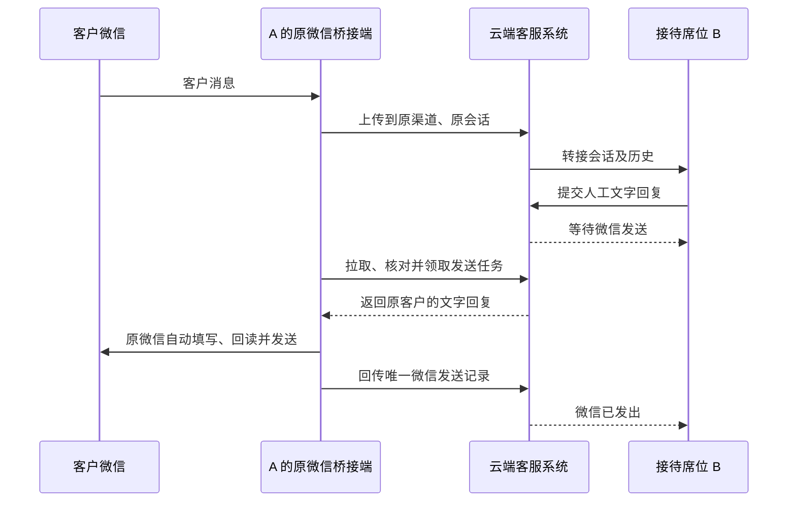

# 个人微信云端席位交接与原号回复

## 1. 本次开发目标

客户通过个人微信进入席位 A，云端将会话交给席位 B。B 在域见客服工作台回复，云端将发送任务交回 A 原来绑定的微信桥接端，由自动化操作原微信发给客户。

两端只连接云端，不需要电脑互连。回复回传 A 不改变当前负责人 B；A 的员工无需确认或转发。A 可关闭客服网页，但桥接进程及原微信必须可用。

## 2. 范围与操作流程

本批只实现个人微信人工文字回复的云端交接和送达确认。复用已有席位、会话转接、人工接管、AI 辅助、接待范围和无 Hook 桥接，不新增全局接待模式设置，不改企微原生接待，不扩展人工发送图片或语音。

1. 管理员为 B 创建现有席位账号，B 登录客服工作台。
2. AI 默认接待；触发转人工或员工主动接管后，使用已有分配/转接入口指定 B。
3. B 在自己的会话中查看前文并提交文字回复，可使用已有 AI 辅助草稿。
4. 云端保存发送任务，B 的气泡显示“等待微信发送”；刷新页面后仍可恢复状态。
5. 原桥接端领取任务，核实原微信账号、客户内部标识和当前授权，再执行发送。
6. 只有核对到原会话的唯一微信发送记录，云端才确认“微信已发出”。此状态不代表客户已读。
7. 会话再转给 C 时保留历史及原发送渠道。尚未领取的旧负责人回复作废；已领取的在途任务按原发送结果核对，不能假称已撤回。

## 3. 必须分别保存的身份

| 信息 | 作用 |
| --- | --- |
| 租户、原渠道、访客及原微信内部身份 | 确定发送从哪一个微信账号发给哪一个客户；不随席位转接变化 |
| 当前会话、负责人、最近一次分配记录 | 确定谁有权提交回复；普通客户新消息不使归属快照过期 |
| 发送员工及人工消息编号 | 审计操作人，并使重复提交返回同一个任务 |
| 本机领取尝试编号、云端领取编号、发送回执 | 防止断网、重复拉取或进程重启导致重复点击发送 |

桥接授权沿用当前渠道凭据、访客身份和接待范围校验。浏览器不能自行指定另一个微信或客户作为发送目标。

## 4. 实现设计

### 4.1 云端

- 复用 `StaffMessageDelivery`，为个人微信增加独立持久化发送任务及数据库迁移。其他渠道保持原投递逻辑。
- 人工回复入队时复核当前员工权限、会话归属和原渠道身份；接管阻止该会话尚未发送的 AI 答复继续发布。
- 原始文字与发送人写入队列。领取前再次检查归属、原账号、接待授权及服务权限。转走再转回也不能复活旧发送任务。
- 使用 PostgreSQL 行锁保证一个任务只被一个领取尝试取得；同一尝试的网络重试幂等。超时或结果不明进入核对状态，不重新派发。
- 收到真实发送回执后写入员工聊天历史；历史写入失败独立重试，不能再次触发微信发送。
- 桥接专用历史接口屏蔽已由人工发送任务完成的正文、保留消息序号；员工端正常显示原文，防止旧桥接从历史二次代发。

### 4.2 桥接端

- 人工任务与 AI 轮次使用独立标识，复用现有本机账本、桌面发送锁和原客户定位。
- 流程：拉取 → 校验 → 填写并回读 → 领取 → 再核对目标/草稿 → 点击发送 → 核对微信记录 → 回传结果。
- 领取请求发出前持久化 `attempt_id`，响应丢失后沿用原编号。
- 授权或归属变化时停止旧任务，只清除能够确认由桥接填写的草稿，保留人工编辑。
- 重启后恢复账本并核对迟到回执；结果不明的任务不得再次点击。运行中因回执不明暂停时，每 2 秒只读核对；网络异常后退避重试。本机确认发送且云端接受回执后，自动解除对应暂停，保留其他错误。
- 网络等待不占用桌面发送锁，多会话的桌面操作仍串行执行。

### 4.3 工作台

复用人工回复气泡及回执轮询，增加可选字段 `delivery_transport` 区分个人微信。状态枚举保持兼容：

| 状态 | 个人微信文案与行为 |
| --- | --- |
| `pending` | 等待微信发送；云端已接受，可清空已提交的输入内容 |
| `processing` | 微信发送中；不再次提交 |
| `sent` | 微信已发出；必须以本机发送回执为依据 |
| `unknown` | 发送结果待核对；只查询状态，不自动重发 |
| `failed` | 显示停止原因；需要重新发送时创建新的人工消息，不复活旧任务 |

刷新后从服务端恢复未完成任务。查询发现会话已转交或无权限时停止访问原会话。提交成功与微信发送成功分别处理。

## 5. 桥接接口契约

接口前缀：`/v1/chat/wechat-local-deliveries`。认证复用当前桥接方案。

公共请求字段：`platform_api_key`、`channel_id`、`channel_type=251`。

| POST 路径 | 附加请求字段 | 结果 |
| --- | --- | --- |
| `/ready` | 无 | `replies`：`delivery_id`、`client_msg_no`、`text`、`created_at` |
| `/{delivery_id}/check` | 可选 `attempt_id`；已领取任务须沿用原编号 | 当前可发送状态；身份/归属过期返回 409 |
| `/{delivery_id}/claim` | `attempt_id` | `claim_id`；同一尝试可幂等查询 |
| `/{delivery_id}/receipt` | `claim_id`、`result=sent/unknown`、可选 `receipt` | 回执确认；相同回执不重复写历史 |

永久停止的任务不通过重试接口复活。人工回复不经过新的 AI 生成，也不因此新增一次 AI 自动回复扣次。

## 6. 验收矩阵

| 场景 | 预期 |
| --- | --- |
| A → B 转接，B 提交 | 负责人保持 B，任务回原渠道及原客户 |
| 未授权员工、其他租户/渠道/客户 | 拒绝提交或领取，不暴露正文 |
| 客户继续发消息 | 负责人没变时人工任务仍有效 |
| B → C，或 B → C → B | 尚未领取的旧任务失效 |
| AI 生成中人工接管/回复 | 未发出的 AI 回复停止发布 |
| 同一任务两个并发领取 | 只允许一个尝试取得发送许可 |
| 领取响应丢失、进程重启 | 复用尝试编号，不重复点击 |
| 桥接离线、工作台刷新 | 云端保留任务，页面显示待发送 |
| 草稿被人工修改、目标不唯一 | 停止发送并保留人工草稿 |
| 微信无明确回执、迟到回执 | 先待核对，后凭唯一回执完成，不盲目重发 |
| 历史写入失败或重复回执 | 恢复历史一次，不重新发微信 |
| 旧桥接消费已送达历史 | 只推进序号，不再代发 |

自动测试使用合成身份与模拟桌面；数据库锁及迁移须用独立 PostgreSQL 验证。正式双席位微信验收需新版云端与新版桥接共同运行，不能以单元测试代替真实微信回执。

## 7. 执行与发布边界

本次执行顺序：确认接口与影响范围 → TDD 实现云端/桥接/工作台 → 协议及并发检查 → 文档记录结果。

发布时先备份并执行云端迁移/API，再更新工作台和桥接下载包，最后升级本机桥接，保留绑定、接待范围、账本和开机自启。开发阶段保持生产环境不变；用户已在后续指令授权将本批单独提交、推送、部署，并更新本机桥接后进行双席位验收。

回退先停止新任务提交，保留待发送及待核对记录，确认在途任务后再回退应用。含未完成任务时不能删除新表或自动补发历史消息；迁移降级仅在隔离验证或确认数据可清理的维护窗口执行。

## 8. 执行记录

- 2026-11-04：确定本批仅开发个人微信云端席位交接与人工文字回传；代码基线 `3449168`。
- 已实现云端持久化发送队列、原微信桥接领取与回执、工作台发送状态；继续复用既有转接界面和无 Hook 自动化。
- 云端 38 项测试通过，相关源码 mypy、lint 通过；Alembic 唯一 head 为 `0048_wechat_staff_delivery`。
- 独立 PostgreSQL 验证通过：迁移升级/降级/再升级、人工回复取消待发 AI、并发领取、重复回执只写一次历史、B→C→B 旧任务失效、普通会话活动不使任务失效，以及超时不重派、迟到回执结算。测试环境已清理，原有服务容器保持不变。
- 桥接基础实现完整测试 146 项通过；后续编号保护相关 19 项通过。补充迟到回执调度修复后，受影响 36 项通过，最后一处恢复保护再跑 10 项通过。以上是分阶段结果，不累计宣称最终全量测试；未执行真实微信发送。
- 工作台 34 项测试、TypeScript 类型检查、相关文件 ESLint 及 Vite 构建通过。构建保留既有分包警告；未进行新版页面的真实登录验收。
- 模型迁移检查、跨服务契约检查和变更空白检查通过。实时协议检查脚本未识别到流协议改动，桥接历史屏蔽和回执契约另由测试及人工审查验证。
- 项目通用检查脚本未通过：当前 Git Bash 缺少 `poetry`、`yarn`；已使用可用 Python 虚拟环境及 Node 依赖完成上述对应范围检查。全项目 lint/type-check 不计为通过。PR 汇总脚本因 Bash `GROUPS` 变量冲突退出，变更摘要改由显式差异审查完成。
- 本地完整服务栈未启动，本次用接口测试和隔离 PostgreSQL 验证替代开发环境联调；正式双席位登录、微信实际发送回执、离线恢复仍须在新版部署后限量验收。
- 开发阶段未提交、推送、部署，未替换正在运行的桥接或更改生产数据库。后续发布按第 7 节执行，发布结果以镜像、下载包及微信真实回执记录核验。页面验收位置为客服工作台的会话转接及人工回复气泡。
